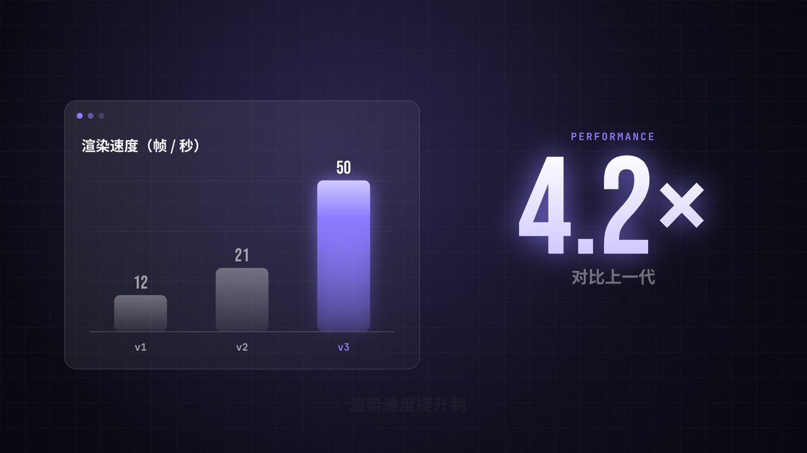
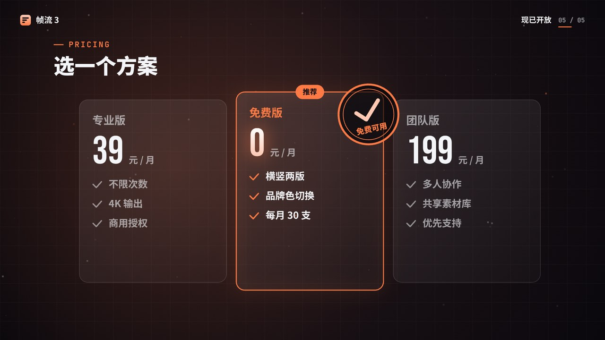
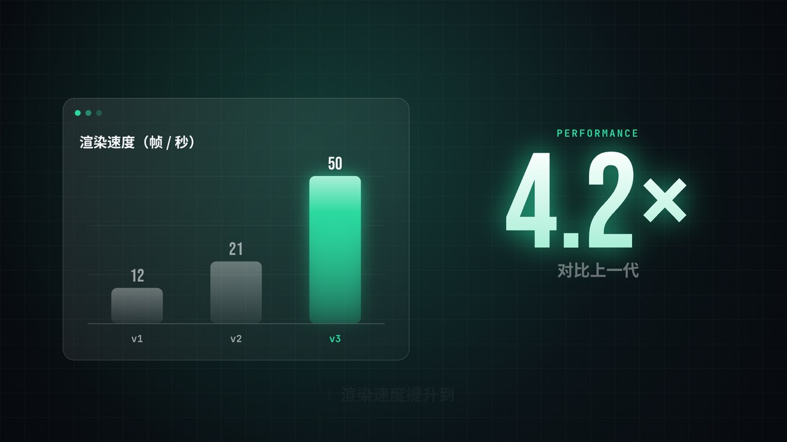

# dark-keynote 暗色科技发布会风格包

[← 全部风格包](../README.md)

由 [C-044 暗色科技发布会](../../skills/ai-coding-video/styles/framework.md#C-044) 沉淀：近黑底、发丝网格、只有一个品牌强调色，元素按网格吸附、落在节拍上，扫光揭示，最后用一个巨大数字说出核心价值。适合软件发布、产品介绍、功能讲解、季度数据。

演示片（虚构产品「帧流 3」，15 秒）：同一份代码只换品牌色，出了三种颜色。介绍页的「风格包」一节可以点标签切换着看。风格说明见 [STYLE.md](STYLE.md)。

| 紫 `#8B7BFF`（默认） | 橙 `#FF7A45` | 绿 `#2BD99F` |
|---|---|---|
|  |  |  |
| [横屏](demo/dark-keynote-purple-16x9.mp4) · [竖屏](demo/dark-keynote-purple-9x16.mp4) | [横屏](demo/dark-keynote-orange-16x9.mp4) · [竖屏](demo/dark-keynote-orange-9x16.mp4) | [横屏](demo/dark-keynote-green-16x9.mp4) · [竖屏](demo/dark-keynote-green-9x16.mp4) |

## 部件

所有部件在 [`pack.js`](pack.js) 的 `DK` 里，签名都是 `(ctx, K, t, o)`。`t` 是部件自己的本地时间（秒），可以为负（还没开始）。横竖构图由 `LAND` 自动切换。

| 部件 | 调用 | 内容 `o` | 时长 |
|---|---|---|---|
| 主题 | `K = DK.theme({ accent: '#FF7A45' })` | `accent` 品牌色；可选 `head`、`num`、`mono` 字体，`beat` 一拍几秒 | — |
| 背景 | `DK.backdrop(ctx, K, t)` | — | 全程 |
| ① 片头 | `DK.title(ctx, K, t, o)` | `{ kicker, title, sub }` | 约 2 秒到位 |
| ② 讲解 | `DK.explain(ctx, K, t, o)` | `{ kicker, title, steps: [...], label, start, every }` | `start + 步数 × every` |
| ③ 数据 | `DK.data(ctx, K, t, o)` | `{ kicker, title, bars: [{ label, v }], unit, digits, big: { from, to, digits, suffix, label, start } }` | 约 2.6 秒到位 |
| ④ 转场 | `DK.transition(ctx, K, p, drawA, drawB)` | `p` 进度 0–1，`drawA`、`drawB` 各画一整帧 | 建议 0.6 秒 |
| ⑤ 字幕 | `DK.caption(ctx, K, t, cues)` | `[{ a, b, text }]`，和画面同一条时间轴 | 全程 |

还导出了几个零件，自己拼新部件时用：`DK.glass`（玻璃卡片）、`DK.sweep`（扫光）、`DK.kicker`（小标题）、`DK.pop`（吸附缓动）。

把部件排成一支片子，看 [`demo/scene.js`](demo/scene.js)：一张分段表（每段一个开始时刻和一个部件），段与段之间用转场，字幕最后叠在上面。

## 声音

[`sound_kit.py`](sound_kit.py) 里每种部件一个函数：`bed` 铺底、`title_in` 片头、`step_in` 讲解每一步、`bars_in` 柱子、`number_in` 大数字、`transition` 转场。在 `sound.py` 里按分段表的时刻调用，见 [`demo/sound.py`](demo/sound.py)。

## 用到自己的项目里

1. 拷 `pack.js`、`sound_kit.py`，以及它们依赖的 `samples/lib/lib.js`（缓动、`rr`、`wrapCJK` 等）和 `samples/lib/synth.py`。
2. `DK.theme({ accent: '你的品牌色' })`；字体换成项目自己的（`head`、`num`、`mono`）。
3. 照 `demo/scene.js` 写自己的分段表和字幕，照 `demo/sound.py` 对齐声音。
4. 把 [STYLE.md](STYLE.md) 抄进项目规范，以后新做的画面按它来。

依赖 Canvas 2D；出片用本仓库的 `samples/batch.py`（Playwright + ffmpeg），或项目自己的逐帧渲染管线。
