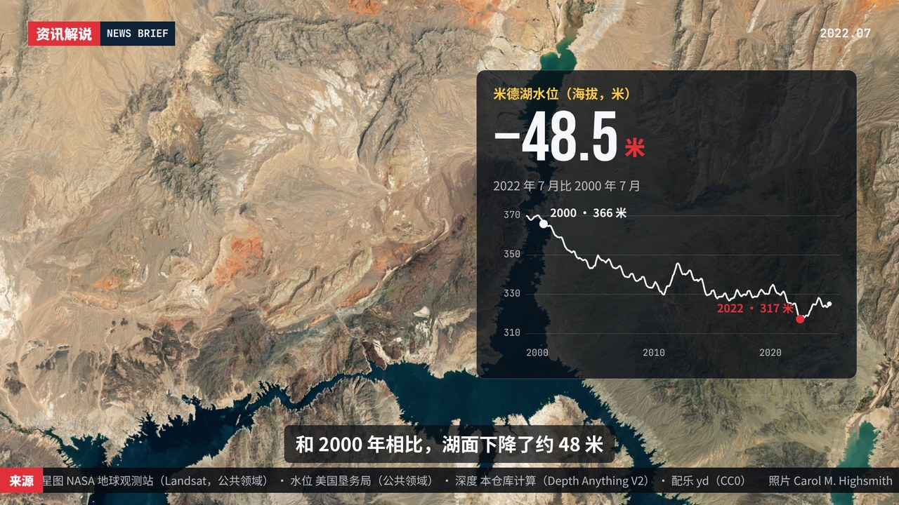
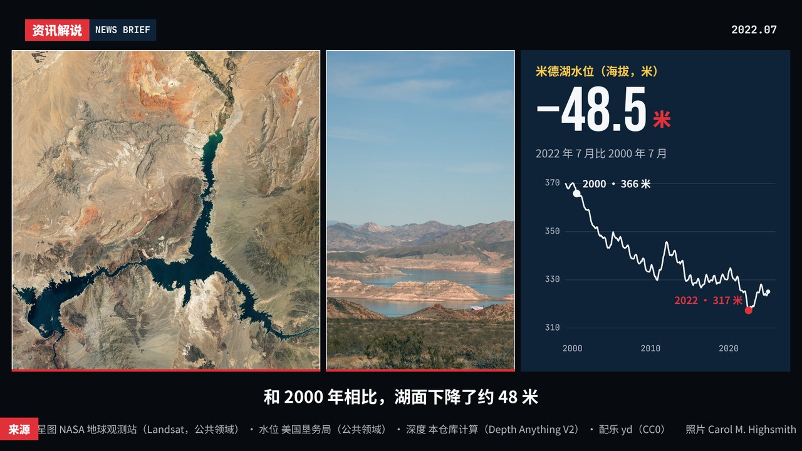

# news-brief 新闻资讯解说风格包

[← 全部风格包](../README.md)

由 [T-007 卫星地图简报](../../skills/ai-coding-video/styles/footage.md#T-007) 沉淀：公共领域照片加公开数据，做成电视新闻式的解说短片。红底栏目条、标题、前后对比、数据卡、照片上的标注、底部滚动出处、跟旁白走的字幕，这些都固定不变。**切换的是「画面组织」**，也就是照片怎么上屏，不切换颜色。适合时事解说、灾害和气候新闻、城市和环境变化、数据新闻。

演示片（米德湖水位跌到蓄水以来最低，15 秒）：分段表、文字、数据、旁白、配乐都只有一份，播放器参数 `v` 换了三种画面组织。风格说明见 [STYLE.md](STYLE.md)，素材出处见 [demo/assets.json](demo/assets.json)。

| 单图推拉 `kenburns`（默认） | 2.5D 视差分层 `parallax` | 多图拼贴分屏 `collage` |
|---|---|---|
|  |  |  |
| [横屏](https://github.com/Chans-gh/AI-Coding-Video/releases/download/media/pack-news-brief-kenburns-16x9.mp4) · [竖屏](https://github.com/Chans-gh/AI-Coding-Video/releases/download/media/pack-news-brief-kenburns-9x16.mp4) | [横屏](https://github.com/Chans-gh/AI-Coding-Video/releases/download/media/pack-news-brief-parallax-16x9.mp4) · [竖屏](https://github.com/Chans-gh/AI-Coding-Video/releases/download/media/pack-news-brief-parallax-9x16.mp4) | [横屏](https://github.com/Chans-gh/AI-Coding-Video/releases/download/media/pack-news-brief-collage-16x9.mp4) · [竖屏](https://github.com/Chans-gh/AI-Coding-Video/releases/download/media/pack-news-brief-collage-9x16.mp4) |

## 部件

所有部件在 [`pack.js`](pack.js) 的 `NB` 里。`t` 是部件自己的本地时间（秒），可以为负（还没开始）。横竖构图由 `LAND` 自动切换。

| 部件 | 调用 | 内容 | 说明 |
|---|---|---|---|
| 主题 | `K = NB.theme()` | 可选 `red`、`head`、`num`、`mono` | 颜色固定，不随画面组织变 |
| 照片 | `NB.photo(img, depth, cuts)` | 深度图可省；`cuts` 是远、中、近三层的分界（默认 `[.35, .72]`） | init 里调一次；有深度图就切出三层并补好层下的洞 |
| 画面组织 | `r = NB.LAYOUTS[v].draw(ctx, K, t, d, shot, P)` | `shot`：`{ photos, kind, move, labels }`，`kind` 取 `headline` / `compare` / `chart` / `note` | 返回 `r.box`（文字卡放哪）、`r.pin(i, u, v)`（第 i 张照片上 (u, v) 的屏幕坐标）、`r.panel`（文字卡有没有自己的格子） |
| ① 栏目条 | `NB.bug(ctx, K, t, o)` | `{ show, en, date }` | 全程 |
| ② 标题 | `NB.headline(ctx, K, t, box, o, panel)` | `{ kicker, title, sub }` | 约 1 秒到位 |
| ③ 对比 | `kind: 'compare'` 的镜头 | `labels: [前, 后]` | 由画面组织画：滑杆 / 前后两张卡片 / 左右分屏 |
| ④ 数据卡 | `NB.chart(ctx, K, t, box, o, panel)` | `{ title, rows: [{x, y}], ymin, ymax, yticks, xticks, big: { value, digits, unit, label }, marks }` | 折线约 2 秒画完，大数字 1 秒数到 |
| ⑤ 标注 | `NB.note(ctx, K, t, box, o, a, b, panel)` | `{ kicker, title, lineTo }`；`a`、`b` 用 `r.pin()` 取 | 括号框住照片上的一段，虚线延伸到 `lineTo` |
| ⑥ 滚动出处 | `y = NB.ticker(ctx, K, t, text)` | 一般传 `credits(A)` | 返回滚动条顶边，字幕放在它上面 |
| ⑦ 字幕 | `NB.subtitle(ctx, K, t, A, y)` | `A` 是 `loadAssets()` 的结果 | 跟旁白的逐句时间 |
| ⑧ 转场 | `NB.transition(ctx, K, p, drawA, drawB)` | `p` 进度 0–1 | 一道红条横扫，建议 0.5 秒 |

标注和数据卡不自己算位置，都用画面组织返回的 `box` 和 `pin()`，所以三种画面组织共用同一套部件。

## 声音

旁白（语音合成的公开音色）和 CC0 配乐都记在 `demo/assets.json` 里，由 [`demo/sound.py`](demo/sound.py) 的 `synth.assets()` 摆好，三种画面组织共用一条声音。不用 1 级的电子音。

## 用到自己的项目里

1. 拷整个 `packs/news-brief/`，以及它依赖的 `samples/lib/`、`samples/player.html`、`samples/batch.py`、`samples/render.py`。演示素材在 `demo/assets/`，可以先原样跑通：`cd samples && python3 batch.py pack:news-brief --quick`。
2. 换素材：照片、数据换成你自己的公共领域或有授权的素材，出处、许可逐份记进 `assets.json`；要做视差，用 `python3 samples/T-018/depth.py <照片> <深度图.png>` 给每张照片估深度图。
3. 照 `demo/scene.js` 写自己的分段表：每段写清用哪几张照片、哪种镜头、配哪个文字部件；段落起点用 `cueTime()` 跟旁白走。
4. 选一种画面组织作为项目默认（`v`），把 [STYLE.md](STYLE.md) 抄进项目规范。

依赖 Canvas 2D；出片用本仓库的 `samples/batch.py`（Playwright + ffmpeg），或项目自己的逐帧渲染管线。
