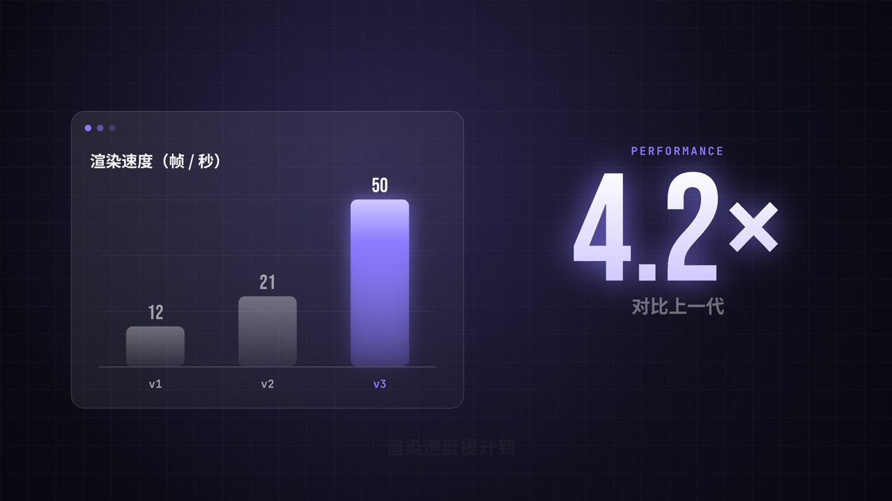

# dark-keynote 暗色科技发布会风格包

[← 全部风格包](https://github.com/Chans-gh/AI-Coding-Video/tree/main/packs/README.md)

由 [C-044 暗色科技发布会](../../styles/framework.md#C-044) 沉淀：近黑底、发丝网格、只有一个品牌强调色，元素按网格吸附、落在节拍上，扫光揭示，最后用一个巨大数字说出核心价值。适合软件发布、产品介绍、功能讲解、季度数据。

演示片（虚构产品「帧流 3」的发布短片）：同一份代码只换品牌色。介绍页的「风格包」一节可以点标签切换着看。风格说明见 [STYLE.md](STYLE.md)。

- **完整演示片**（横屏，71 秒，紫、橙、绿各一支）：开场四个镜头 → 五章（怎么用、有多快、谁在用、能做什么、现已开放，每章一张章节闪卡加 6–8 个镜头）→ 片尾。45 种分镜各出现一次（章节闪卡除外），一个镜头 1.5–2.25 秒，切点都在拍上。不带旁白，每章一句字幕。
- **15 秒切换片段**：竖屏，换品牌色对比用。

| 紫 `#8B7BFF`（默认） | 橙 `#FF7A45` | 绿 `#2BD99F` |
|---|---|---|
| [完整演示片](https://github.com/Chans-gh/AI-Coding-Video/releases/download/media/pack-dark-keynote-purple-16x9.mp4) · [竖屏 15 秒](https://github.com/Chans-gh/AI-Coding-Video/releases/download/media/pack-dark-keynote-purple-9x16.mp4) | [完整演示片](https://github.com/Chans-gh/AI-Coding-Video/releases/download/media/pack-dark-keynote-orange-16x9.mp4) · [竖屏 15 秒](https://github.com/Chans-gh/AI-Coding-Video/releases/download/media/pack-dark-keynote-orange-9x16.mp4) | [完整演示片](https://github.com/Chans-gh/AI-Coding-Video/releases/download/media/pack-dark-keynote-green-16x9.mp4) · [竖屏 15 秒](https://github.com/Chans-gh/AI-Coding-Video/releases/download/media/pack-dark-keynote-green-9x16.mp4) |

## 部件

所有部件在 [`pack.js`](pack.js) 的 `DK` 里，签名都是 `(ctx, K, t, o)`。`t` 是部件自己的本地时间（秒），可以为负（还没开始）。横竖构图由 `LAND` 自动切换。主题：`K = DK.theme({ accent: '#FF7A45' })`，可选 `head`、`num`、`mono` 字体，`beat` 一拍几秒。种类记在 [`meta.json`](meta.json) 的 `parts`。

| 分镜 | 调用 | 内容 `o` |
|---|---|---|
| **开场** | | |
| 冷开场 | `DK.coldOpen` | `{ brand, sub }`：黑场里一个光点炸开成标志 |
| 砸字 | `DK.slam` | `{ text, sub, start, every }`：字一个个从大砸到原大 |
| 快闪字 | `DK.flash` | `{ words: [...], kicker, every }`：一拍换一个词 |
| 滚动字带 | `DK.marquee` | `{ rows: [...] }`：三行字带反向滚动，中间一行是强调色 |
| 章节闪卡 | `DK.chapter` | `{ n, of, title, en }`：0.75 秒的章号加章名，`speed` 调快 |
| **界面** | | |
| 搜索框 | `r = DK.search` | `{ kicker, title, query, button, chips, start, cps }`；返回按钮位置 |
| 聊天 | `DK.chat` | `{ kicker, title, msgs: [{ who: 'me' / 'ai', text }], start, every }` |
| 代码演示 | `rows = DK.code` | `{ kicker, title, sub, label, lines, start, cps }`；返回每行位置 |
| 终端 | `DK.terminal` | `{ kicker, title, label, lines: [{ cmd } / { out, hot } / { bar, secs }], start, cps }` |
| 流程图 | `DK.flow` | `{ kicker, title, nodes: [{ label, sub }], start, every }` |
| 双设备 | `DK.devices` | `{ kicker, title, start, secs }`：横屏和竖屏两个画框同时渲染 |
| 放大镜 | `DK.magnify` | `{ kicker, title, n, pick, label, start }`：一排帧里放大第 `pick` 帧 |
| 通知 | `DK.toast` | `{ kicker, title, items: [{ title, sub }], start, every }` |
| **数据** | | |
| 柱状图 | `DK.data` | `{ kicker, title, bars: [{ label, v }], every, unit, digits }`；带 `big` 时右边加大数字（15 秒片段用） |
| 大数字 | `DK.bigNumber` | `{ kicker, from, to, digits, prefix, suffix, label, sub, start, secs }` |
| 翻牌计时 | `DK.flipboard` | `{ kicker, value: '00:42', label, start, flip }` |
| 仪表盘 | `DK.gauge` | `{ kicker, label, value, max, start, secs }` |
| 对比 | `DK.compare` | `{ kicker, title, a, b, start, lag }`，`a`、`b` = `{ tag, name, value, unit, note, bar }` |
| 排名赛跑 | `DK.race` | `{ kicker, title, items: [{ label, from, to, hot }], start, secs }` |
| 划掉改写 | `DK.strike` | `{ kicker, pre, before, after, tag, start }` |
| 折线图 | `DK.line` | `{ kicker, title, labels, values, unit, digits, start, secs }` |
| 点状地图 | `DK.dotmap` | `{ kicker, title, cities: [{ x, y, label }], hub, start }`，`x`、`y` 是 0–1 |
| 热力格 | `DK.heat` | `{ kicker, title, weeks, total, unit, start, secs }` |
| 占比环 | `DK.ring` | `{ kicker, title, items: [{ label, v }], start, every }` |
| 散点图 | `r = DK.scatter` | `{ kicker, title, xl, yl, n, hot: { x, y, r, label }, start }`；返回突出点位置 |
| 漏斗 | `DK.funnel` | `{ kicker, title, steps: [{ label, v }], start, every }` |
| 雷达图 | `DK.radar` | `{ kicker, title, axes, a, b, start }`，`a`、`b` = `{ label, v: [0–1, ...] }` |
| **讲述** | | |
| 引用 | `DK.quote` | `{ text, source, start, cps }` |
| 思维导图 | `DK.mindmap` | `{ center, branches: [{ label, leaves }], start, every }` |
| 功能宫格 | `DK.grid` | `{ kicker, title, items: [{ icon, label }], start, every }`：格子逐个翻开 |
| 对比表 | `DK.table` | `{ kicker, title, cols, rows: [{ label, cells }], hot, start, every }` |
| 韦恩图 | `DK.venn` | `{ kicker, a, b, mid, start }` |
| 卡片堆 | `DK.stack` | `{ cards: [{ tag, title, sub }], start, every }`：一张张甩开露出下一张 |
| 问答翻卡 | `DK.qa` | `{ q, a, flip }`：问题卡在 `flip` 秒翻到答案 |
| 中英双语 | `DK.bilingual` | `{ kicker, zh, en }` |
| 大字揭示 | `DK.reveal` | `{ word, sub }`：巨大的字缩回，字里透出画面 |
| **收尾** | | |
| 时间线 | `DK.timeline` | `{ kicker, title, steps: [{ when, text }], now, nowLabel, start, every }` |
| 价格方案 | `r = DK.plans` | `{ kicker, title, plans: [{ name, price, unit, feats, hot }], start, every }`；返回突出方案位置 |
| 价签 | `DK.priceTag` | `{ price, label }` |
| 片尾 | `DK.outro` | `{ kicker, title, recap, cta, foot, every }` |
| **叠加**（写在分镜表的 `over` 里，位置取宿主的返回值） | | |
| 光标点击 | `DK.cursor` | `{ x, y, w, h, click }`：光标移到位置上点一下 |
| 标注 | `DK.callout` | `{ x, y, w, h, label, side }` |
| 手绘圈注 | `DK.scribble` | `{ x, y, w, h, label, side }`：手画的圈加一句话 |
| 信息条 | `DK.lower` | `{ name, role, tag }`：不用位置 |
| 印章 | `DK.stamp` | `{ x, y, w, label }`：斜着盖下去 |

层（`t` 是全片时间）：

| 层 | 调用 | 说明 |
|---|---|---|
| 背景 | `DK.backdrop(ctx, K, t)` | 近黑渐变加网格，柔光一直漂移 |
| 粒子 | `DK.dust(ctx, K, t)` | 稀疏的光点缓慢上浮 |
| 镜头 | 在 `scene.js` 里 | 每段从原大推近 3.5%，单双段往相反方向平移，没有一帧完全静止 |
| 转场 | `(ctx, K, p, drawA, drawB)` | `DK.transition` 光边、`DK.push` 推移、`DK.dissolve` 叠化、`DK.zoom` 缩放穿越、`DK.wipe` 遮罩擦除、`DK.flashCut` 闪白、`DK.flip` 翻转；时长在 `segments.json` 的 `tr` |
| 节拍 | `segments.json` | 每段时长必须是整拍（0.375 秒），`scene.js` 启动时检查 |
| 角标 | `DK.corner(ctx, K, t, o)` | `{ brand, ch, al }`；开场、章节卡、片尾不显示 |
| 字幕 | `DK.caption(ctx, K, t, cues)` | `[{ a, b, text }]`，每章一句，可以跨好几个镜头 |

还导出了几个零件，自己拼新部件时用：`DK.glass`（玻璃卡片）、`DK.sweep`（扫光）、`DK.kicker`（小标题）、`DK.head`（段标题）、`DK.logo`（标志）、`DK.mini`（片中片的小画面）、`DK.pop`（吸附缓动）。15 秒片段另用 `DK.title`（片头）、`DK.explain`（要点讲解）。

把分镜排成一支片子，看 [`demo/segments.json`](demo/segments.json) 和 [`demo/scene.js`](demo/scene.js)：分镜表每行一个分镜：整屏部件 `part`、时长 `d`（整拍）、进场转场 `tr`、内容 `o`、本地时间倍速 `speed`、叠在这一段上的部件 `over`（`at` 是段内时刻，`anchor` 取宿主返回值：数字取第几项，`"self"` 取整个）、字幕 `cues`；`scene.js` 照表画，各层叠在上面。15 秒切换片段是 [`demo/clip.js`](demo/clip.js)。

## 声音

[`sound_kit.py`](sound_kit.py) 里的音全部由 `synth.py` 合成：`bed_chapters` 按章起伏的铺底（一章换一个和弦，正文镜头有轻节拍，章节卡和片尾歇拍），每种分镜、叠加和转场各有对应的音（`cold_open`、`slam_hit`、`flash_hit`、`swish`、`pop_in`、`click`、`clack`、`stamp_in`、`tag_in`、`typing`、`bars_in`、`number_in` 等，转场 `transition`、`push`、`dissolve`、`zoom_tr`、`wipe_tr`、`flash_tr`、`flip_tr`）。[`demo/sound.py`](demo/sound.py) 读同一张分镜表，按部件放音，时刻照部件的 `start`、`every` 推算；15 秒切换片段用 `bed` 和 [`demo/clip_sound.py`](demo/clip_sound.py)。

## 用到自己的项目里

1. 拷 `pack.js`、`sound_kit.py`，以及它们依赖的 `samples/lib/lib.js`（缓动、`rr`、`wrapCJK` 等）和 `samples/lib/synth.py`。
2. `DK.theme({ accent: '你的品牌色' })`；字体换成项目自己的（`head`、`num`、`mono`）。
3. 照 `demo/segments.json` 写自己的分镜表和字幕，`demo/scene.js`、`demo/sound.py` 照表出画面和声音，一般不用改。
4. 把 [STYLE.md](STYLE.md) 抄进项目规范，以后新做的画面按它来。

依赖 Canvas 2D；出片用本仓库的 `samples/batch.py`（Playwright + ffmpeg），或项目自己的逐帧渲染管线。
