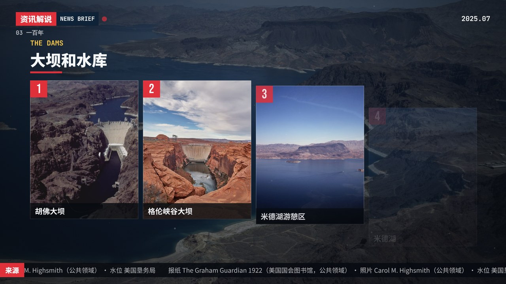
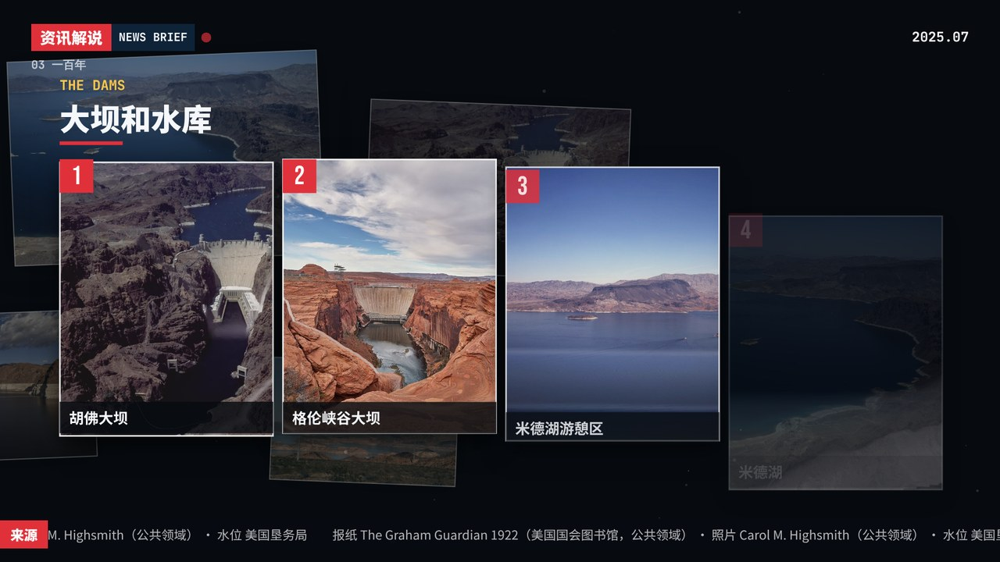
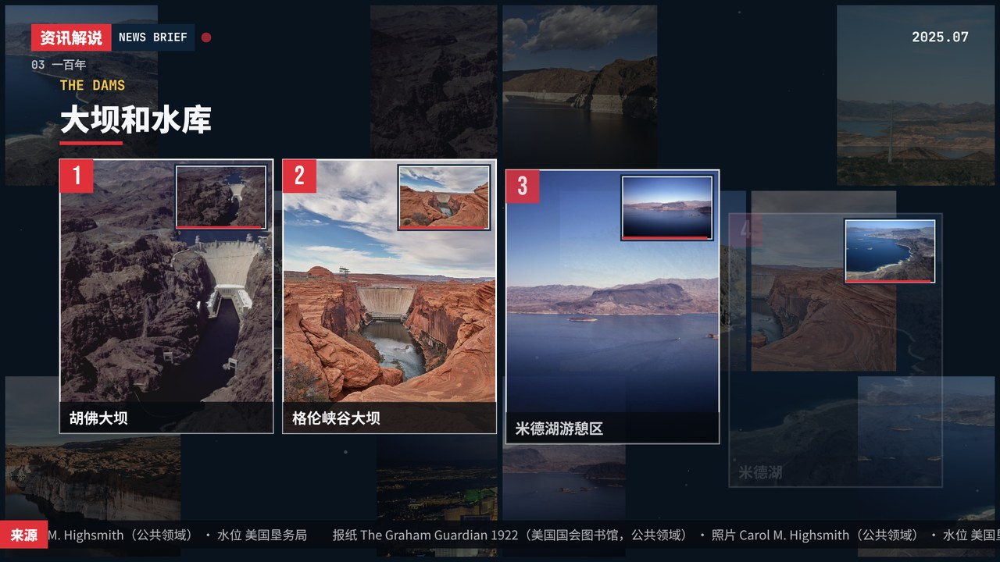

# news-brief 新闻资讯解说风格包

[← 全部风格包](https://github.com/Chans-gh/AI-Coding-Video/tree/main/packs/README.md)

由 [T-007 卫星地图简报](../../styles/footage.md#T-007) 沉淀：公共领域照片加公开数据，做成电视新闻式的解说短片。红底栏目条、标题、数据卡、照片上的标注、出处、字幕这些都固定不变。**切换的是「画面组织」**，也就是照片怎么上屏，不切换颜色。适合时事解说、灾害和气候新闻、城市和环境变化、数据新闻。

演示片（米德湖水位跌到蓄水以来最低）：分镜表、文字、数据、声音都只有一份，播放器参数 `v` 换了三种画面组织。风格说明见 [STYLE.md](STYLE.md)，素材出处见 [demo/assets.json](demo/assets.json)。

- **完整演示片**（横屏，68 秒，三种画面组织各一支）：开场四个镜头 → 四章（水位、一条河、一百年、现在，每章一张栏目闪卡加 6–8 个镜头）→ 出处、延伸阅读、片尾。分镜各出现一次（栏目闪卡除外），一个镜头 1.6 或 2 秒，切点都在配乐的拍上（0.4 秒一拍）。不带旁白，章里有字幕。
- **15 秒片段**：横屏，带旁白，换画面组织对比用。

| 单图推拉 `kenburns`（默认） | 2.5D 视差分层 `parallax` | 多图拼贴分屏 `collage` |
|---|---|---|
|  |  |  |
| [完整演示片](https://github.com/Chans-gh/AI-Coding-Video/releases/download/media/pack-news-brief-kenburns-16x9.mp4) · [15 秒片段](https://github.com/Chans-gh/AI-Coding-Video/releases/download/media/pack-news-brief-kenburns-clip-16x9.mp4) | [完整演示片](https://github.com/Chans-gh/AI-Coding-Video/releases/download/media/pack-news-brief-parallax-16x9.mp4) · [15 秒片段](https://github.com/Chans-gh/AI-Coding-Video/releases/download/media/pack-news-brief-parallax-clip-16x9.mp4) | [完整演示片](https://github.com/Chans-gh/AI-Coding-Video/releases/download/media/pack-news-brief-collage-16x9.mp4) · [15 秒片段](https://github.com/Chans-gh/AI-Coding-Video/releases/download/media/pack-news-brief-collage-clip-16x9.mp4) |

## 部件

所有部件在 [`pack.js`](pack.js) 的 `NB` 里，签名都是 `(ctx, K, t, o)`。`t` 是部件自己的本地时间（秒），可以为负（还没开始）；横竖构图由 `LAND` 自动切换。主题：`K = NB.theme()`，颜色固定，可选 `head`、`num`、`mono` 字体和 `beat`。场景在 init 里往 `K` 上挂 `K.P`（照片，`NB.photo(img, depth)` 做好）、`K.L`（画面组织 `NB.LAYOUTS[v]`）、`K.geo`（地图）、`K.D`（数据）。种类记在 [`meta.json`](meta.json) 的 `parts`。

| 分镜 | 调用 | 内容 `o` |
|---|---|---|
| **开场** | | |
| 快讯冷开场 | `NB.coldOpen` | `{ flag, en, line, sub }`：红条扫开，「快讯」牌落下 |
| 头条砸字 | `NB.slam` | `{ words, sub, every }`：一拍砸一个词 |
| 今日要点快闪 | `NB.points` | `{ kicker, items, every }` |
| 滚动快讯带 | `NB.crawl` | `{ rows }`：几行快讯反向滚动 |
| 栏目闪卡 | `NB.chapter` | `{ n, of, title, en, src }`：0.8 秒，`src` 是这一章的出处，章内角标显示 |
| **照片** | | |
| 单图加标题 | `r = NB.story` | `{ photo, kicker, title, sub, move }`；返回标题框，供标注叠加 |
| 前后对比 | `NB.compare` | `{ photos: [前, 后], labels, move }`：滑杆 / 前后两张卡片 / 左右分屏，由画面组织决定 |
| 卫星图放大 | `NB.satZoom` | `{ photo, at: [u, v], zoom, kicker, title, info }` |
| 档案扫描页 | `NB.archive` | `{ photo, hl, kicker, date, title }`：旧报纸页，`hl` 是要圈的那一块 |
| 地图定位 | `NB.mapPin` | `{ kicker, title, basin, pins: [{ lon, lat, label }] }`：州界和河道来自 `K.geo` |
| 带出处的素材框 | `NB.sourceFrame` | `{ photo, src, place, tag, caption }` |
| 分屏 | `NB.split` | `{ kicker, title, photos, labels }` |
| 图集条 | `NB.strip` | `{ kicker, title, photos, labels }`：几张照片一拍一张滑进来 |
| **数据** | | |
| 大数字 | `NB.bigNumber` | `{ kicker, title, from, to, digits, unit, label, bar }` |
| 柱状图 | `NB.bars` | `{ kicker, title, unit, min, max, digits, bars: [{ label, v }] }` |
| 折线图 | `NB.line` | `{ title, rows, ymin, ymax, yticks, xticks, big, marks }`；`rows` 可以写 `K.D` 里的键 |
| 占比环 | `NB.ring` | `{ kicker, title, unit, digits, items }` |
| 排名 | `NB.rank` | `{ kicker, title, unit, min, max, digits, items }` |
| 地图热区 | `NB.heatMap` | `{ kicker, title, values: { 州名: 数 }, unit, view }` |
| 翻牌 | `NB.flip` | `{ kicker, title, value, unit, label }` |
| 统计表 | `NB.table` | `{ kicker, title, cols, rows, hot }` |
| 增减箭头 | `NB.delta` | `{ kicker, title, unit, digits, items: [{ label, v, note }] }` |
| 时间对比 | `NB.versus` | `{ kicker, title, unit, base, digits, diff, a, b }`：两个年份的数并排 |
| 门槛线 | `NB.thresholds` | `{ kicker, title, min, max, from, value, unit, levels }`：水位跌过几道警戒线 |
| **讲述** | | |
| 原句引用 | `NB.quote` | `{ text, en, who }` |
| 事件时间线 | `NB.timeline` | `{ kicker, title, items: [{ y, text }] }` |
| 要点清单 | `NB.checklist` | `{ kicker, title, items }` |
| 问答 | `NB.qa` | `{ q, a, at }` |
| 关系图 | `NB.relation` | `{ kicker, title, center, sub, nodes }` |
| 名词解释 | `NB.glossary` | `{ kicker, term, en, def, line }` |
| 事实核查 | `NB.factCheck` | `{ kicker, claim, verdict, fact, at }`：`at` 秒盖章 |
| 两面看 | `NB.proCon` | `{ left: { title, items }, right }` |
| **收尾** | | |
| 出处汇总 | `NB.sources` | `{ kicker, title, items }` |
| 延伸阅读 | `NB.reading` | `{ kicker, title, items: [{ k, title, url }] }` |
| 片尾 | `NB.outro` | `{ show, en, recap, bye, sub, every }` |
| **叠加**（叠在某一段上） | | |
| 标注 | `NB.bracket` | `{ label }`：金色括号框住宿主返回的一块 |
| 圈注 | `NB.circle` | `{ label }`：手绘圈 |
| 人名条 | `NB.nameplate` | `{ name, role }` |
| 资料 / 现场标签 | `NB.label` | `{ text }` |
| 出处角标 | `NB.credit` | `{ text }` |
| **层**（贯穿全片） | | |
| 背景 | `K.L.backdrop(ctx, K, t, names, seed)` | 纯代码镜头后面的底：调暗的整张照片 / 漂浮照片卡 / 照片网格，随画面组织变 |
| 粒子 | `NB.dust` | 缓慢漂浮的尘点 |
| 镜头 | 在 `scene.js` 里 | 每段从原大推近一点，单双段往相反方向平移 |
| 转场 | `NB.TRANS[名字](ctx, K, p, drawA, drawB)` | `bar` 红条横扫、`push` 推移、`fade` 叠化、`zoom` 缩放穿越、`flash` 闪白、`doors` 对开门、`tiles` 方块翻；时长在 `segments.json` 的 `tr` |
| 节拍 | `segments.json` | 每段时长必须是整拍（`beat`，0.4 秒），`scene.js` 启动时检查 |
| 角标 | `NB.corner(ctx, K, t, o)` | `{ show, en, date, ch, src, al, beat }`：左上栏目条、右上章名和出处、拍点；开场、栏目闪卡、片尾不显示 |
| 字幕 | `NB.captions(ctx, K, t, cues)` | `[{ a, b, text }]`，不超过所在段的结尾 |

照片上屏全交给画面组织：`K.L.draw` 画整屏照片镜头，`K.L.frame(ctx, K, t, A, r, v)` 把一张照片放进框 `r`，`K.L.backdrop` 画纯代码镜头的底。三种画面组织各写一套，部件只调这三个函数，所以换 `v` 每个镜头都跟着变。还导出几个零件：`NB.cover`（按焦点铺满并返回 (u, v) → 屏幕坐标）、`NB.tag`、`NB.pop`、`NB.area`（正文区）。15 秒片段另用 `NB.headline`、`NB.chart`、`NB.note`、`NB.ticker`、`NB.subtitle`、`NB.transition`。

把分镜排成一支片子，看 [`demo/segments.json`](demo/segments.json) 和 [`demo/scene.js`](demo/scene.js)：分镜表每行一个分镜：整屏部件 `part`、时长 `d`（整拍）、进场转场 `tr`、内容 `o`、本地时间倍速 `speed`、叠加 `over`、字幕 `cues`；栏目闪卡的 `o.src` 是这一章的出处，章内角标照它写。15 秒片段是 [`demo/clip.js`](demo/clip.js)。

## 声音

全部是公开曲库里 CC0 的录音，出处逐份记在 [`demo/assets.json`](demo/assets.json)，不用 1 级的电子音。配乐 `music_full.mp3` 是一段 CC0 节奏循环，拍长用 [`samples/tools/beats.py`](../../samples/tools/beats.py) 量出来（0.4 秒），`music_ss` 让第 0 秒落在拍上。[`demo/sound.py`](demo/sound.py) 读同一张分镜表：每种分镜进场一个音（`demo/assets/sfx/` 里按部件命名），有逐项出现的（砸字、要点、图集、清单、地图钉）每项一下，事实核查在盖章时刻一下；每种转场一个不同的音（`tr_<名字>`）；叠加各有一个音。15 秒片段用旁白加配乐，见 [`demo/clip_sound.py`](demo/clip_sound.py)。

## 用到自己的项目里

1. 拷整个 `packs/news-brief/`，以及它依赖的 `samples/lib/`、`samples/player.html`、`samples/batch.py`、`samples/render.py`。演示素材在 `demo/assets/`，可以先原样跑通：`cd samples && python3 batch.py pack:news-brief --quick`。
2. 换素材：照片、数据换成你自己的公共领域或有授权的素材，出处、许可逐份记进 `assets.json`；要做视差，用 `python3 samples/T-018/depth.py <照片> <深度图.png>` 给每张照片估深度图。
3. 照 `demo/segments.json` 写自己的分镜表；画面的主角是什么、用哪个部件、字放哪一档，查 [`lookup.json`](lookup.json)。`demo/scene.js`、`demo/sound.py` 照表出画面和声音，一般只改素材清单。
4. 选一种画面组织作为项目默认（`v`），把 [STYLE.md](STYLE.md) 抄进项目规范。

依赖 Canvas 2D；出片用本仓库的 `samples/batch.py`（Playwright + ffmpeg），或项目自己的逐帧渲染管线。
