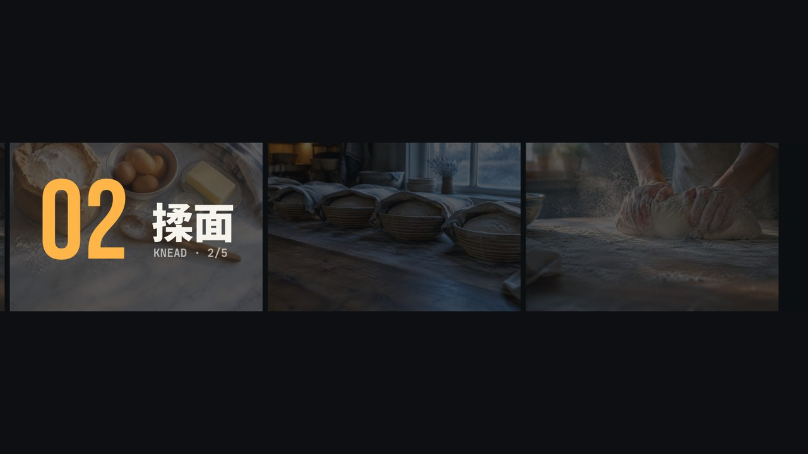
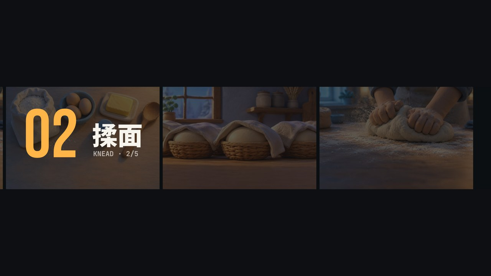

# style-swap 分镜换画风风格包

[← 全部风格包](https://github.com/Chans-gh/AI-Coding-Video/tree/main/packs/README.md)

由 [G-016 分镜表短片](../../styles/generated.md#G-016) 沉淀：AI 生图的提示词写成 **「镜头段 + 风格段 + 约束段」**。分镜、镜头段、约束段、剪辑代码、配乐都只有一份，**切换的是「画风」**：只换风格段那一行，生成一套新图，片子跟着换。这也是「提示词 = 固定段 + 可换段」的范例。适合短片提案、绘本动画、给同一个故事试几种美术方向。

演示片讲清晨街角一家面包店从亮灯到开门，16 个镜头 × 3 种画风，每种画风另有一张底纹，全部用 AI 生图生成。分镜表、文字、声音都只有一份，播放器参数 `v` 换画风：镜头里的图、纯代码镜头后面的底纹、数据镜头里高亮的那一组、引用的风格段原文都跟着换。风格说明见 [STYLE.md](STYLE.md)，提示词见 [demo/prompts.json](demo/prompts.json)，素材出处见 [demo/assets.json](demo/assets.json)。

- **完整演示片**（横屏，72.6 秒，三种画风各一支）：开场四个镜头 → 五章（天亮、揉面、进炉、出炉、开门，每章一张章节闪卡加 6–7 个镜头）→ 时间线、生成信息、片尾。分镜各出现一次（章节闪卡除外），一个镜头 1.8 秒，切点都在配乐的拍上（0.6 秒一拍）。不带旁白，每章一句字幕。数据镜头画的是这套图真实的生成记录 [demo/genlog.json](demo/genlog.json)。
- **15 秒片段**：横屏，带旁白，三个镜头换画风对比用。

| 写实摄影 `photo`（默认） | 水彩插画 `watercolor` | 3D 黏土 `clay` |
|---|---|---|
|  |  |  |
| [完整演示片](https://github.com/Chans-gh/AI-Coding-Video/releases/download/media/pack-style-swap-photo-16x9.mp4) · [15 秒片段](https://github.com/Chans-gh/AI-Coding-Video/releases/download/media/pack-style-swap-photo-clip-16x9.mp4) | [完整演示片](https://github.com/Chans-gh/AI-Coding-Video/releases/download/media/pack-style-swap-watercolor-16x9.mp4) · [15 秒片段](https://github.com/Chans-gh/AI-Coding-Video/releases/download/media/pack-style-swap-watercolor-clip-16x9.mp4) | [完整演示片](https://github.com/Chans-gh/AI-Coding-Video/releases/download/media/pack-style-swap-clay-16x9.mp4) · [15 秒片段](https://github.com/Chans-gh/AI-Coding-Video/releases/download/media/pack-style-swap-clay-clip-16x9.mp4) |

## 提示词的结构

[`demo/prompts.json`](demo/prompts.json) 是唯一的正本：

| 段 | 字段 | 谁共用 | 写什么 |
|---|---|---|---|
| 镜头段 | `shots[].prompt` | 每个镜头一段，所有画风共用；`ch` 记属于哪一章 | 镜头号、景别、画面里有什么，不写任何画法 |
| 风格段 | `styles.<键>` | **只有这一段随画风换** | 媒介、笔触或材质、镜头和光线，不写画面内容 |
| 约束段 | `rules` | 全片共用 | 色调、构图留白、禁止项（不出现人脸、文字、标志） |
| 底纹 | `textures.<键>` | 每种画风一张 | 只有底纹这一段加风格段，给纯代码镜头当背景 |

[`demo/compose.py`](demo/compose.py) 按 `join` 把三段拼成每张图的完整提示词，写进 `assets.json`（文件名 `<画风>-<镜头>.jpg`、`<画风>-tex.jpg`），再由 `samples/tools/assets.py` 统一生成。

## 部件

所有部件在 [`pack.js`](pack.js) 的 `SW` 里，签名都是 `(ctx, K, t, o)`。`t` 是部件自己的本地时间（秒），可以为负；横竖构图由 `LAND` 自动切换。主题：`K = SW.theme()`，颜色固定，可选 `head`、`num`、`mono` 字体和 `beat`。场景在 init 里往 `K` 上挂 `K.I`（当前画风的图，键是镜头号和 `tex`）、`K.ALL`（所有画风的图）、`K.v`、`K.names`、`K.Pr`（prompts.json）、`K.G`（genlog.json）。种类记在 [`meta.json`](meta.json) 的 `parts`；`o.img` 写镜头号（`s1`…`s16`），部件自己取当前画风那张。

| 分镜 | 调用 | 内容 `o` |
|---|---|---|
| **开场** | | |
| 生图冷开场 | `SW.coldOpen` | `{ img, title, sub }`：像素块从大到小、噪点褪去，像去噪一样显影 |
| 砸字 | `SW.slam` | `{ words, sub, every }`：一拍砸一个词 |
| 快闪图 | `SW.flash` | `{ imgs, words, every }`：一拍换一张图 |
| 提示词字带 | `SW.marquee` | `{ shots }`：三行提示词原文反向滚动，中间一行是风格段 |
| 章节闪卡 | `SW.chapter` | `{ n, of, title, en, imgs }`：一条图带横穿，0.6 秒 |
| **素材**（生成的图怎么上屏） | | |
| 整屏镜头加提示词条 | `r = SW.shot` | `{ img, move: { z, fx, fy }, n, size }`；返回框，供叠加 |
| 镜头卡 | `SW.shotCard` | `{ img, n, size, dur }`：分镜表的一格 |
| 分屏 | `SW.split` | `{ imgs, labels }` |
| 胶片条 | `SW.filmstrip` | `{ imgs, labels }` |
| 联系表宫格 | `SW.grid` | `{ imgs, kicker, title, hot }` |
| 放大镜 | `SW.loupe` | `{ img, from, at, zoom, label }` |
| 笔刷显影 | `SW.reveal` | `{ img, label }` |
| 照片堆 | `SW.stack` | `{ imgs }` |
| 画风并排 | `SW.lineup` | `{ img, title, sub }`：同一镜头的所有画风，当前这种放大 |
| 画风滑杆 | `SW.swap` | `{ img }`：当前画风和下一种来回扫 |
| 构图取景 | `SW.crop` | `{ img, label }`：三分线和约束段要求的留白 |
| **数据**（生成记录和像素） | | |
| 大数字 | `SW.bigNumber` | `{ kicker, title, label }`：总张数，下面按画风分段 |
| 翻牌 | `SW.flip` | `{ kicker, title, unit, label }`：平均每张几秒 |
| 柱状图 | `SW.bars` | `{ kicker, title, unit }`：每种画风平均用时 |
| 落地进度线 | `SW.progress` | `{ kicker, title }`：完成张数随时间涨 |
| 占比环 | `SW.ring` | `{ kicker, title }`：体积按画风分 |
| 排名 | `SW.rank` | `{ kicker, title, top }`：用时最长的几张 |
| 热力格 | `SW.heat` | `{ kicker, title }`：镜头 × 画风的用时 |
| 仪表盘 | `SW.gauge` | `{ kicker, title, limit, label }`：素材体积占上限多少 |
| 对比 | `SW.versus` | `{ kicker, title, a, b }`：不写数时取「一次就成 / 重试才成」 |
| 散点 | `SW.scatter` | `{ kicker, title }`：提示词字数和用时 |
| 色板 | `SW.palColors` | `{ img, kicker, title }`：从图的像素取 6 个主色 |
| **讲述** | | |
| 提示词公式 | `SW.formula` | `{ title, shot, img, every }`：三段依次落下，风格段亮起 |
| 风格段引用 | `SW.quote` | `{ who }`：当前画风的风格段原文 |
| 提示词打字 | `p = SW.typing` | `{ img, cps }`：三段三色逐字打出，再出图；返回「生成」键的点 |
| 名词解释 | `SW.glossary` | `{ term, en, def, line }` |
| 问答翻卡 | `SW.qa` | `{ q, a, at }` |
| 画风对比表 | `SW.styleTable` | `{ kicker, title, rows: [[维度, photo, watercolor, clay]] }` |
| 约束清单 | `SW.checklist` | `{ kicker, title, items }` |
| 提示词结构树 | `SW.tree` | `{ kicker, title }` |
| 角色卡 | `SW.character` | `{ imgs, at, name, traits }`：从图里裁出主角 |
| **收尾** | | |
| 时间线 | `SW.timeline` | `{ kicker, title, items: [{ time, text, img }] }` |
| 生成信息 | `SW.credits` | `{ img, kicker, title, items: [[键, 值]] }` |
| 片尾 | `SW.outro` | `{ img, title, sub }` |
| **叠加**（叠在某一段上） | | |
| 镜头号标签 | `SW.tag` | `{ text }`：贴在宿主框的左上角 |
| 取景角 | `SW.corners` | 四个角收到框上 |
| 手绘圈注 | `SW.circle` | `{ r, text }` |
| 印章 | `SW.stamp` | `{ text }`：「AI 生成」章 |
| 光标点击 | `SW.cursor` | 移到宿主返回的点上按下 |
| **层**（贯穿全片） | | |
| 背景 | `SW.backdrop` | 当前画风的底纹铺满、压暗、慢慢漂，随画风变 |
| 粒子 | `SW.grain` | 面粉一样的细颗粒往上飘 |
| 镜头 | 在 `scene.js` 里 | 每段从原大推近一点，单双段往相反方向平移 |
| 转场 | `SW.TRANS[名字](ctx, K, p, drawA, drawB)` | `dissolve` 叠化、`push` 推、`iris` 光圈、`flash` 闪白、`slice` 百叶、`dip` 暗场、`diag` 斜擦；时长在 `segments.json` 的 `tr` |
| 节拍 | `segments.json` | 每段时长必须是整拍（`beat`，0.6 秒），`scene.js` 启动时检查 |
| 角标 | `SW.corner(ctx, K, t, o)` | 左上包名和当前画风，右上章名和镜头数，拍点；开场、章节闪卡、片尾不显示 |
| 字幕 | `SW.captions(ctx, K, t, cues)` | `[{ a, b, text }]`，不跨到下一章 |

还导出几个零件：`SW.cover`（按焦点铺满并返回 (a, b) → 屏幕坐标）、`SW.area`（正文区）、`SW.pop`、`SW.chip`、`SW.glass`、`SW.promptOf`（和 compose.py 拼法一致）、`SW.stats`（生成记录的统计）、`SW.palette`。15 秒片段另用 `SW.stage`、`SW.clipShot`、`SW.clipLineup`、`SW.promptStrip`、`SW.subtitle`、`SW.transition`。

把分镜排成一支片子，看 [`demo/segments.json`](demo/segments.json) 和 [`demo/scene.js`](demo/scene.js)：每行一个分镜：整屏部件 `part`、时长 `d`（整拍）、进场转场 `tr`、内容 `o`、叠加 `over`、字幕 `cues`。15 秒片段是 [`demo/clip.js`](demo/clip.js)。看每个镜头排得对不对，用 `python3 tools/shots.py style-swap --v clay`（在 `samples/` 下跑），一格一个镜头。

## 声音

全部是公开曲库里 CC0 的录音，出处逐份记在 [`demo/assets.json`](demo/assets.json)，不用 1 级的电子音。配乐 `music_full.mp3` 是一首 CC0 的曲子，拍长用 [`samples/tools/beats.py`](../../samples/tools/beats.py) 量出来（0.6 秒），`music_ss` 让第 0 秒落在拍上。[`demo/sound.py`](demo/sound.py) 读同一张分镜表：每种分镜进场一个音（`demo/assets/sfx/` 里按部件命名，Kenney 的界面音效），逐项出现的（砸字、快闪、宫格、照片堆、清单、画风并排）每项一下，问答在翻卡时刻一下；每种转场一个不同的嗖声（`tr_<名字>`）；叠加各有一个音。15 秒片段用语音合成的旁白（公开音色）加配乐，见 [`demo/clip_sound.py`](demo/clip_sound.py)。

## 用到自己的项目里

1. 拷整个 `packs/style-swap/`，以及它依赖的 `samples/lib/`、`samples/player.html`、`samples/batch.py`、`samples/render.py`、`samples/tools/`。演示的图在 `demo/assets/`，不配生成服务也能先跑通：`cd samples && python3 batch.py pack:style-swap --quick`。
2. 改 `prompts.json`：写自己的分镜（镜头段）、约束段和底纹，风格段留下想比较的几种。跑 `python3 ../packs/style-swap/demo/compose.py`，再按 Skill 的 `materials.md`「配置生成服务」配好服务，跑 `python3 tools/assets.py pack:style-swap` 生成。数据镜头要换成自己的生成记录：照 `demo/genlog.json` 的格式记每张图的用时、重试次数。
3. 照 `demo/segments.json` 写自己的分镜表；画面的主角是什么、用哪个部件、字放哪一档，查 [`lookup.json`](lookup.json)。`demo/scene.js`、`demo/sound.py` 照表出画面和声音。
4. 用户选定一种画风后，把 [STYLE.md](STYLE.md) 和那一行风格段一起写进项目规范，以后新镜头只写镜头段。

依赖 Canvas 2D；出片用本仓库的 `samples/batch.py`（Playwright + ffmpeg）。
