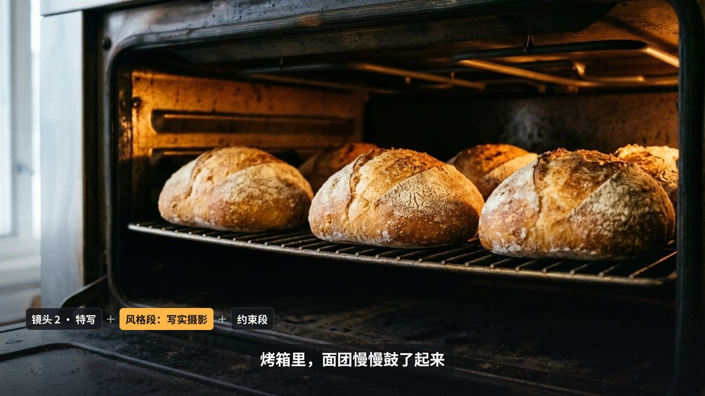
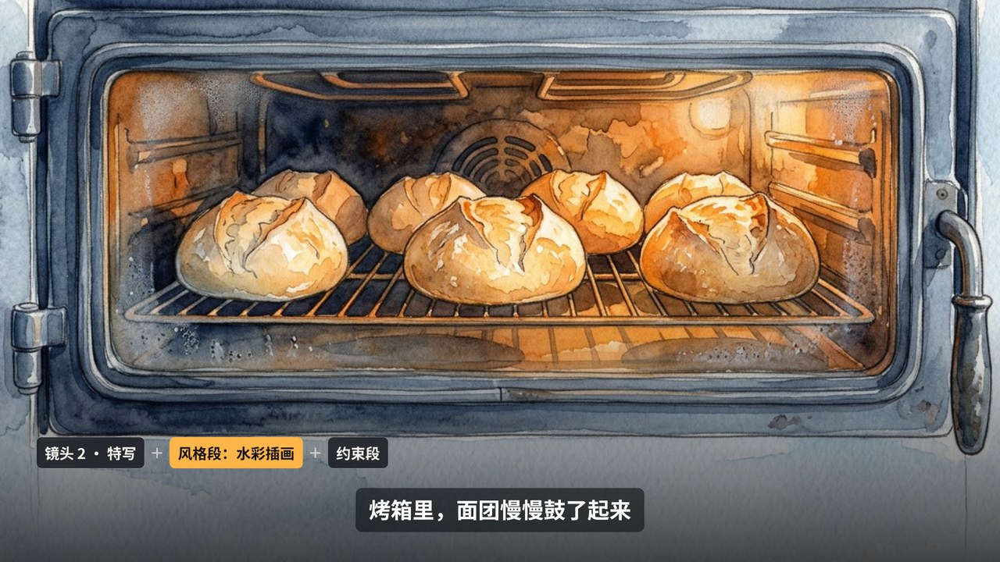
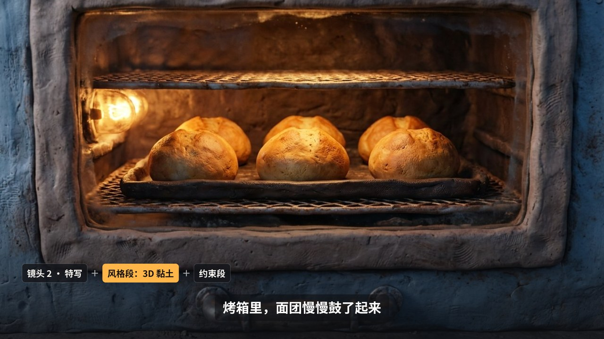

# style-swap 分镜换画风风格包

[← 全部风格包](https://github.com/Chans-gh/AI-Coding-Video/tree/main/packs/README.md)

由 [G-016 分镜表短片](../../styles/generated.md#G-016) 沉淀：AI 生图的提示词写成 **「镜头段 + 风格段 + 约束段」**。分镜、镜头段、约束段、剪辑代码、旁白、配乐都只有一份，**切换的是「画风」**：只换风格段那一行，生成一套新图，片子跟着换。这也是「提示词 = 固定段 + 可换段」的范例。适合短片提案、绘本动画、给同一个故事试几种美术方向。

演示片（清晨街角面包店的三个镜头，15 秒）：片头把提示词公式摆在画面上、风格段亮着；每个镜头角上一条提示词条；片尾三种画风并排，当前这种亮起。风格说明见 [STYLE.md](STYLE.md)，提示词见 [demo/prompts.json](demo/prompts.json)。

| 写实摄影 `photo`（默认） | 水彩插画 `watercolor` | 3D 黏土 `clay` |
|---|---|---|
|  |  |  |
| [横屏](https://github.com/Chans-gh/AI-Coding-Video/releases/download/media/pack-style-swap-photo-16x9.mp4) · [竖屏](https://github.com/Chans-gh/AI-Coding-Video/releases/download/media/pack-style-swap-photo-9x16.mp4) | [横屏](https://github.com/Chans-gh/AI-Coding-Video/releases/download/media/pack-style-swap-watercolor-16x9.mp4) · [竖屏](https://github.com/Chans-gh/AI-Coding-Video/releases/download/media/pack-style-swap-watercolor-9x16.mp4) | [横屏](https://github.com/Chans-gh/AI-Coding-Video/releases/download/media/pack-style-swap-clay-16x9.mp4) · [竖屏](https://github.com/Chans-gh/AI-Coding-Video/releases/download/media/pack-style-swap-clay-9x16.mp4) |

## 提示词的结构

[`demo/prompts.json`](demo/prompts.json) 是唯一的正本：

| 段 | 字段 | 谁共用 | 写什么 |
|---|---|---|---|
| 镜头段 | `shots[].prompt` | 每个镜头一段，所有画风共用 | 镜头号、景别、画面里有什么，不写任何画法 |
| 风格段 | `styles.<键>` | **只有这一段随画风换** | 媒介、笔触或材质、镜头和光线，不写画面内容 |
| 约束段 | `rules` | 全片共用 | 色调、构图留白、禁止项（没有人物、文字、标志） |

[`demo/compose.py`](demo/compose.py) 按 `join` 把三段拼成每张图的完整提示词，写进 `assets.json`（每种画风 × 每个镜头一张，文件名 `<画风>-<镜头>.jpg`），再由 `samples/tools/assets.py` 统一生成。

## 部件

所有部件在 [`pack.js`](pack.js) 的 `SW` 里，签名都是 `(ctx, K, t, …)`，`t` 是本地时间（秒）。

| 部件 | 调用 | 内容 | 说明 |
|---|---|---|---|
| 主题 | `K = SW.theme()` | 可选 `hot`、`head`、`mono` | 颜色固定，画风的差别全在图里 |
| ① 提示词公式 | `SW.formula(ctx, K, t, o, bgImg)` | `{ title, shot, style, styleName, rules }` | 三段依次落下，风格段约 1.3 秒后亮起 |
| ② 镜头 | `SW.shot(ctx, K, t, d, img, move)` | `move`：`{ z, fx, fy 各 [起, 止] }` | 横屏铺满；竖屏整张放在上半部，背后垫模糊底 |
| ③ 提示词条 | `SW.strip(ctx, K, t, o)` | `{ shotName, styleName, styleText }` | 镜头段 ＋ 风格段（高亮）＋ 约束段 |
| ④ 画风并排 | `SW.lineup(ctx, K, t, o)` | `{ title, sub, items: [{ img, name, on }] }` | 片尾，当前画风放大亮起 |
| ⑤ 字幕 | `SW.subtitle(ctx, K, t, A)` | `A` 是 `loadAssets()` 的结果 | 跟语音合成的逐句时间 |
| ⑥ 转场 | `SW.transition(ctx, K, p, drawA, drawB)` | `p` 进度 0–1 | 叠化加轻微缩回，建议 0.5 秒 |

## 声音

语音合成的旁白（公开音色）和 CC0 配乐记在 `demo/assets.json`，由 [`demo/sound.py`](demo/sound.py) 摆好，三种画风共用一条声音。

## 用到自己的项目里

1. 拷整个 `packs/style-swap/`，以及它依赖的 `samples/lib/`、`samples/player.html`、`samples/batch.py`、`samples/render.py`、`samples/tools/`。演示的 9 张图在 `demo/assets/`，不配生成服务也能先跑通：`cd samples && python3 batch.py pack:style-swap --quick`。
2. 改 `prompts.json`：写自己的分镜（镜头段）和约束段，风格段留下想比较的几种。跑 `python3 ../packs/style-swap/demo/compose.py`，再按 Skill 的 `materials.md`「配置生成服务」配好服务，跑 `python3 tools/assets.py pack:style-swap` 生成。
3. 照 `demo/scene.js` 改分镜表和每个镜头的推拉；每个分镜的起点用 `cueTime()` 跟旁白走。
4. 用户选定一种画风后，把 [STYLE.md](STYLE.md) 和那一行风格段一起写进项目规范，以后新镜头只写镜头段。

依赖 Canvas 2D；出片用本仓库的 `samples/batch.py`（Playwright + ffmpeg）。
