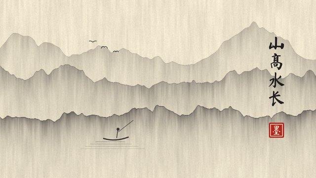
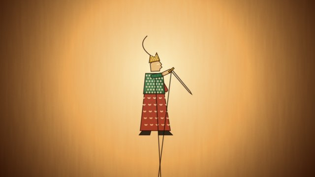
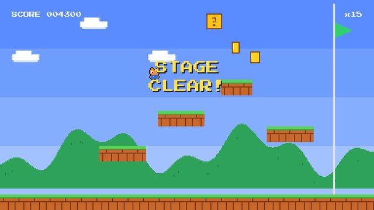
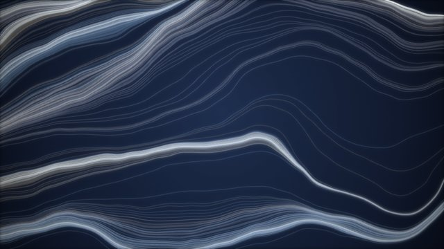
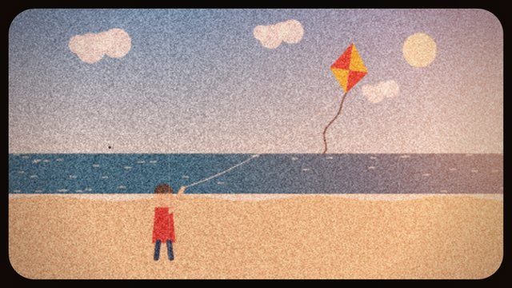
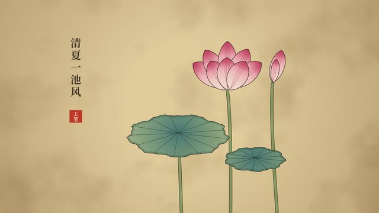
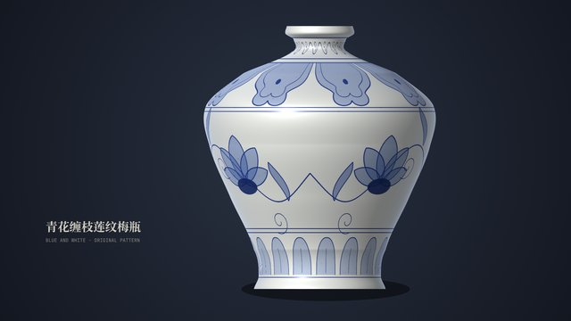
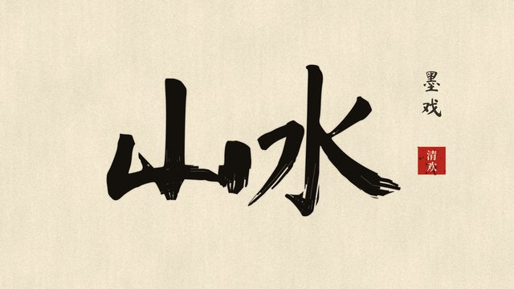
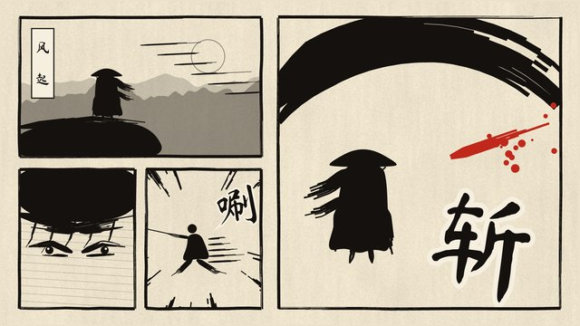
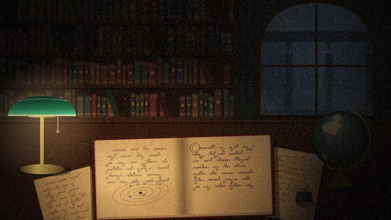

# Canvas 2D（88 种）

[← 选风格索引](../index.md) · [提示词方法](../prompting.md) · [技术标签](../tags.md)

画面画在 Canvas 2D 画布上：路径、填充、像素操作，必要时叠一层 WebGL 做纸纹、晕染这类全屏效果。手绘、版画、像素类风格大多在这里。

每个条目依次是：样片缩略图（已渲染的才有）、一句可直接复制的风格提示词、题材、适合讲什么、技术标签、参考链接。「技术（已验证）」表示仓库里有真能跑出这段样片的代码；「技术（建议）」是推荐写法，还没有样片验证。

<a id="C-001"></a>

## C-001 中国水墨 / 写意



```text
用中国水墨写意风格：暖色宣纸底（#F2ECDE）带纸纤维，画面 60–80% 留白，只用墨分五色的黑灰，没骨笔触自带深浅边、快笔处带干笔飞白，全片唯一的红是朱印，场景之间用墨滴在湿纸上晕开过渡，镜头像展开手卷一样从右往左横移，古琴配乐。
```

- 题材：手绘与绘画
- 适合：武侠、哲理、东方题材
- 技术（已验证）：Canvas 2D · Playwright · ffmpeg
- 样片代码：samples/C-001/
- 技术（建议）：Canvas 2D · WebGL
- 参考：[Lemo 说明](https://github.com/lemomo-ai/lemo-opuscar/blob/main/styles/ink-wash/STYLE.md) · [@AxtonLiu](https://x.com/AxtonLiu/status/2103288413969621231) · [@shfred0](https://x.com/shfred0/status/2102495989194236158)

<a id="C-002"></a>

## C-002 水彩

```text
用水彩风格：暖白色冷压棉纸纹理，颜料透明叠色、边缘有水渍积色，干笔处露出纸白，颜色略微溢出铅笔线，一镜到底横移穿过风景，角落有手写批注，结尾拉远成一张手绘地图。
```

- 题材：手绘与绘画
- 适合：自然、旅行、温情 MV
- 技术（建议）：Canvas 2D · p5.brush
- 参考：[Lemo 说明](https://github.com/lemomo-ai/lemo-opuscar/blob/main/styles/watercolor/STYLE.md) · [@johnknopf](https://x.com/johnknopf/status/2103170666187117006) · [@mablesjoseph](https://x.com/mablesjoseph/status/2103465246014746943)

<a id="C-003"></a>

## C-003 钢笔淡彩

```text
用钢笔淡彩城市速写风格：奶油色冷压纸，棕褐色针管笔线条轻微抖动、出头、不闭合，透明淡彩随手点上、略微偏离线条并溢出，颜色在纸边溶成空白，整个画面像速写本上的一页。
```

- 题材：手绘与绘画
- 适合：城市、公园、日常
- 技术（建议）：Canvas 2D · Rough.js
- 参考：[Lemo 说明](https://github.com/lemomo-ai/lemo-opuscar/blob/main/styles/urban-sketch/STYLE.md)

<a id="C-004"></a>

## C-004 油画厚涂

```text
用刮刀油画厚涂风格：大块平整、边缘锋利的色面，侧光照出每一道颜料隆起的肌理，先保证明暗结构再加质感，焦点处硬边、其余区域安静平涂，人物用少量笔触概括。
```

- 题材：手绘与绘画
- 适合：情绪片、艺术感广告
- 技术（建议）：Canvas 2D · WebGL · GLSL
- 参考：[Lemo 说明](https://github.com/lemomo-ai/lemo-opuscar/blob/main/styles/impasto/STYLE.md) · [@yumaeriel](https://x.com/yumaeriel/status/2103053166006657284)

<a id="C-005"></a>

## C-005 蜡笔绘本

```text
用儿童蜡笔绘本风格：米白色粗纹纸，蜡笔只附着在纸纹凸起处、露出细小白点，靛蓝色抖动描边，排线会越出轮廓，全片只用一次透明水彩晕染来揭示蜡笔藏起来的东西，睡前故事般的温柔节奏。
```

- 题材：手绘与绘画
- 适合：儿童故事
- 技术（建议）：Canvas 2D · p5.js
- 参考：[Lemo 说明](https://github.com/lemomo-ai/lemo-opuscar/blob/main/styles/crayon-book/STYLE.md)

<a id="C-006"></a>

## C-006 儿童涂鸦

```text
用儿童涂鸦风格：像 6 岁孩子画的，线条稚拙、比例不准、颜色涂出界，蜡笔和水彩笔混用，动作是一格一格的简单替换，不要任何专业透视和光影。
```

- 题材：手绘与绘画
- 适合：亲子、MV；可附孩子的原画让它照着动起来
- 技术（建议）：Canvas 2D · Rough.js

<a id="C-007"></a>

## C-007 铅笔素描

```text
用铅笔素描风格：速写本纸纹上的石墨灰阶，先出淡淡的构图辅助线再逐笔加深，阴影用排线和擦抹表现，保留擦痕和未完成的线，只用黑白灰。
```

- 题材：手绘与绘画
- 适合：创意过程、设计思考
- 技术（建议）：Canvas 2D
- 参考：[源码](https://github.com/yasinozmeen/animasyon-stil-katalogu/tree/main/stiller/karakalem)

<a id="C-010"></a>

## C-010 黑板粉笔

```text
用黑板粉笔风格：墨绿色黑板带旧擦痕，白色和黄色粉笔字有颗粒和断笔，板擦擦过留下灰雾，画面像老师上课的板书，关键词用粉笔圈出和画下划线。
```

- 题材：手绘与绘画
- 适合：课程、规则、“别忘了”
- 技术（建议）：Canvas 2D
- 参考：[源码](https://github.com/yasinozmeen/animasyon-stil-katalogu/tree/main/stiller/kara-tahta)

<a id="C-011"></a>

## C-011 沙画

```text
用沙画风格：暖光灯箱上的一层细沙，形象由手指划开的沙痕和剪影构成，只用棕褐和暖黄两种色调，转场是沙子被抹开再聚成下一个画面。
```

- 题材：手绘与绘画
- 适合：历史叙事
- 技术（建议）：Canvas 2D · WebGL

<a id="C-012"></a>

## C-012 手绘卡通角色片

```text
用手绘卡通角色片风格：纸张质感背景，用 p5.brush 水彩笔刷上色、线条略带抖动，角色造型简单且全片固定，有清晰表情和夸张但克制的表演，每个镜头围绕角色情绪展开。
```

- 题材：手绘与绘画
- 适合：角色短片、个人故事
- 技术（建议）：Canvas 2D · p5.js · p5.brush
- 参考：[ClaudeAnimationBase](https://github.com/JohnHeibel/ClaudeAnimationBase)

<a id="C-013"></a>

## C-013 皮影戏



```text
用中国皮影戏风格：半透明的染色兽皮人偶，身上镂空如蕾丝纹样，关节分段、由操纵杆带动、动作有轻微摆荡，贴在棉布幕上、被背后的油灯照亮并微微闪烁，人偶离幕远时边缘变虚，锣鼓和板胡配乐。
```

- 题材：东方传统
- 适合：神话、民间故事
- 技术（已验证）：Canvas 2D · Playwright · ffmpeg
- 样片代码：samples/C-013/
- 技术（建议）：Canvas 2D
- 参考：[Lemo 说明](https://github.com/lemomo-ai/lemo-opuscar/blob/main/styles/shadow-puppet/STYLE.md)

<a id="C-014"></a>

## C-014 浮世绘


```text
用江户浮世绘木版画风格：平涂色块加雕刻感墨线，主色是普鲁士蓝，天空和水面用上深下浅的晕染渐变，看得见纸纹和套版痕迹，每个镜头都是一幅完整版画，镜头像展开画卷一样横移。
```

- 题材：东方传统
- 适合：旅途、日本题材
- 技术（已验证）：Canvas 2D · Playwright · ffmpeg
- 样片代码：samples/C-014/
- 技术（建议）：Canvas 2D
- 参考：[Lemo 说明](https://github.com/lemomo-ai/lemo-opuscar/blob/main/styles/ukiyoe/STYLE.md)

<a id="C-016"></a>

## C-016 纸雕灯影

```text
用纸雕灯影风格：6–9 层镂空卡纸叠在浅木盒里，背后暖色灯光透过纸层，窗户和月亮从镂孔里发亮，每层在下一层上投出柔和阴影，镜头在层与层之间形成视差，开场先拍桌上这只真实灯箱再推进去。
```

- 题材：东方传统
- 适合：中秋、节日、团圆
- 技术（建议）：Canvas 2D
- 参考：[Lemo 说明](https://github.com/lemomo-ai/lemo-opuscar/blob/main/styles/paper-lantern/STYLE.md) · [@makwired](https://x.com/makwired/status/2103008945220567166)

<a id="C-017"></a>

## C-017 麻胶版画

```text
用麻胶版画（linocut）风格：米色纸上只用黑色加一种朱红，所有形状边缘带雕刻刀痕，大色块里有油墨印不实的斑驳颗粒，放射线和粗体大字构成宣传海报式构图，元素像盖印一样“压”上画面。
```

- 题材：印刷、版画与装饰
- 适合：宣言、单一强信息
- 技术（建议）：Canvas 2D
- 参考：[源码](https://github.com/yasinozmeen/animasyon-stil-katalogu/tree/main/stiller/linocut)

<a id="C-018"></a>

## C-018 木刻

```text
用木刻版画风格：每一帧都是一块涂黑的木板，光只存在于被刀刻掉的地方，用密集的平行刀痕表现明暗和质感，画面是随着刻刀一道道刻出来的，最多加一种颜色，只给火、炉、灯这类“燃烧的东西”。
```

- 题材：印刷、版画与装饰
- 适合：严肃寓言、历史
- 技术（建议）：Canvas 2D
- 参考：[Lemo 说明](https://github.com/lemomo-ai/lemo-opuscar/blob/main/styles/woodcut/STYLE.md)

<a id="C-019"></a>

## C-019 Risograph 孔版印刷

```text
用 Risograph 孔版印刷风格：暖色纸上 2–3 种半透明荧光专色（如荧光粉、蓝、黄）叠印出新颜色，暗部用半调网点，油墨有颗粒和不均，各色版每帧轻微错位抖动，像一张张印出来的动画。
```

- 题材：印刷、版画与装饰
- 适合：轻松生活、潮流品牌
- 技术（建议）：Canvas 2D · WebGL
- 参考：[Lemo 说明](https://github.com/lemomo-ai/lemo-opuscar/blob/main/styles/risograph/STYLE.md)

<a id="C-025"></a>

## C-025 分层卡纸剪纸

```text
用分层卡纸剪纸风格：场景由多层彩色卡纸前后叠成，每层边缘是剪刀剪出的不规则线并露出纸纤维，层与层之间有真实投影，镜头移动时各层形成视差，星星和月亮像用线吊着，角色是关节式剪纸。
```

- 题材：纸艺、材质与定格
- 适合：童话、情感开场
- 技术（建议）：Canvas 2D
- 参考：[源码](https://github.com/yasinozmeen/animasyon-stil-katalogu/tree/main/stiller/kagit-kesik) · [Papermotion](https://github.com/francozanardi/papermotion)

<a id="C-027"></a>

## C-027 拼贴

```text
用拼贴风格：剪报字母、撕边纸片、格子本、胶带和荧光笔涂抹叠在一起，强对比配色（如粉红加黑），元素一张张“贴”上画面并跟节拍跳动，字幕用勒索信式拼字。
```

- 题材：纸艺、材质与定格
- 适合：MV、观点讲解、节庆
- 技术（建议）：Canvas 2D · HTML/CSS
- 参考：[@NFT_Chen](https://x.com/NFT_Chen/status/2103380404791333144)

<a id="C-030"></a>

## C-030 剪影剧场

```text
用剪影剧场风格：人物、房屋和树全是纯黑剪影，背景是一整片渐变天空，随剧情从日落的橙红慢慢变到月夜的深蓝，暗色幕布框住画面，只有很少几行诗一样的文字。
```

- 题材：纸艺、材质与定格
- 适合：诗意短片
- 技术（建议）：Canvas 2D

<a id="C-035"></a>

## C-035 70 年代电视片头

```text
用 70 年代电视节目片头风格：橙、褐、芜菇黄的暖色调，放射光线和彩虹条纹，圆润粗衣线字体带多层描边阴影，画面像显像管电视播放（圆角、暗角、轻微扫描线和色散），来一段复古放克配乐。
```

- 题材：平面设计与动态排版
- 适合：怀旧开场、系列片头
- 技术（建议）：Canvas 2D · WebGL
- 参考：[源码](https://github.com/yasinozmeen/animasyon-stil-katalogu/tree/main/stiller/retro-70ler)

<a id="C-048"></a>

## C-048 1930 年代橡皮管卡通

```text
用 1930 年代橡皮管卡通风格：黑白手工勾线加灰阶平涂，角色四肢是没有关节的橡皮管、戴白手套、黑豆眼带缺口，万物（杯子、水龙头、房子）都活着并跟着热爵士乐队左右摇摆，整个画面像老胶片，有颗粒、划痕和抖动。
```

- 题材：卡通与动漫
- 适合：搞笑追逐
- 技术（建议）：Canvas 2D · SVG
- 参考：[Lemo 说明](https://github.com/lemomo-ai/lemo-opuscar/blob/main/styles/rubber-hose/STYLE.md) · [@ianstig](https://x.com/ianstig/status/2103169675928764486)

<a id="C-049"></a>

## C-049 80 年代赛璐璐动画

```text
用 80 年代日本赛璐璐动画风格：角色是双色平涂（亮面加一层硬阴影）的赛璐璐片，叠在喷枪渐变的手绘背景上，霓虹灯逆光勾出轮廓，按一拍三的有限动画节奏动，整体像 1987 年录像带在显像管电视上播放，有轻微色散和带子噪点。
```

- 题材：卡通与动漫
- 适合：城市夜景、怀旧
- 技术（建议）：Canvas 2D
- 参考：[Lemo 说明](https://github.com/lemomo-ai/lemo-opuscar/blob/main/styles/cel-anime-80s/STYLE.md)

<a id="C-052"></a>

## C-052 连环漫画 / 漫画分格

```text
用复古报纸连环漫画风格：黑色粗边框分格，网点印刷底纹，黄、红、青高饱和平涂，对白气泡和旁白框用手写字，关键动作配爆炸形拟声字和速度线，镜头在格子之间推进，最后拉远看到整页漫画。
```

- 题材：卡通与动漫
- 适合：搞笑、对话、悬念
- 技术（建议）：Canvas 2D · HTML/CSS
- 参考：[源码](https://github.com/yasinozmeen/animasyon-stil-katalogu/tree/main/stiller/cizgi-roman) · [@elianiva_](https://x.com/elianiva_/status/2103003425915195750)

<a id="C-053"></a>

## C-053 16-bit 像素平台



```text
用 16-bit 横版平台游戏像素风格：低分辨率整数倍放大、像素边缘锐利不模糊，限定 16–32 色调色板，蓝天白云、圆形山丘、砖块和金币，顶部 HUD 显示分数和时间，角色跳跃顶砖块，完成时弹出像素字“过关”，芯片音效。
```

- 题材：游戏
- 适合：游戏化、进度
- 技术（已验证）：Canvas 2D · Playwright · ffmpeg
- 样片代码：samples/C-053/
- 技术（建议）：Canvas 2D
- 参考：[源码](https://github.com/yasinozmeen/animasyon-stil-katalogu/tree/main/stiller/piksel) · [@riku720720](https://x.com/riku720720/status/2102515055116063144)

<a id="C-054"></a>

## C-054 16-bit 像素 RPG

```text
用 90 年代主机 RPG 像素风格：内部分辨率 320×180 再整数倍放大，限定调色板，底部蓝色对话框逐字打出并带“哔哔”声，有战斗菜单、HP/MP 数值和存档点，镜头不动、场景靠切换，带回声的芯片音乐。
```

- 题材：游戏
- 适合：冒险故事
- 技术（建议）：Canvas 2D
- 参考：[Lemo 说明](https://github.com/lemomo-ai/lemo-opuscar/blob/main/styles/pixel-rpg/STYLE.md)

<a id="C-056"></a>

## C-056 微游戏快闪

```text
用微游戏快闪风格：每关只有几秒、屏幕上一个大写指令词（如“吃！”）、只做一个动作，每一关换一种完全不同的画风（蜡笔、蓝图、像素…），关与关之间有倒计时和成败判定，节奏越来越快。
```

- 题材：游戏
- 适合：趣味、短视频
- 技术（建议）：Canvas 2D
- 参考：[Lemo 说明](https://github.com/lemomo-ai/lemo-opuscar/blob/main/styles/microgame/STYLE.md)

<a id="C-058"></a>

## C-058 可玩游戏 / 模拟器录屏

```text
先用 Canvas 2D 做一个可以真实操作的单文件 HTML 游戏（横版动作、机关、战斗、灯光闪烁），再让脚本自动玩一遍并录制 60 秒演示，保留 HUD 和菜单，镜头跟随角色。
```

- 题材：游戏
- 适合：游戏 demo、交互科普
- 技术（建议）：Canvas 2D · Playwright
- 参考：[@ring_hyacinth](https://x.com/ring_hyacinth/status/2102865595675050010) · [@RyanSael](https://x.com/RyanSael/status/2102591147927654847)

<a id="C-060"></a>

## C-060 16mm 黑白纪录片

```text
用 16mm 黑白老纪录片风格：粗胶片颗粒、随机划痕和灰尘、整体明暗轻微闪烁、四角暗角，开头是倒数计时片头，字幕用打字机字体，片名用衣线字加细边框，聚光灯打在主体上。
```

- 题材：电影年代与屏幕科技
- 适合：历史、起源故事
- 技术（建议）：Canvas 2D · WebGL
- 参考：[源码](https://github.com/yasinozmeen/animasyon-stil-katalogu/tree/main/stiller/belgesel-16mm)

<a id="C-061"></a>

## C-061 1920 年代默片

```text
用 1920 年代默片喜剧风格：画面是铜版插画式墨线加银灰晕染，4:3 画幅放在天鹅绒幕布中间，胶片闪烁、轻微上下晃动，对白用黑底白字的字幕卡代替，整段用一个固定全景镜头讲完一个笑点，影院钢琴即兴配乐。
```

- 题材：电影年代与屏幕科技
- 适合：喜剧
- 技术（建议）：Canvas 2D
- 参考：[Lemo 说明](https://github.com/lemomo-ai/lemo-opuscar/blob/main/styles/silent-film/STYLE.md)

<a id="C-077"></a>

## C-077 生成式抽象 / 音乐可视化

```text
用生成式抽象音乐可视化风格：分形纹理和有机体形态按音乐的频谱和节拍生长、脉动、变形，青蓝和冷色为主，每个可见的碰撞或重音都对应一次视觉变化，整段没有具象角色和文字。
```

- 题材：3D 与实时图形
- 适合：音乐片、艺术装置
- 技术（建议）：Canvas 2D · p5.js · WebGL
- 参考：[@KamStudioLabs](https://x.com/KamStudioLabs/status/2102899866762440893)

<a id="C-084"></a>

## C-084 1950 年代科学教科书

```text
用 1950 年代科学教科书插图风格：泛黄米色纸页，页眉有科目、章节名和页码，插图用单色网点加有限的蓝、橙专色，图注写“Fig. 1”，粗衣线大标题，旁边有黑底白字的“知识补充”小方框，像翻书一样一页一页讲解。
```

- 题材：信息讲解与产品发布
- 适合：科普、复古教学栏目
- 技术（建议）：Canvas 2D

<a id="C-087"></a>

## C-087 多画风穿越

```text
让同一个角色依次穿越多种画风世界（如暖色写实城市→动漫东京→黏土村庄→像素世界）：角色的外形、配色和剪影在每个世界保持不变，只改变线条、填色、纹理和着色方式，镜头贴近角色视线高度，每次画风切换本身就是转场。
```

- 题材：卡通与动漫
- 适合：品牌 IP 角色、年度回顾、炫技短片；需要先给角色设定图
- 技术（建议）：Canvas 2D · WebGL
- 参考：[@ianstig](https://x.com/ianstig/status/2103169675928764486)

<a id="C-088"></a>

## C-088 圆珠笔速写

```text
用圆珠笔速写风格：奶油色卡纸上只有一支蓝色圆珠笔，线条粗细几乎不变，明暗全靠排线的疏密来表现，笔画停住的地方留一个小墨点，先画轮廓再一层层加排线，整段像把一张速写慢放出来。
```

- 题材：手绘与绘画
- 适合：产品与物件特写、手账感讲解、复古钟表机械
- 技术（建议）：Canvas 2D · Rough.js
- 参考：[anidoodle 风格索引](https://github.com/alexgreensh/anidoodle/blob/main/skills/anidoodle/references/styles/INDEX.md)

<a id="C-089"></a>

## C-089 碎色印象派

```text
用印象派碎色笔触风格：亚麻底布上一小块一小块不混色的不透明色点，每一笔落下就不再修改，互补色并排放着让眼睛自己去混（橙玫瑰进蓝影、紫进金），水面用长而平的笔触、天空顺着云势排，全程没有轮廓线，形体就是色点停下来的地方。
```

- 题材：手绘与绘画
- 适合：风景、日出日落、旅行、艺术感广告
- 技术（建议）：Canvas 2D · WebGL
- 参考：[anidoodle 配方](https://github.com/alexgreensh/anidoodle/blob/main/skills/anidoodle/references/styles/brokenColour.md)

<a id="C-090"></a>

## C-090 炭笔擦除重绘

```text
用炭笔擦除重绘风格：厚棉纸上先用柳枝炭条轻轻起形、最后才用压缩炭条提黑，侧锋铺大调子、纸擦笔揉成雾气，每次修改都用可塑橡皮擦掉一部分再画在残影上，什么都不会被擦干净，只用一种暖黑和奶油白。
```

- 题材：手绘与绘画
- 适合：回忆与思考、艺术创作过程、静物与树木
- 技术（建议）：Canvas 2D
- 参考：[anidoodle 配方](https://github.com/alexgreensh/anidoodle/blob/main/skills/anidoodle/references/styles/charcoalErasure.md)

<a id="C-091"></a>

## C-091 彩色铅笔

```text
用彩色铅笔风格：奶油色卡纸的纸纹让每片颜色里都带着细小的留白，笔触是短而略弯的排线，几乎全部朝同一个斜向，颜色靠力度和一层层叠色出来（紫叠暮蓝、蓝叠青），没有轮廓线，最后才用深色铅笔补几根断续的外形线。
```

- 题材：手绘与绘画
- 适合：儿童内容、生活场景插画、温和的讲解
- 技术（建议）：Canvas 2D · p5.brush
- 参考：[anidoodle 配方](https://github.com/alexgreensh/anidoodle/blob/main/skills/anidoodle/references/styles/colouredPencil.md)

<a id="C-092"></a>

## C-092 刮画板

```text
用刮画板风格：白色瓷土上盖一层黑墨，所有笔触都是用刀尖把墨刮掉，画面从全黑开始，在光照到的地方一道道刮出白色的毛发和轮廓，没有灰色，灰度只来自白线排得有多密，刮痕从不渐入，都是整条整条刻出来的。
```

- 题材：手绘与绘画
- 适合：动物、夜景、悬疑、版画质感的片头
- 技术（建议）：Canvas 2D
- 参考：[anidoodle 配方](https://github.com/alexgreensh/anidoodle/blob/main/skills/anidoodle/references/styles/scratchboard.md)

<a id="C-093"></a>

## C-093 点刻

```text
用点刻风格：一支 0.25 mm 针管笔在光滑白卡纸上一个点一个点地点出来，所有点一样大，明暗只由点的疏密决定，没有线、没有排线、没有轮廓，边缘就是点密度变化的地方，先点最暗的部分再向亮处扩散，点只出现、不渐入、不移动。
```

- 题材：手绘与绘画
- 适合：博物与自然标本、科普、慢节奏纪录片
- 技术（建议）：Canvas 2D
- 参考：[anidoodle 配方](https://github.com/alexgreensh/anidoodle/blob/main/skills/anidoodle/references/styles/stipple.md)

<a id="C-094"></a>

## C-094 民间故事绘本

```text
用民间故事绘本风格：奶油色纸上先有一幅完整的铅笔底稿，再上水粉和水彩，近处厚涂、饱和、笔触可见，中景变成透明的薄水彩，远处干脆只留铅笔线，画面越远越空，深度就靠这种画法本身。
```

- 题材：手绘与绘画
- 适合：童话与民间故事、亲子内容、乡村题材
- 技术（建议）：Canvas 2D
- 参考：[anidoodle 配方](https://github.com/alexgreensh/anidoodle/blob/main/skills/anidoodle/references/styles/folkTale.md)

<a id="C-096"></a>

## C-096 铜版雕刻（博物图版）

```text
用 19 世纪铜版雕刻博物图版风格：刻刀在铜板上刻出由细变粗再收尖的线，明暗全靠排线（一层平行线、二层交叉、最暗处第三层），不用任何灰色填充，奶油色版画纸上有压痕和边框，罗马体大写标题配意大利体学名，印好之后再手工罩一层透明水彩，颜色可以溢出线条。
```

- 题材：印刷、版画与装饰
- 适合：自然博物、历史、科普、美术馆展览
- 技术（建议）：Canvas 2D
- 参考：[Lemo 说明](https://github.com/lemomo-ai/lemo-opuscar/blob/main/styles/engraving/STYLE.md)

<a id="C-097"></a>

## C-097 单线雕版

```text
用单线雕版风格：整幅画只用一根不断的雕刻线，像螺旋一样绕出整个形体，线的粗细随明暗变化，亮处细、暗处粗，没有任何填充和别的笔画，整幅图就是一笔。
```

- 题材：印刷、版画与装饰
- 适合：品牌标志、月亮与星球等圆形主体、艺术短片
- 技术（建议）：Canvas 2D
- 参考：[anidoodle 风格索引](https://github.com/alexgreensh/anidoodle/blob/main/skills/anidoodle/references/styles/INDEX.md)

<a id="C-099"></a>

## C-099 手工刺绣

```text
用手工刺绣风格：棉线穿过绷在木绣绷里的亚麻布，每个形状的边缘就是针脚的线头，茎用轮廓绣、花瓣用缎面绣顺着形状排、叶子用鱼骨绣、花心用法式结粒绣，光从左上来，针脚按绣的顺序一针一针缝出来。
```

- 题材：纸艺、材质与定格
- 适合：手工艺与家居、母婴、节日祝福、非遗
- 技术（建议）：Canvas 2D
- 参考：[anidoodle 配方](https://github.com/alexgreensh/anidoodle/blob/main/skills/anidoodle/references/styles/embroidery.md)

<a id="C-108"></a>

## C-108 等距绘本

```text
用等距绘本风格：30° 真等距、满出画框的一处真实场所（站台、闸机、路口），只用三色阶平涂、无描边无阴影，背对镜头的无脸小人按规则依次走动，屋顶像纸翻页一样掀开，衬线大字一个字一个字落在地面上，配柔和的立式钢琴和颤音琴。
```

- 题材：信息讲解与产品发布
- 适合：公共礼仪、排队规则、生活常识
- 技术（建议）：Canvas 2D · GSAP · Web Audio
- 参考：[Lemo STYLE.md](https://github.com/lemomo-ai/lemo-opuscar/blob/main/styles/isometric-picture-book/STYLE.md)

<a id="C-110"></a>

## C-110 电路板

```text
用电路板风格：正俯视的一块印制电路板，绿色阻焊层下是铜箔，走线只走 0/45/90° 并切斜角，金色焊盘和过孔，白色单线丝印写字，电流、货物或信号化作沿铜线奔跑的光脉冲，镜头在整张板和单个元件之间缩放，配继电器咔哒声和电源嗡鸣。
```

- 题材：信息讲解与产品发布
- 适合：供应链、系统架构、能源输送
- 技术（建议）：Canvas 2D · WebGL · Web Audio
- 参考：[Lemo STYLE.md](https://github.com/lemomo-ai/lemo-opuscar/blob/main/styles/circuit-board/STYLE.md)

<a id="C-114"></a>

## C-114 霓虹灯牌

```text
用霓虹灯牌风格：夜里一面深色砖墙，文字和图标是弯出来的玻璃灯管，未通电时是暗玻璃，通电时先闪烁几下、嗡嗡作响再稳住，管芯白热、外圈是粉、青或黄的光晕，光洒在砖墙上并倒映在湿地面里，一场只挂一块招牌，最多三种灯色。
```

- 题材：电影年代与屏幕科技
- 适合：品牌口号、夜生活、开业宣传
- 技术（建议）：Canvas 2D · WebGL · Web Audio
- 参考：[code-video neon.md](https://github.com/Changroro/code-video/blob/main/references/styles/neon.md)

<a id="C-121"></a>

## C-121 电影预告片

```text
用电影预告片风格：约 2.6:1 的超宽遮幅，上下黑边贯穿全片，暖棕近黑的暗角夜空里飘着极淡的尘粒，每个意思独占一屏、居中，小号字距拉开的琥珀色眉题、发光的大号衬线数字、一道青铜细线，画面像呼吸一样亮起再经黑场溶出，片名处一道横向镜头光晕加重击。
```

- 题材：电影年代与屏幕科技
- 适合：新品预告、发布日倒数、品牌大片
- 技术（建议）：Canvas 2D · WebGL · Web Audio
- 参考：[code-video trailer.md](https://github.com/Changroro/code-video/blob/main/references/styles/trailer.md)

<a id="C-122"></a>

## C-122 16-bit 街机闯关

```text
用16-bit 街机闯关风格：紫色星夜和闪烁的像素星，全屏轻扫描线，故事走一遍游戏流程：投币开场伴随屏幕一震、闪烁的“按下开始”、角色在关卡地图上一格格跳到下一个节点、最高分逐位滚动、对战屏的血条，最后“通关”对话框，像素字只按 8 的倍数放大，配芯片音乐。
```

- 题材：游戏
- 适合：产品功能闯关、竞品对决、年度回顾
- 技术（建议）：Canvas 2D · Web Audio
- 参考：[code-video arcade.md](https://github.com/Changroro/code-video/blob/main/references/styles/arcade.md) · [animation-skills pixel-arcade](https://github.com/madhavsomani/animation-skills/blob/main/skills/pixel-arcade/SKILL.md)

<a id="C-128"></a>

## C-128 史前洞穴岩画

```text
用史前洞穴岩画风格：凹凸不平的石灰岩壁由噪声生成浮雕和裂缝，形象只用赭红、土黄和木炭黑，炭笔边缘起毛并渗进岩面颗粒，手印用喷吹法留下负形，野牛和鹿在两三个姿态之间交替奔跑，一支摇曳的火把照到哪里哪里才看得见，配低沉的鼓声。
```

- 题材：手绘与绘画
- 适合：人类起源、狩猎故事、远古历史
- 技术（建议）：Canvas 2D · p5.js
- 参考：[huashu 风格卡 01_cave](https://github.com/alchaincyf/huashu-art-motion/blob/main/references/%E9%A3%8E%E6%A0%BC%E9%85%8D%E6%96%B9/01_cave.md)

<a id="C-129"></a>

## C-129 古埃及墓室壁画

```text
用古埃及墓室壁画风格：沙黄灰泥墙按横向带状分栏，人物头和腿画侧面、眼睛和肩膀画正面，土红、孔雀绿、青金蓝平涂后勾细黑线，旁边竖排的象形符号一笔一笔重新写出，人物按身份定大小，转场是上一栏像石板一样下滑露出下一栏。
```

- 题材：手绘与绘画
- 适合：古文明科普、历史叙事、仪式与流程讲解
- 技术（建议）：Canvas 2D · GSAP
- 参考：[huashu 风格卡 02_egypt](https://github.com/alchaincyf/huashu-art-motion/blob/main/references/%E9%A3%8E%E6%A0%BC%E9%85%8D%E6%96%B9/02_egypt.md)

<a id="C-130"></a>

## C-130 古希腊黑绘陶瓶

```text
用古希腊黑绘陶瓶风格：橙红陶土底上人物和动物都是光亮的黑色剪影，细节用刻线刮出、露出底下的陶色，偶尔点一点紫红和白，画面绕着弧形瓶身展开，回纹和棕榈叶饰带在上下沿反向滚动，镜头像转动陶瓶一样横移换场，配里拉琴拨弦。
```

- 题材：手绘与绘画
- 适合：神话故事、体育竞技、古典文学
- 技术（建议）：Canvas 2D · p5.js
- 参考：[huashu 风格卡 03_greek](https://github.com/alchaincyf/huashu-art-motion/blob/main/references/%E9%A3%8E%E6%A0%BC%E9%85%8D%E6%96%B9/03_greek.md)

<a id="C-131"></a>

## C-131 古罗马石子马赛克

```text
用古罗马石子马赛克风格：形象由几毫米见方的小石块沿轮廓一圈圈排出，石色是大理石白、赭黄、砖红、灰绿这些天然土色，块与块之间露出暗灰灰泥缝，石面有细微凹凸和高光，新画面跟着鼓点从一点开始一块块翻面铺开，镜头像俯看庭院地面一样缓慢移动。
```

- 题材：印刷、版画与装饰
- 适合：古代城市、考古科普、庄重的纪念片
- 技术（建议）：Canvas 2D · p5.js
- 参考：[huashu 风格卡 04_roman](https://github.com/alchaincyf/huashu-art-motion/blob/main/references/%E9%A3%8E%E6%A0%BC%E9%85%8D%E6%96%B9/04_roman.md) · [opus-5.5-mv mosaic-and-sand](https://github.com/cyborggirl963/opus-5.5-music-video-art-styles/tree/main/styles/mosaic-and-sand)

<a id="C-132"></a>

## C-132 哥特泥金手抄本

```text
用哥特泥金手抄本风格：泛黄羊皮纸上是双栏黑体拉丁字和一个巨大的彩绘首字母，背景铺着压花金箔，一道斜向高光随时间扫过所有金色处并闪出四角星，群青和朱红平涂的人物站在尖拱框里，页边的藤蔓和小兽慢慢爬动，转场是翻过一页羊皮纸。
```

- 题材：印刷、版画与装饰
- 适合：中世纪传说、奇幻故事、典籍与历史讲解
- 技术（建议）：Canvas 2D · WebGL
- 参考：[huashu 风格卡 05_gothic](https://github.com/alchaincyf/huashu-art-motion/blob/main/references/%E9%A3%8E%E6%A0%BC%E9%85%8D%E6%96%B9/05_gothic.md)

<a id="C-133"></a>

## C-133 早期文艺复兴湿壁画

```text
用早期文艺复兴湿壁画风格：干灰泥墙面略带粉化斑驳，颜色是粉蓝天空、土绿、淡赭和玫瑰色，人物像厚重的体块，轮廓清楚、明暗简单，建筑像舞台盒子一样把场景分成一格格可读的空间，光线均匀清明几乎没有投影，镜头沿墙面从一幕平移到下一幕，配素歌吟唱。
```

- 题材：手绘与绘画
- 适合：历史叙事、城市与社会生活、连环故事
- 技术（建议）：Canvas 2D · p5.js
- 参考：[huashu 风格卡 38_giotto](https://github.com/alchaincyf/huashu-art-motion/blob/main/references/%E9%A3%8E%E6%A0%BC%E9%85%8D%E6%96%B9/38_giotto.md) · [huashu 风格卡 39_piero](https://github.com/alchaincyf/huashu-art-motion/blob/main/references/%E9%A3%8E%E6%A0%BC%E9%85%8D%E6%96%B9/39_piero.md) · [huashu 风格卡 43_lorenzetti](https://github.com/alchaincyf/huashu-art-motion/blob/main/references/%E9%A3%8E%E6%A0%BC%E9%85%8D%E6%96%B9/43_lorenzetti.md)

<a id="C-134"></a>

## C-134 盛期文艺复兴晕涂

```text
用盛期文艺复兴晕涂风格：暖褐基调的油画，形体边缘没有线，全靠烟雾般的明暗慢慢晕开，远山按空气透视一层比一层更蓝更淡，人物用稳定的三角形构图，画面带细密龟裂纹和发黄的光油，动作缓慢庄重，转场是窗口射进一束光照亮下一幕。
```

- 题材：手绘与绘画
- 适合：人物传记、艺术史讲解、庄重的品牌片
- 技术（建议）：Canvas 2D · WebGL
- 参考：[huashu 风格卡 06_renaissance](https://github.com/alchaincyf/huashu-art-motion/blob/main/references/%E9%A3%8E%E6%A0%BC%E9%85%8D%E6%96%B9/06_renaissance.md) · [huashu 风格卡 40_raphael](https://github.com/alchaincyf/huashu-art-motion/blob/main/references/%E9%A3%8E%E6%A0%BC%E9%85%8D%E6%96%B9/40_raphael.md) · [huashu 风格卡 41_michelangelo](https://github.com/alchaincyf/huashu-art-motion/blob/main/references/%E9%A3%8E%E6%A0%BC%E9%85%8D%E6%96%B9/41_michelangelo.md)

<a id="C-135"></a>

## C-135 巴洛克明暗对照

```text
用巴洛克明暗对照风格：画面八成沉在近乎全黑的暖褐阴影里，一束左上方的斜光或一支烛火只照亮脸、手和金属器物，亮部厚涂暖黄白，暗部薄而透，光照范围随烛焰轻轻呼吸，光柱里有浮尘飘动，镜头极慢地推进，转场是光圈收拢再打开。
```

- 题材：手绘与绘画
- 适合：悬疑与心理戏、人物肖像、宗教与历史场景
- 技术（建议）：Canvas 2D · WebGL
- 参考：[huashu 风格卡 32_rembrandt](https://github.com/alchaincyf/huashu-art-motion/blob/main/references/%E9%A3%8E%E6%A0%BC%E9%85%8D%E6%96%B9/32_rembrandt.md) · [huashu 风格卡 44_cortona](https://github.com/alchaincyf/huashu-art-motion/blob/main/references/%E9%A3%8E%E6%A0%BC%E9%85%8D%E6%96%B9/44_cortona.md)

<a id="C-136"></a>

## C-136 威尼斯风景画

```text
用威尼斯风景画风格：低低的地平线上压着占画面三分之二的银灰色天空，水面和建筑用干而快的小笔触点出碎光，边缘松动不收紧，人物小到只剩一点黑加一点白或红，细长的小船慢慢划过，色调是银灰、淡绿和暖赭，镜头沿运河缓缓横移。
```

- 题材：手绘与绘画
- 适合：城市风光、旅行纪录、怀旧短片
- 技术（建议）：Canvas 2D · p5.brush
- 参考：[huashu 风格卡 42_guardi](https://github.com/alchaincyf/huashu-art-motion/blob/main/references/%E9%A3%8E%E6%A0%BC%E9%85%8D%E6%96%B9/42_guardi.md)

<a id="C-138"></a>

## C-138 后印象派厚涂

```text
用后印象派厚涂风格：画面由一根根方向明确的短粗油彩笔触铺满，墙面竖排、地面顺着透视、天空绕着漩涡打转，同一区域里混用十几种相近色相，钴蓝和铬黄互补对撞，轮廓用深蓝粗线勾出并每隔几帧轻轻抖动，灯和星星外有一圈圈光晕向外扩，转场是漩涡把画面卷走。
```

- 题材：手绘与绘画
- 适合：情绪 MV、艺术史讲解、夜景与乡村
- 技术（建议）：Canvas 2D · p5.js
- 参考：[huashu 风格卡 09_postimp](https://github.com/alchaincyf/huashu-art-motion/blob/main/references/%E9%A3%8E%E6%A0%BC%E9%85%8D%E6%96%B9/09_postimp.md)

<a id="C-139"></a>

## C-139 新印象派点彩

```text
用新印象派点彩风格：画面全部由同样大小的纯色圆点并排组成，不在调色盘上混色，橙点旁放蓝点、绿点旁放红点让眼睛自己去混，阴影处的点更冷更密、亮处更暖更稀，点在原位轻轻明灭像在呼吸，人物轮廓安静而几何，转场是旧画面结晶成圆点再重新组合。
```

- 题材：手绘与绘画
- 适合：公园与假日、科学色彩讲解、安静的风景
- 技术（建议）：Canvas 2D · p5.js
- 参考：[huashu 风格卡 29_seurat](https://github.com/alchaincyf/huashu-art-motion/blob/main/references/%E9%A3%8E%E6%A0%BC%E9%85%8D%E6%96%B9/29_seurat.md)

<a id="C-140"></a>

## C-140 综合主义平涂

```text
用综合主义平涂风格：大块不讲透视的平涂色面，每块用深蓝或深褐粗轮廓圈住，像掐丝珐琅一样，颜色按情绪而不按自然，草地可以是橙红、树影可以是紫，人物造型简化、姿态静止，背景常是一整片单色，只有风和呼吸在动，转场是一块色面滑入覆盖画面。
```

- 题材：手绘与绘画
- 适合：神话与民俗、热带风情、心理与象征叙事
- 技术（建议）：Canvas 2D · SVG
- 参考：[huashu 风格卡 48_gauguin](https://github.com/alchaincyf/huashu-art-motion/blob/main/references/%E9%A3%8E%E6%A0%BC%E9%85%8D%E6%96%B9/48_gauguin.md)

<a id="C-141"></a>

## C-141 表现主义

```text
用表现主义风格：整个世界用长而弯的流线笔触画出，天空、水面和人物都沿同一股力场扭曲波动，血橙、硫黄和深蓝紫强烈对撞，人物的脸简化成惊惧的面具，画面每一行都在缓慢地正弦扭动，转场是一条彩色天空带从上往下压满屏幕，配低沉弦乐。
```

- 题材：手绘与绘画
- 适合：焦虑与心理题材、恐怖短片、情绪化 MV
- 技术（建议）：Canvas 2D · WebGL
- 参考：[huashu 风格卡 19_munch](https://github.com/alchaincyf/huashu-art-motion/blob/main/references/%E9%A3%8E%E6%A0%BC%E9%85%8D%E6%96%B9/19_munch.md) · [huashu 风格卡 36_picasso_blue](https://github.com/alchaincyf/huashu-art-motion/blob/main/references/%E9%A3%8E%E6%A0%BC%E9%85%8D%E6%96%B9/36_picasso_blue.md)

<a id="C-142"></a>

## C-142 分析立体主义

```text
用分析立体主义风格：物体被拆成许多半透明的小几何切面，同一画面里同时露出正面和侧面，色彩压到赭褐、灰绿、暗金几种，切面互相穿插分不清前后，零散的印刷字母和报纸碎片夹在中间，切面缓慢滑动错位，转场是碎片打散后重新拼成新的物体。
```

- 题材：手绘与绘画
- 适合：艺术史讲解、多视角分析、咖啡馆与城市生活
- 技术（建议）：Canvas 2D · p5.js
- 参考：[huashu 风格卡 11_cubism](https://github.com/alchaincyf/huashu-art-motion/blob/main/references/%E9%A3%8E%E6%A0%BC%E9%85%8D%E6%96%B9/11_cubism.md)

<a id="C-144"></a>

## C-144 超现实主义

```text
用超现实主义风格：无限延伸的平坦荒原和低地平线，傍晚斜光拉出极长的影子，日常物体以不合理的方式出现，钟表像软蜡一样往下流淌，长腿动物缓慢走过，形体画得写实、处境却荒谬，天空是澄澈的青到杏黄渐变，转场是新画面像液滴一样从上往下流下来盖住旧画面。
```

- 题材：手绘与绘画
- 适合：梦境与记忆、时间主题、哲学短片
- 技术（建议）：Canvas 2D · WebGL
- 参考：[huashu 风格卡 23_dali](https://github.com/alchaincyf/huashu-art-motion/blob/main/references/%E9%A3%8E%E6%A0%BC%E9%85%8D%E6%96%B9/23_dali.md)

<a id="C-145"></a>

## C-145 美国都市写实主义

```text
用美国都市写实主义风格：空荡的餐馆、加油站和公寓窗边，清晨或深夜的光以锋利的硬边斜块落在墙和地板上，色面平整几乎看不到笔触，人物孤零零地坐着不动，只有光斑缓慢移动扫过脸，配色是暖黄、青绿和砖红，镜头固定不动，声音只有远处的车声。
```

- 题材：手绘与绘画
- 适合：孤独与城市题材、短篇小说改编、安静的情绪片
- 技术（建议）：Canvas 2D · GSAP
- 参考：[huashu 风格卡 24_hopper](https://github.com/alchaincyf/huashu-art-motion/blob/main/references/%E9%A3%8E%E6%A0%BC%E9%85%8D%E6%96%B9/24_hopper.md)

<a id="C-147"></a>

## C-147 波普艺术

```text
用波普艺术风格：粗黑描边的漫画式人物，皮肤和背景是规则的大号网点，只用纯黄、纯红、纯蓝和黑白，思考泡和拟声字放大到占半个画面，同一张头像在四宫格里不断换配色，换场时一道闪电劈开画面并整体网点化，节奏跟着鼓点硬切。
```

- 题材：印刷、版画与装饰
- 适合：消费与流行文化、广告片、喜剧短片
- 技术（建议）：Canvas 2D · p5.js
- 参考：[huashu 风格卡 13_pop](https://github.com/alchaincyf/huashu-art-motion/blob/main/references/%E9%A3%8E%E6%A0%BC%E9%85%8D%E6%96%B9/13_pop.md)

<a id="C-150"></a>

## C-150 敦煌壁画

```text
用敦煌壁画风格：土红色干泥壁作底，矿物色只有石青、石绿、白和赭，颜色褪淡、背景有剥落斑块，人物和走兽用流畅的长线勾出，飞天横向飞过、长飘带在身后起伏，锯齿形小山和被风吹弯的叶片点缀画面，转场是旧画面剥落掉下露出新画，配琵琶。
```

- 题材：东方传统
- 适合：佛教与丝路故事、文博科普、东方奇幻
- 技术（建议）：Canvas 2D · p5.js
- 参考：[huashu 风格卡 20_dunhuang](https://github.com/alchaincyf/huashu-art-motion/blob/main/references/%E9%A3%8E%E6%A0%BC%E9%85%8D%E6%96%B9/20_dunhuang.md) · [huashu 风格卡 55_dunhuang](https://github.com/alchaincyf/huashu-art-motion/blob/main/references/%E9%A3%8E%E6%A0%BC%E9%85%8D%E6%96%B9/55_dunhuang.md)

<a id="C-151"></a>

## C-151 南宋院体山水

```text
用南宋院体山水风格：淡黄绢本上主景全压在一角，山石用方硬的侧锋斧劈皴扫出，其余大半画面是雾和水的留白，一棵拖枝老松斜伸出画外，小小的高士在崖边远望，淡墨加一点赭石和花青，镜头从留白处缓缓移向那一角，配洞箫。
```

- 题材：东方传统
- 适合：诗词意境、哲理独白、东方品牌片
- 技术（建议）：Canvas 2D · p5.brush
- 参考：[huashu 风格卡 50_ma_yuan](https://github.com/alchaincyf/huashu-art-motion/blob/main/references/%E9%A3%8E%E6%A0%BC%E9%85%8D%E6%96%B9/50_ma_yuan.md)

<a id="C-152"></a>

## C-152 波斯细密画

```text
用波斯细密画风格：画面不用透视，花园、建筑和人物从下往上层层堆叠，每一层都布满精细的花草纹样，群青、翠绿、朱红和金色平涂，边框外有书法栏和泥金花边，人物小而多、同时在做不同的事，镜头像读书页一样从下往上缓慢摇，配乌德琴。
```

- 题材：手绘与绘画
- 适合：中东与丝路故事、宫廷与诗歌、群像叙事
- 技术（建议）：Canvas 2D · SVG
- 参考：[huashu 风格卡 51_persian_miniature](https://github.com/alchaincyf/huashu-art-motion/blob/main/references/%E9%A3%8E%E6%A0%BC%E9%85%8D%E6%96%B9/51_persian_miniature.md)

<a id="C-154"></a>

## C-154 逐帧沸腾线

```text
用逐帧沸腾线风格：米白纸纹底上用粗细随压力变化的手绘线勾出形象，每张线稿准备三四个细微不同的版本、每两帧轮换一次，让静止画面也像在呼吸，动作以一拍二为主、快动作切一拍一，快速位移时只插一帧拉长的拖影，烟雾、水花和速度线逐帧手绘叠在主体上。
```

- 题材：卡通与动漫
- 适合：品牌短片、手作感片头、角色小剧场
- 技术（建议）：Canvas 2D · p5.brush
- 参考：[mg-styles-15 05-cel-boil](https://github.com/Vincentwei1021/mg-styles-15/blob/main/prompts/05-cel-boil.md)

<a id="C-158"></a>

## C-158 大理石纹染纸

```text
用大理石纹染纸风格：颜料浮在水槽表面，被一滴滴落下的颜色推开成同心圈，再被梳子拉成羽毛纹和孔雀纹，色与色交界处有细细的深色纹脉和颜料颗粒，每次变形都能精确倒放、让图案被梳回原样，配色是靛蓝、赭红、芥末黄和象牙白。
```

- 题材：纸艺、材质与定格
- 适合：记忆与时间、水与风、抽象音乐 MV
- 技术（建议）：Canvas 2D · WebGL
- 参考：[opus-5.5-mv marbling](https://github.com/cyborggirl963/opus-5.5-music-video-art-styles/tree/main/styles/marbling)

<a id="C-159"></a>

## C-159 魔灯幻灯片

```text
用魔灯幻灯片风格：漆黑讲堂里一盏油灯把手工上色的雕版玻璃片投在圆形光斑里，四周暗角，光随油灯不停闪烁，换片时玻璃片横向滑入或两张叠化，偶尔插进一片旋转的彩色万花筒片，镜头不时拉远露出幕布和观众剪影，旁白像一场旅行讲座。
```

- 题材：电影年代与屏幕科技
- 适合：历史与游记、讲故事式 MV、维多利亚时代题材
- 技术（建议）：Canvas 2D · GSAP
- 参考：[opus-5.5-mv magic-lantern](https://github.com/cyborggirl963/opus-5.5-music-video-art-styles/tree/main/styles/magic-lantern)

<a id="C-160"></a>

## C-160 玻璃版长曝光

```text
用玻璃版长曝光风格：像 19 世纪的玻璃底片曝光几分钟甚至几个月，静止的建筑和树清晰锐利，走过的人只留下半透明的幽灵拖影，太阳在天上画出一道道弧线，银灰色调带光晕、灰尘、划痕和边缘药膜剥落，画面一角的纸套上用手写数字计着曝光时长。
```

- 题材：电影年代与屏幕科技
- 适合：时间流逝、静与动的对比、怀旧与记忆
- 技术（建议）：Canvas 2D · WebGL
- 参考：[opus-5.5-mv glass-plate](https://github.com/cyborggirl963/opus-5.5-music-video-art-styles/tree/main/styles/glass-plate)

<a id="C-163"></a>

## C-163 夜色平涂海报

```text
用夜色平涂海报风格：靛蓝夜色里只有窗口和路灯的琥珀色光，阴影是硬边几何色块，人物只用轮廓线勾出，画面被弧形接缝分成几格，同一个街角在不同时刻各占一格，结尾所有格子收拢成一栋楼，每格变成一扇亮灯的窗。
```

- 题材：平面设计与动态排版
- 适合：城市日常、多线并行故事、温情 MV
- 技术（建议）：Canvas 2D · GSAP
- 参考：[opus-5.5-mv night-poster](https://github.com/cyborggirl963/opus-5.5-music-video-art-styles/tree/main/styles/night-poster)

<a id="C-164"></a>

## C-164 车厢珐琅彩绘

```text
用车厢珐琅彩绘风格：画面就是一节旅行篷车的木侧板，用光亮珐琅漆画成，每一笔都是双色鬃刷笔触加一记白色高光挑笔，玫瑰、卷叶和金箔饰框围住中间的风景，表面有清漆细裂，夜景里的灯跟着节拍一盏盏亮起，边框上的彩带打结又解开。
```

- 题材：印刷、版画与装饰
- 适合：公路与旅人、民间集市、节庆夜晚
- 技术（建议）：Canvas 2D · p5.brush
- 参考：[opus-5.5-mv painted-enamel](https://github.com/cyborggirl963/opus-5.5-music-video-art-styles/tree/main/styles/painted-enamel)

<a id="C-165"></a>

## C-165 剧院彩绘布景

```text
用剧院彩绘布景风格：从观众席后排望向一座小剧场，台上的山、树和云都是手绘平板和吊幕，靠铰链和吊线由看不见的工人拉动，鼓风机吹得纸叶乱颤，脚灯从下往上照亮演员，歌词写在台边画架的卡片上，镜头从后排一路推近到舞台。
```

- 题材：纸艺、材质与定格
- 适合：戏剧化叙事、喜剧歌曲、舞台感品牌片
- 技术（建议）：Canvas 2D · GSAP
- 参考：[opus-5.5-mv showboat](https://github.com/cyborggirl963/opus-5.5-music-video-art-styles/tree/main/styles/showboat)

<a id="C-168"></a>

## C-168 字雨


```text
用字雨风格：纯黑屏幕上一列列绿色等宽字符从上往下坠落，每列最前面的字最亮、近乎白色，身后拖着渐暗的尾巴，字符在下落途中随机换字，各列速度不同，镜头偶尔推进穿过字帘，某一刻雨幕里的字排出一个隐藏的单词或轮廓，配低频电子嗡鸣。
```

- 题材：电影年代与屏幕科技
- 适合：黑客与 AI 题材、科技片头、数据主题转场
- 技术（已验证）：Canvas 2D · Playwright · ffmpeg
- 样片代码：samples/C-168/
- 技术（建议）：Canvas 2D · WebGL

<a id="C-171"></a>

## C-171 流动的丝线



```text
用流动的丝线风格：深色背景上成千上万根半透明细丝顺着缓慢变化的噪声流场游走，留下柔和的轨迹，颜色从珍珠白渐变到淡金和冰蓝，丝线交叠处更亮，音乐重音时被扰动散开、再慢慢理顺，镜头几乎不动，整体像丝绸在水里漂。
```

- 题材：3D 与实时图形
- 适合：冥想与放松、奢侈品与面料广告、抽象音乐可视化
- 技术（已验证）：Canvas 2D · Playwright · ffmpeg
- 样片代码：samples/C-171/
- 技术（建议）：Canvas 2D · p5.js

<a id="C-172"></a>

## C-172 萤火光尘


```text
用萤火光尘风格：暮色深蓝的草地和树林剪影里，几百颗暖黄绿的小光点慢慢浮起、明灭、绕圈飞行，靠近镜头的光点大而失焦成光斑，远处的细小清晰，每颗按各自的节奏呼吸闪烁，偶尔聚成一个形状又散开，配虫鸣和轻柔钢琴。
```

- 题材：3D 与实时图形
- 适合：夏夜回忆、治愈系 MV、童话开场
- 技术（已验证）：Canvas 2D · Playwright · ffmpeg
- 样片代码：samples/C-172/
- 技术（建议）：Canvas 2D · p5.js

<a id="C-173"></a>

## C-173 星空连线


```text
用星空连线风格：深蓝黑夜空里散布着大小亮度不同的星点，细细的发光线一笔一笔把星星连成星座，连好后淡淡浮出线描轮廓又隐去，星点缓慢闪烁、整片天空缓缓旋转，镜头偶尔推近一颗星，配低沉的环境音和细碎的铃声。
```

- 题材：信息讲解与产品发布
- 适合：天文科普、关系与网络讲解、浪漫告白
- 技术（已验证）：Canvas 2D · Playwright · ffmpeg
- 样片代码：samples/C-173/
- 技术（建议）：Canvas 2D · GSAP

<a id="C-176"></a>

## C-176 老胶片（褪色彩色）



```text
用老胶片风格：像七十年代超 8 毫米家庭影片，颜色整体偏洋红和暖黄、阴影发青，粗颗粒逐帧跳动，画面四角是圆角片门，偶尔闪过橙色漏光，片子轻微上下晃动，换卷处出现打孔和过曝白帧，配放映机的嗒嗒声。
```

- 题材：电影年代与屏幕科技
- 适合：家庭回忆、复古广告、年代感 MV
- 技术（已验证）：Canvas 2D · Playwright · ffmpeg
- 样片代码：samples/C-176/
- 技术（建议）：Canvas 2D · WebGL

<a id="C-180"></a>

## C-180 工笔



```text
用工笔风格：微黄的熟绢底上，形象先用细匀的铁线描勾出完整墨线，再一层层平涂分染石青、石绿、朱砂和胭脂，花瓣和羽毛的颜色从根部向外渐淡，边线始终清晰、不被颜色盖住，画面一线一线勾出、一层一层染出来，配古筝。
```

- 题材：东方传统
- 适合：花鸟与节令、宫廷与仕女、文博科普
- 技术（已验证）：Canvas 2D · Playwright · ffmpeg
- 样片代码：samples/C-180/
- 技术（建议）：Canvas 2D · SVG

<a id="C-182"></a>

## C-182 青花



```text
用青花风格：白釉瓷面上只有一种钴蓝，浓处发黑并带铁锈色斑点，淡处像水一样晕开，缠枝莲和卷草纹一笔一笔画出来，画面沿瓷瓶或瓷盘的弧面展开，釉面一道柔和的反光随镜头转动滑过，转场是瓷器旋转露出背面的新画，配古琴。
```

- 题材：东方传统
- 适合：文博与陶瓷科普、茶与器物品牌、古典诗词
- 技术（已验证）：Canvas 2D · WebGL2 · GLSL · Playwright · ffmpeg
- 样片代码：samples/C-182/
- 技术（建议）：Canvas 2D · WebGL

<a id="C-184"></a>

## C-184 书法



```text
用书法风格：米色宣纸上一支毛笔按笔顺一笔笔写出大字，起笔藏锋、收笔回锋，墨色随笔速从浓到枯变化，飞白处露出纸纹，每幅字写完盖一方朱印，镜头跟着笔尖移动，写完再拉远看整幅，声音只有毛笔擦过纸面的沙沙声。
```

- 题材：东方传统
- 适合：标题与片名、诗词展示、文化品牌片
- 技术（已验证）：Canvas 2D · Playwright · ffmpeg
- 样片代码：samples/C-184/
- 技术（建议）：Canvas 2D · p5.brush

<a id="C-185"></a>

## C-185 水墨漫画



```text
用水墨漫画风格：宣纸色的漫画页被不规则的墨线框分成几格，人物用浓墨粗线勾出，衣袍是一大笔泼墨带飞白，打斗时的速度线是一笔扫过的干笔，拟声字用毛笔写成，只有血或火用一点朱红，镜头在格子之间推进，配鼓点和刀剑声。
```

- 题材：卡通与动漫
- 适合：武侠与仙侠故事、动作短片、国风连载
- 技术（已验证）：Canvas 2D · Playwright · ffmpeg
- 样片代码：samples/C-185/
- 技术（建议）：Canvas 2D · p5.brush

<a id="C-187"></a>

## C-187 吉卜力式手绘动画

```text
用吉卜力式手绘动画风格：背景像水彩加不透明水粉画成，云、树叶和房屋都有手作的笔触与真实的生活细节，角色用干净的细描线加两三阶赛璐璐平涂，和背景在光向、透视和接触阴影上严丝合缝；风吹过时草浪、衣角和发梢按先后次序摆动，人物做饭、骑车、开窗这类生活动作有重心和前后因果，镜头多为平视的长停留和缓慢横移。只学画法，不出现任何现有角色、场景或标志。
```

- 题材：卡通与动漫
- 适合：成长故事、乡村与城市生活、温暖的品牌短片
- 技术（建议）：Canvas 2D · p5.brush
- 参考：[huashu 风格卡 25_ghibli](https://github.com/alchaincyf/huashu-art-motion/blob/main/references/%E9%A3%8E%E6%A0%BC%E9%85%8D%E6%96%B9/25_ghibli.md)

<a id="C-188"></a>

## C-188 新海诚式光影

```text
用新海诚式光影风格：几乎写实的室内或街景，天空是饱和的蓝和层层叠叠被阳光镶边的积雨云，电线、屋顶和飞机拉线衬在天边，窗外强光把窗框投成地板上的亮块，空气里有丁达尔光柱和漂浮的光尘，玻璃上挂着水珠，角色用赛璐璐平涂、阴影落在背光一侧并带一道暖色轮廓光，整体叠加镜头光晕、泛光和冷暖分离的调色，镜头缓慢推近或仰拍天空。只学画法，不出现现有角色或场景。
```

- 题材：卡通与动漫
- 适合：青春、离别与重逢、城市日常、音乐 MV
- 技术（建议）：Canvas 2D · WebGL
- 参考：[huashu 风格卡 35_shinkai](https://github.com/alchaincyf/huashu-art-motion/blob/main/references/%E9%A3%8E%E6%A0%BC%E9%85%8D%E6%96%B9/35_shinkai.md)

<a id="C-190"></a>

## C-190 草间弥生式无限波点

```text
用草间弥生式无限波点风格：墙面、地板、人物和物件全部铺满大小两套错位排列、手画般略带椭圆的圆点，红底白点、黄底黑点为主，所有点的大小随一道从画面中心向外扩散的波一起胀缩，像整个空间在呼吸；窗外是一格格规则排列、向镜头无限飞来的彩色小灯，像镜屋里的无尽反射；结尾全屏被同一种波点吞没、物体轮廓消融在点阵里。
```

- 题材：手绘与绘画
- 适合：艺术展宣传、品牌联名、音乐可视化、关于“无限”和“重复”的主题
- 技术（建议）：Canvas 2D
- 参考：[huashu 风格卡 21_kusama](https://github.com/alchaincyf/huashu-art-motion/blob/main/references/%E9%A3%8E%E6%A0%BC%E9%85%8D%E6%96%B9/21_kusama.md)

<a id="C-191"></a>

## C-191 柯比式 60 年代美漫

```text
用柯比式 60 年代美漫风格：米黄旧新闻纸上，同一组形体先印一遍平涂色块加本戴网点（青、品红、黄网点角度各不相同），再叠一遍粗黑墨线，两层故意错开几像素像套色不准；阴影是背光一侧的大块实黑加一圈平行羽化排线，能量用一簇簇大小不一、不断跳动的黑色圆点表示，构图夸张、透视强烈、人物动作张开到极致，拟声字和对白框手写。
```

- 题材：卡通与动漫
- 适合：超级英雄式的夸张叙事、科幻冒险、产品“超能力”宣传
- 技术（建议）：Canvas 2D
- 参考：[huashu 风格卡 27_kirby](https://github.com/alchaincyf/huashu-art-motion/blob/main/references/%E9%A3%8E%E6%A0%BC%E9%85%8D%E6%96%B9/27_kirby.md)

<a id="C-194"></a>

## C-194 旧学院风（暗黑学院）



```text
用旧学院风风格：深色木书架、绿罩台灯、皮面古籍、黄铜地球仪和散落的手写笔记，主色是墨绿、栗棕、酒红和羊皮纸黄，唯一的光源是暖黄烛光或台灯，在纸面上投出柔和的阴影，书页被风翻动、墨水笔在纸上写出花体字，窗外是阴雨的石砌回廊，画面压暗并带细颗粒，节奏缓慢，配钢琴和翻书声。
```

- 题材：手绘与绘画
- 适合：文学与哲学讲解、读书分享、学术与考试类内容、悬疑开场
- 技术（已验证）：Canvas 2D · Playwright · ffmpeg
- 样片代码：samples/C-194/
- 技术（建议）：Canvas 2D · WebGL
