# T 类：公共领域素材（20 种）

[← 选风格索引](../index.md) · [提示词方法](../prompting.md) · [用素材做视频](../materials.md) · [技术标签](../tags.md)

画面里用到真实的录像、录屏、照片或数据。本仓库的样片只用公共领域素材（NASA、美国国会图书馆、NOAA、Natural Earth、Project Gutenberg、archive.org 上标为公共领域的），出处和许可逐份记在样片的 `assets.json` 里；你自己做时换成自己的素材即可。按内容类型排列，每个条目标出用到了哪几种素材。

每个条目依次是：样片缩略图、一句可直接复制的风格提示词、内容类型、素材、适合讲什么、技术标签、参考链接。提示词只描述做法，素材换成你手上的那份。

<a id="T-001"></a>

## T-001 数据实体化

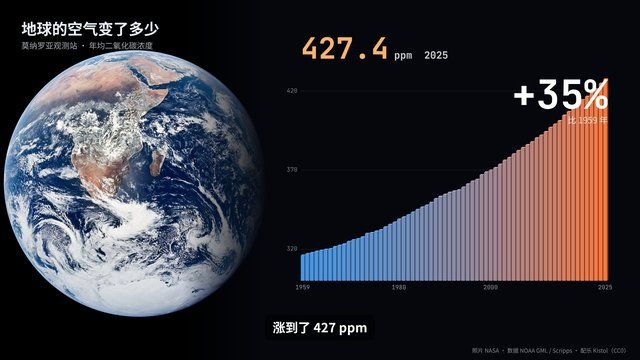

```text
用「数据实体化」做法：一张真实照片先铺满画面慢慢推近，再退到一侧让出空间；另一侧把真实数据表的每一行变成一根立体方柱（正面、顶面、侧面三种明度），按时间顺序一根根落下长高，颜色随数值从冷变暖，大号等宽数字跟着当前那根计数，旁白说到关键数字时正好长到那里，结尾打出变化幅度，角落小字写清照片和数据的出处。
```

- 内容类型：知识科普讲解
- 素材：照片 · 数据
- 技术类型：数据可视化 · 照片运镜
- 适合：科普、气候和环境、长期趋势
- 技术（已验证）：Canvas 2D · Playwright · ffmpeg
- 样片代码：[samples/T-001/](https://github.com/Chans-gh/AI-Coding-Video/tree/main/samples/T-001)
- 技术（建议）：Canvas 2D · Playwright · ffmpeg
- 参考：[Lemo 说明](https://github.com/lemomo-ai/lemo-opuscar/blob/main/styles/data-physical/STYLE.md)

<a id="T-002"></a>

## T-002 口播剪辑 + 花字

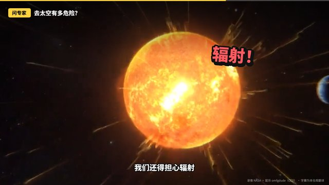

```text
用「口播剪辑 + 花字」：把一段访谈或口播的原片按句子剪成几段跳切，每换一句交替推近和拉回景别，像两台机位来回切，切点闪一帧白；每句挑一个关键词做成弹出的超粗大字（黑色粗描边、轻微倾斜和晃动、颜色一句一换），底部是逐句的描边字幕，顶部一条标题牌和进度条。原声为主，配乐压得很低。
```

- 内容类型：口播 / 数字人
- 素材：录像
- 技术类型：剪辑与字幕
- 适合：知识口播、访谈切片、短视频带观点
- 技术（已验证）：Canvas 2D · Playwright · ffmpeg
- 样片代码：[samples/T-002/](https://github.com/Chans-gh/AI-Coding-Video/tree/main/samples/T-002)
- 技术（建议）：Canvas 2D · Playwright · ffmpeg
- 参考：[原帖 @sab8a](https://x.com/sab8a/status/2103144778481475686)

<a id="T-003"></a>

## T-003 复古产品广告

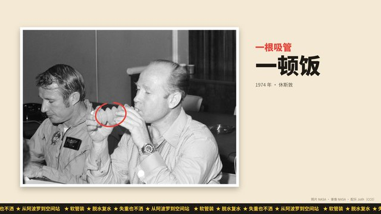

```text
用复古印刷广告的版式做带货短片：米色纸底，产品的老照片加白边和投影贴在版面上缓慢推镜，手绘感的红圈圈住产品，引线拉出黄底黑字的圆角卖点贴纸并弹出；旁边是一大一小两行卖点文案，接一段「今天还这么用」的录像，最后是圆形裁切的产品卡和锯齿星形「上新」标，底部跑马灯滚卖点。
```

- 内容类型：产品广告和带货
- 素材：照片 · 录像
- 技术类型：照片运镜 · 剪辑与字幕
- 适合：产品介绍、老物件新卖点、品牌历史
- 技术（已验证）：Canvas 2D · Playwright · ffmpeg
- 样片代码：[samples/T-003/](https://github.com/Chans-gh/AI-Coding-Video/tree/main/samples/T-003)
- 技术（建议）：Canvas 2D · Playwright · ffmpeg
- 参考：—

<a id="T-004"></a>

## T-004 倒计时分屏

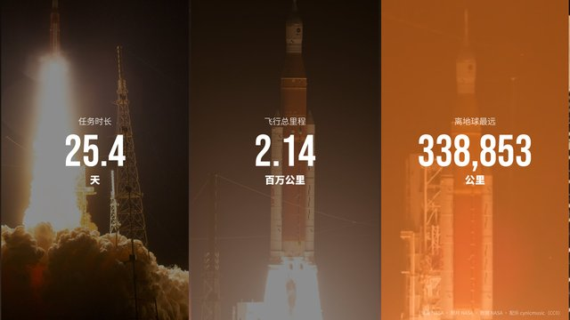

```text
用「倒计时分屏」：画面从中间劈开，一边是事件现场的录像，一边是照片上压着几乎占满半屏的倒计时数字，每过一秒数字放大一下再换；归零时打出大号英文口号，录像铺满全屏；接着画面分成三格依次滚进来，每格一个关键数字从 0 数到真值；最后一张照片压暗，落两行口号和日期。
```

- 内容类型：品牌宣传片
- 素材：录像 · 照片 · 数据
- 技术类型：剪辑与字幕 · 数据可视化
- 适合：发布会、发射和开幕、品牌节点
- 技术（已验证）：Canvas 2D · Playwright · ffmpeg
- 样片代码：[samples/T-004/](https://github.com/Chans-gh/AI-Coding-Video/tree/main/samples/T-004)
- 技术（建议）：Canvas 2D · Playwright · ffmpeg
- 参考：[Lemo 说明](https://github.com/lemomo-ai/lemo-opuscar/blob/main/styles/countdown/STYLE.md)

<a id="T-005"></a>

## T-005 默片字幕卡重剪


```text
用默片字幕卡重剪老电影讲一个小故事：镜头之间插入深底双线花边的中文字幕卡，衬线大字，一张卡只说一句；影片段落可以加速或放慢，统一加棕褐色调、每帧亮度轻微闪烁、片门上下晃一两个像素、随机划痕灰尘和暗角，竖屏时影片放中间、上下黑边写第几幕；配乐用钢琴，加放映机的咔哒声。
```

- 内容类型：短剧 / 动漫剧 / 故事
- 素材：录像
- 技术类型：剪辑与字幕
- 适合：老电影新讲、短故事、历史趣闻
- 技术（已验证）：Canvas 2D · Playwright · ffmpeg
- 样片代码：[samples/T-005/](https://github.com/Chans-gh/AI-Coding-Video/tree/main/samples/T-005)
- 技术（建议）：Canvas 2D · Playwright · ffmpeg
- 参考：—

<a id="T-006"></a>

## T-006 轨道 MV

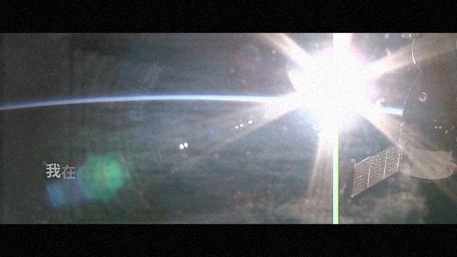

```text
用电影感音乐 MV 的剪法：两三段风景录像和一张照片按节拍切换，切点闪一帧暖白、叠一层缓慢移动的橙色漏光，横屏加 2.39:1 遮幅；歌词左下对齐（竖屏居中），一字一字从下往上浮出，主句粗、副句细，句尾慢慢淡掉；结尾在照片上落中英文片名，全片加细颗粒。
```

- 内容类型：音乐 MV
- 素材：录像 · 照片
- 技术类型：节拍对齐剪辑 · 剪辑与字幕
- 适合：歌曲、氛围短片、旅行和风景剪辑
- 技术（已验证）：Canvas 2D · Playwright · ffmpeg
- 样片代码：[samples/T-006/](https://github.com/Chans-gh/AI-Coding-Video/tree/main/samples/T-006)
- 技术（建议）：Canvas 2D · Playwright · ffmpeg
- 参考：—

<a id="T-007"></a>

## T-007 卫星地图简报

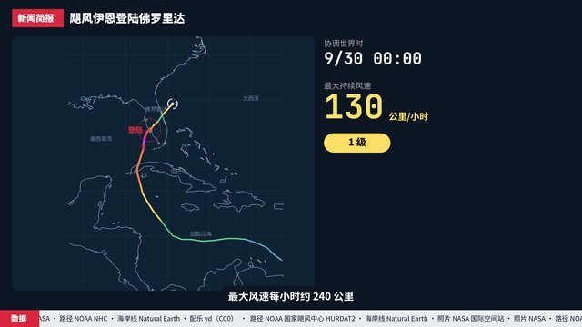

```text
用「卫星地图简报」：深蓝底上用真实海岸线数据画出底图和经纬网，事件的真实轨迹数据一点点画出来，线宽和颜色随强度变化，当前点画成旋转的符号、关键地点有脉冲圈；旁边的读数卡跟着轨迹刷新时间、数值和等级标签，后半段换成卫星或现场照片滑进来；外框是新闻台式的红色标签、标题条、出处跑马灯和跟旁白走的字幕。
```

- 内容类型：新闻资讯解说
- 素材：照片 · 数据
- 技术类型：数据可视化
- 适合：灾害和天气新闻、航线和迁徙、事件复盘
- 技术（已验证）：Canvas 2D · Playwright · ffmpeg
- 样片代码：[samples/T-007/](https://github.com/Chans-gh/AI-Coding-Video/tree/main/samples/T-007)
- 风格包：[packs/news-brief/](https://github.com/Chans-gh/AI-Coding-Video/tree/main/packs/news-brief)
- 技术（建议）：Canvas 2D · Playwright · ffmpeg
- 参考：[Lemo 说明](https://github.com/lemomo-ai/lemo-opuscar/blob/main/styles/satellite-briefing/STYLE.md)

<a id="T-008"></a>

## T-008 档案灯箱

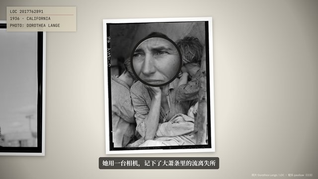

```text
用「档案灯箱」：几张历史底片或照片加白边，略微歪斜地摆在中间亮、四周暗的乳白色灯箱上，镜头在它们之间平移；每张停下时一枚黑框放大镜慢慢滑到细节上，镜片里是放大两倍的画面；左上角一张档案卡用打字机效果打出馆藏编号、年份和摄影者，底部衬线字幕跟着旁白。
```

- 内容类型：纪录片和纪实
- 素材：照片
- 技术类型：批注与前后对比 · 照片运镜
- 适合：历史纪录、人物和档案、博物馆藏品
- 技术（已验证）：Canvas 2D · Playwright · ffmpeg
- 样片代码：[samples/T-008/](https://github.com/Chans-gh/AI-Coding-Video/tree/main/samples/T-008)
- 技术（建议）：Canvas 2D · Playwright · ffmpeg
- 参考：[Lemo 说明](https://github.com/lemomo-ai/lemo-opuscar/blob/main/styles/archive-lighttable/STYLE.md)

<a id="T-009"></a>

## T-009 活体录屏

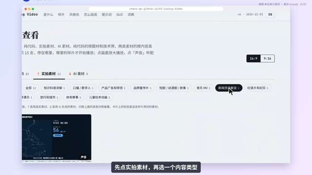

```text
用「活体录屏」：真实操作的录屏放在圆角窗口里，镜头跟着鼠标自动推近到正在操作的区域、操作完再拉回全景；鼠标指针由代码按记录的坐标重画，点击时有涟漪，每一步在角落标出步骤号和一句说明；旁白讲当前步骤，字幕跟着走，背景是柔和的渐变。
```

- 内容类型：教程和录屏演示
- 素材：录屏
- 技术类型：录屏增强
- 适合：软件教程、产品演示、操作说明
- 技术（已验证）：Canvas 2D · Playwright · ffmpeg
- 样片代码：[samples/T-009/](https://github.com/Chans-gh/AI-Coding-Video/tree/main/samples/T-009)
- 技术（建议）：Canvas 2D · Playwright · ffmpeg
- 参考：[Lemo 说明](https://github.com/lemomo-ai/lemo-opuscar/blob/main/styles/living-screencast/STYLE.md)

<a id="T-010"></a>

## T-010 延时城市交响

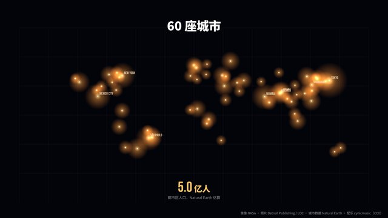

```text
用「延时城市交响」：开场是夜间城市灯火的延时录像，加速播放并叠一层光晕；一道暖色光带扫过后切到一张城市的老照片，棕褐色调加慢推；再一道光带扫过，切到黑底的世界地图，按真实的城市数据从大到小一颗颗点亮光点，亮度和大小跟人口走，最大的几座标上英文名，底部数出合计人口。
```

- 内容类型：旅行和城市
- 素材：录像 · 照片 · 数据
- 技术类型：数据可视化 · 剪辑与字幕
- 适合：城市、旅行目的地、人口和发展
- 技术（已验证）：Canvas 2D · Playwright · ffmpeg
- 样片代码：[samples/T-010/](https://github.com/Chans-gh/AI-Coding-Video/tree/main/samples/T-010)
- 技术（建议）：Canvas 2D · Playwright · ffmpeg
- 参考：[Lemo 说明](https://github.com/lemomo-ai/lemo-opuscar/blob/main/styles/city-symphony/STYLE.md)

<a id="T-011"></a>

## T-011 体育战术板

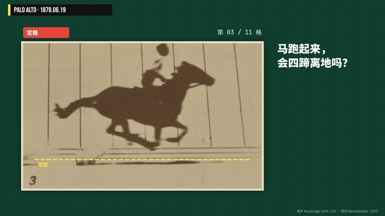

```text
用「体育战术板」：深绿网格底板上，把连拍照片的每一格切出来当动画播，像转播里的回放——先正常速度，再标「慢动作」放慢，最后「定格」在关键一格；定格后用黄色白板笔画出虚线地面、圈住要看的部位、画箭头，旁边的解说板先抛问题再给答案和几个数字；结尾把所有格排成一条胶片，关键格加黄框。
```

- 内容类型：体育赛事
- 素材：照片
- 技术类型：批注与前后对比
- 适合：体育动作分析、比赛复盘、运动科普
- 技术（已验证）：Canvas 2D · Playwright · ffmpeg
- 样片代码：[samples/T-011/](https://github.com/Chans-gh/AI-Coding-Video/tree/main/samples/T-011)
- 技术（建议）：Canvas 2D · Playwright · ffmpeg
- 参考：[Lemo 说明](https://github.com/lemomo-ai/lemo-opuscar/blob/main/styles/telestrator/STYLE.md)

<a id="T-012"></a>

## T-012 绘本翻页

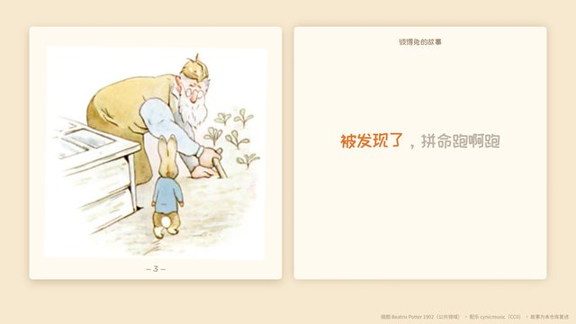

```text
用儿童绘本的翻页做法：奶油色纸底上摊开一本书，左页放插图、右页放一行童趣字体的大字（竖屏上图下字）；插图轻轻呼吸、左右摇摆，像纸偶；翻页时书页绕中线横向翻转一次；文字跟着旁白一字一字从浅灰变成橘色并轻轻跳动，页脚写页码。
```

- 内容类型：儿童绘本动画
- 素材：照片
- 技术类型：照片运镜
- 适合：儿童故事、睡前故事、亲子科普
- 技术（已验证）：Canvas 2D · Playwright · ffmpeg
- 样片代码：[samples/T-012/](https://github.com/Chans-gh/AI-Coding-Video/tree/main/samples/T-012)
- 技术（建议）：Canvas 2D · Playwright · ffmpeg
- 参考：—

<a id="T-013"></a>

## T-013 发射多机位同步

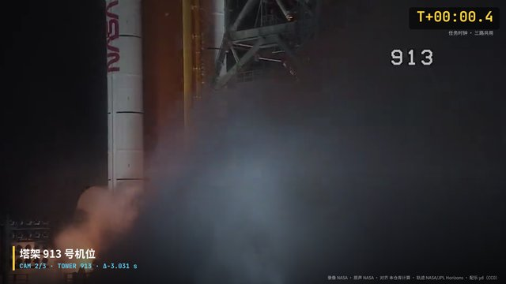

```text
用「发射多机位同步」：同一次发射的几路机位录像各自从不同时刻开始，先用各路的现场声音做互相关，算出每路差几秒，把它们放到同一条时间线上（片头把几条声波对齐的过程画出来，标出算得的偏移）；然后按统一的倒计时切换机位：近景点火、塔架冲出火焰、远景升空，右上角一直是同一个任务时钟；最后换到跟踪镜头，叠上飞船的真实飞行轨迹（地月之间的路线、距地距离和速度读数随轨迹走），时间压缩着播完整个任务。
```

- 内容类型：纪录片和纪实
- 素材：录像 · 数据
- 技术类型：多机位同步 · 传感器与轨迹叠加
- 适合：发射和赛事的多机位回放、纪录片的重大时刻、带数据的活动回顾
- 技术（已验证）：Canvas 2D · Playwright · ffmpeg
- 样片代码：[samples/T-013/](https://github.com/Chans-gh/AI-Coding-Video/tree/main/samples/T-013)
- 技术（建议）：Canvas 2D · Playwright · ffmpeg
- 参考：[NASA 影像库：Artemis I Isolated Launch Views](https://images.nasa.gov/details/KSC-20221116-MH-AJN01-0001-Artemis_I_Isolated_Launch_Views-3314595) · [JPL Horizons](https://ssd.jpl.nasa.gov/horizons/)

<a id="T-014"></a>

## T-014 讲义转片

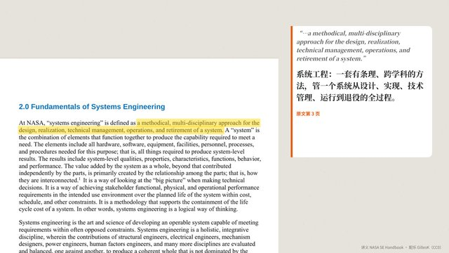

```text
用「讲义转片」：把一份公开手册的几页做成培训短片——页面像纸一样放在浅灰工作台上，代码读这一页的文字层，找到要讲的那句话在页面上的位置，荧光笔从左到右划过去，镜头推近；接着把这句话抽出来做成大号引文卡（原文加中文译文，注明页码）；图示页按讲解顺序逐块圈出、编号，旁边配一行中文要点；结尾三条要点和出处。
```

- 内容类型：企业培训和课件
- 素材：照片 · 数据
- 技术类型：文稿转片
- 适合：新人培训、制度和手册解读、论文和报告速读
- 技术（已验证）：Canvas 2D · Playwright · ffmpeg
- 样片代码：[samples/T-014/](https://github.com/Chans-gh/AI-Coding-Video/tree/main/samples/T-014)
- 技术（建议）：Canvas 2D · Playwright · ffmpeg
- 参考：[NASA Systems Engineering Handbook Rev 2（NTRS）](https://ntrs.nasa.gov/citations/20170001761)

<a id="T-015"></a>

## T-015 年度数据回顾

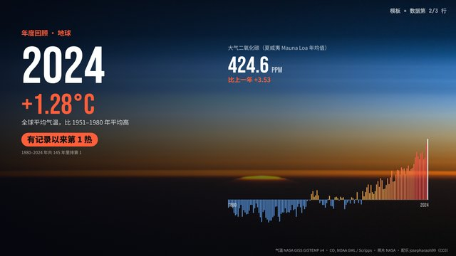

```text
用「年度数据回顾」：一套模板加一张数据表，每一行出一条「年度回顾」短片——太空中的地平线照片做底，大号年份翻牌，全球气温距平的数字滚动到位、写出「有记录以来第几热」，下面一条 1880 年以来的柱状图把这一年点亮，旁边是这一年的二氧化碳浓度；换一行数据就是另一条。样片里依次播三条，最后把三条排成一排，标出「同一模板，3 行数据」。
```

- 内容类型：年度回顾和数据总结
- 素材：数据 · 照片
- 技术类型：模板化批量生成 · 数据可视化
- 适合：年度报告、年终总结、按城市或门店批量出片
- 技术（已验证）：Canvas 2D · Playwright · ffmpeg
- 样片代码：[samples/T-015/](https://github.com/Chans-gh/AI-Coding-Video/tree/main/samples/T-015)
- 技术（建议）：Canvas 2D · Playwright · ffmpeg
- 参考：[NASA GISS GISTEMP](https://data.giss.nasa.gov/gistemp/) · [NOAA Mauna Loa CO₂](https://gml.noaa.gov/ccgg/trends/data.html)

<a id="T-016"></a>

## T-016 访谈金句竖屏

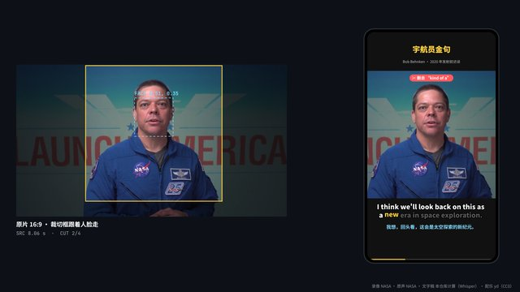

```text
用「访谈金句竖屏」：一段一分钟左右的横屏访谈，先做语音转文字拿到逐词时间，再给每句打分（金句词、长度合适、口头禅少），挑出最好的三句；句子里的「嗯」「你知道」「有点像」和句首的「所以」按词的时间段删掉，剩下的词连成剪辑表。画面先过一遍文字稿：选中的句子高亮、删掉的词划红线；再出竖屏成片——人脸检测的轨迹带着 9:16 裁切框跟着人走，每个跳剪处交替放大一点遮住接缝，逐词弹出的大字幕下面配一行中文翻译，最后一张金句卡收尾。
```

- 内容类型：播客和访谈可视化
- 素材：录像 · 数据
- 技术类型：文字稿剪辑 · 高光切片 · 自动改画幅
- 适合：播客切片、访谈短视频、发布会金句、课程精华
- 技术（已验证）：Canvas 2D · Playwright · ffmpeg
- 样片代码：[samples/T-016/](https://github.com/Chans-gh/AI-Coding-Video/tree/main/samples/T-016)
- 技术（建议）：Canvas 2D · Playwright · ffmpeg
- 参考：[faster-whisper](https://github.com/SYSTRAN/faster-whisper) · [MediaPipe 人脸检测](https://ai.google.dev/edge/mediapipe/solutions/vision/face_detector) · [NASA 影像库](https://images.nasa.gov/)

<a id="T-017"></a>

## T-017 体操骨骼示范

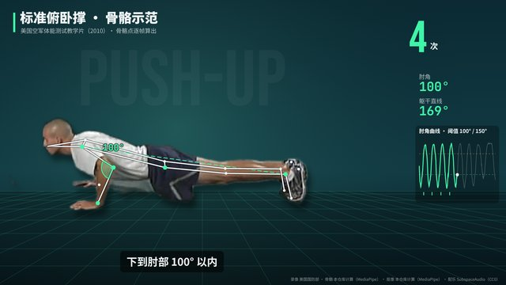

```text
用「体操骨骼示范」：一段老的体能训练示范片，逐帧跑人体姿态估计，拿到骨骼点和人像分割遮罩；画面里有两个人时取身体最横的那个（做俯卧撑的人）。人像按遮罩抠出来放进代码画的训练室，叠上骨骼线、肘部角度弧、按「肩—髋—踝」直不直变色的躯干线；肘角先低于 100° 再回到 150° 以上记一次，计数牌跟着跳，下方一条肘角曲线画出两条阈值线，动作走样时弹出纠正提示，结尾给出次数和平均幅度的小结。
```

- 内容类型：健康和运动指导
- 素材：录像 · 数据
- 技术类型：追踪与姿态叠加 · 抠像合成
- 适合：健身教学、动作纠正、体育课件、康复训练示范
- 技术（已验证）：Canvas 2D · Playwright · ffmpeg
- 样片代码：[samples/T-017/](https://github.com/Chans-gh/AI-Coding-Video/tree/main/samples/T-017)
- 技术（建议）：Canvas 2D · Playwright · ffmpeg
- 参考：[MediaPipe Pose Landmarker](https://ai.google.dev/edge/mediapipe/solutions/vision/pose_landmarker) · [Internet Archive：DoD 影片](https://archive.org/details/gov.dod.dimoc.614892)

<a id="T-018"></a>

## T-018 照片深景推镜

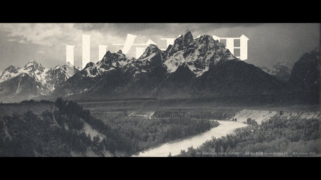

```text
用「照片深景推镜」：一张老的风景照，先用单目深度估计出一张深度图（白近黑远），片元着色器按每个像素的深度反推它在镜头移动后该在的位置——近处挪得多、远处挪得少，迭代几次补上遮挡——一张静照就有了推近加环绕的立体运镜。品牌标题放在天空和山峰之间那一层，从山后升起、被山尖挡住；中段一道扫光把画面换成深度图，让人看到照片被拆成了远近层；结尾回拉，压暗出虚构户外品牌的落版。横屏加 2.39 电影遮幅。
```

- 内容类型：品牌宣传片
- 素材：照片 · 数据
- 技术类型：分层视差与投影
- 适合：品牌片开场、文旅宣传、老照片纪录片、相册回忆
- 技术（已验证）：WebGL2 · GLSL · Canvas 2D · Playwright · ffmpeg
- 样片代码：[samples/T-018/](https://github.com/Chans-gh/AI-Coding-Video/tree/main/samples/T-018)
- 技术（建议）：WebGL2 · GLSL · Canvas 2D · Playwright · ffmpeg
- 参考：[Depth Anything V2](https://github.com/DepthAnything/Depth-Anything-V2) · [美国国家档案馆 Ansel Adams 照片](https://catalog.archives.gov/id/519904)

<a id="T-019"></a>

## T-019 营养成分对比

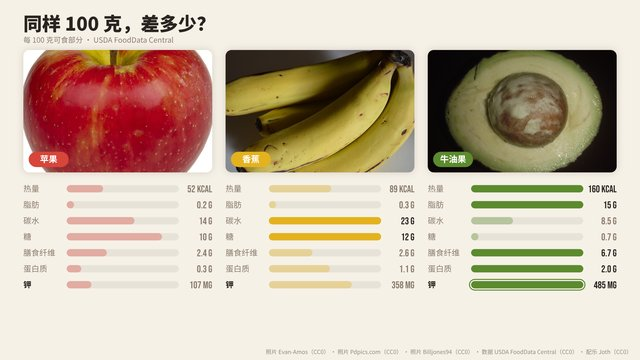

```text
用「营养成分对比」：三张公共领域、CC0 的食物照片（苹果、香蕉、牛油果）各占一栏，缓慢推近；下面套同一套条形图，数据取自美国农业部 FoodData Central 的每 100 克营养成分——热量、脂肪、碳水、膳食纤维、蛋白质、钾逐项长出来，每一项最高的那栏亮起；最后一项写出一句结论，角落注明数据来源。
```

- 内容类型：美食
- 素材：照片 · 数据
- 技术类型：数据可视化 · 照片运镜
- 适合：营养科普、菜单和食材对比、健康饮食账号
- 技术（已验证）：Canvas 2D · Playwright · ffmpeg
- 样片代码：[samples/T-019/](https://github.com/Chans-gh/AI-Coding-Video/tree/main/samples/T-019)
- 技术（建议）：Canvas 2D · Playwright · ffmpeg
- 参考：[USDA FoodData Central](https://fdc.nal.usda.gov/)

<a id="T-020"></a>

## T-020 对局复盘

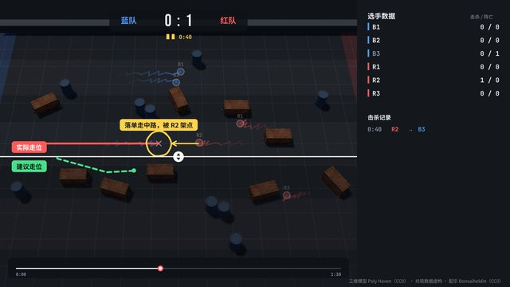

```text
用「对局复盘」：用 CC0 三维模型（木箱、油桶）在 Three.js 里搭一块俯视的竞技场，按一份虚构的对局数据表回放两队六名选手的走位，身后拖着轨迹；击杀发生时标出位置、时间线上落下一个点、数据面板的击杀和伤害跳动；关键一刻暂停，像解说用的战术板一样画圈、画箭头，再把「实际走位」和「建议走位」左右对比。
```

- 内容类型：游戏和电竞
- 素材：三维模型 · 数据
- 技术类型：数据可视化 · 批注与前后对比
- 适合：电竞复盘、战术教学、比赛数据解说
- 技术（已验证）：Three.js · WebGL · Canvas 2D · Playwright · ffmpeg
- 样片代码：[samples/T-020/](https://github.com/Chans-gh/AI-Coding-Video/tree/main/samples/T-020)
- 技术（建议）：Three.js · WebGL · Canvas 2D · Playwright · ffmpeg
- 参考：[Poly Haven](https://polyhaven.com)
