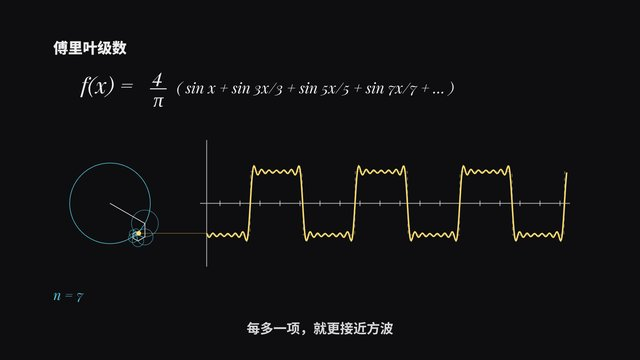
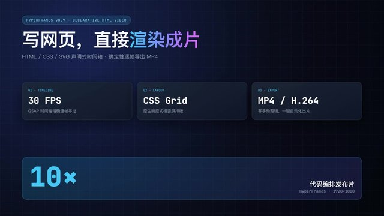
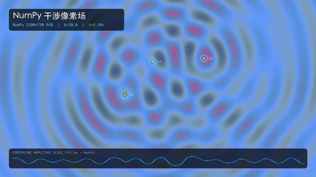
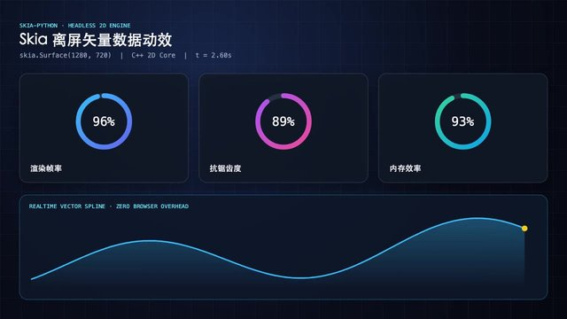
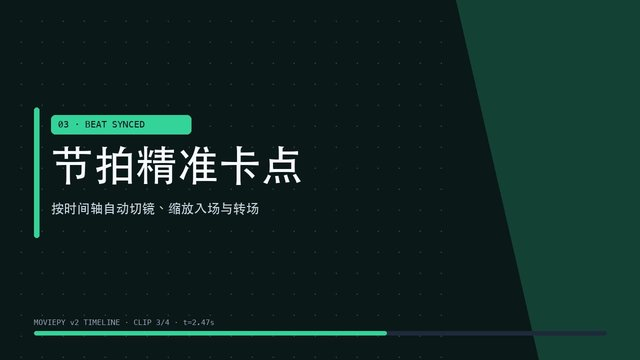
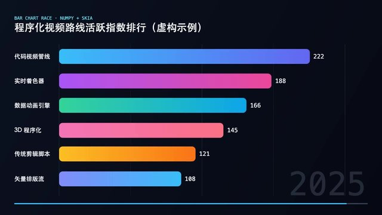
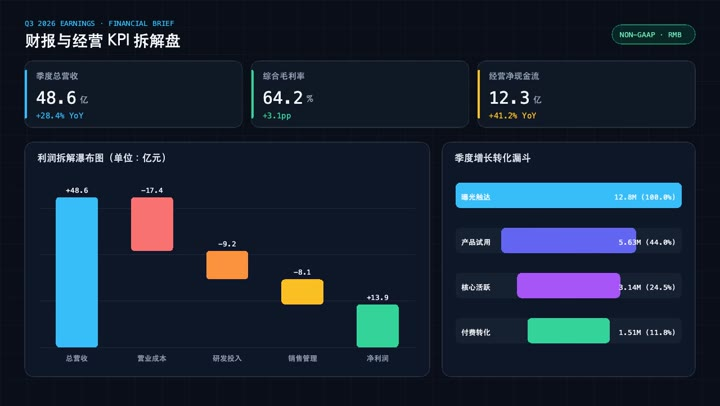
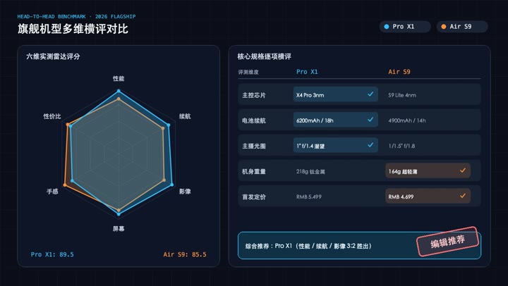

# 整套视频框架（13 种）

[← 选风格索引](../index.md) · [提示词方法](../prompting.md) · [技术标签](../tags.md)

用一整套视频框架直接出片：Manim 做数学动画，Remotion / HyperFrames 用网页组件写视频。

每个条目依次是：样片缩略图（已渲染的才有）、一句可直接复制的风格提示词、题材、适合讲什么、技术标签、参考链接。「技术（已验证）」表示仓库里有真能跑出这段样片的代码；「技术（建议）」是推荐写法，还没有样片验证。

<a id="C-041"></a>

## C-041 公式推导讲解（Manim）



```text
用 Manim 数学讲解风格：深色背景，公式用 LaTeX 渲染并逐项变形、对应项用同一颜色高亮，坐标系和曲线边讲边画出，用动点演示变化，底部字幕和旁白用同一条时间轴。
```

- 题材：信息讲解与产品发布
- 适合：数学、AI 原理
- 技术（已验证）：Canvas 2D · Playwright · ffmpeg
- 样片代码：[samples/C-041/](https://github.com/Chans-gh/AI-Coding-Video/tree/main/samples/C-041)
- 技术（建议）：Manim
- 参考：[@dotey](https://x.com/dotey/status/2103683057689522564) · [@ng169onX](https://x.com/ng169onX/status/2103183904563998809)

<a id="C-044"></a>

## C-044 暗色科技发布会


```text
用暗色科技发布会风格：近黑渐变底加发丝细网格和柔光，只有一个品牌强调色，圆角窗口和通知卡片按网格吸附、每个元素落在音符上，一道扫光揭示产品，最后用一个巨大数字说出核心价值。
```

- 题材：信息讲解与产品发布
- 适合：软件发布
- 技术（已验证）：Canvas 2D · Playwright · ffmpeg
- 样片代码：[samples/C-044/](https://github.com/Chans-gh/AI-Coding-Video/tree/main/samples/C-044)
- 风格包：[packs/dark-keynote/](https://github.com/Chans-gh/AI-Coding-Video/tree/main/packs/dark-keynote)
- 技术（建议）：Remotion · HyperFrames · GSAP
- 参考：[Lemo 说明](https://github.com/lemomo-ai/lemo-opuscar/blob/main/styles/dark-keynote/STYLE.md) · [@rexan_wong](https://x.com/rexan_wong/status/2103707054108299437)

<a id="C-198"></a>

## C-198 HyperFrames 编排发布片



```text
用「HyperFrames 编排发布片」风格：直接写声明式 HTML/CSS/SVG 合成页并用 HyperFrames CLI 渲染成 MP4，暗色渐变与细网格底上由 GSAP 时间轴编排大标题入场、斜向扫光掠过、三张关键指标卡片依次弹入，最后拉出巨型核心数字收尾，横竖屏自适应排版，配科技发布会节奏电子音。
```

- 题材：信息讲解与产品发布
- 适合：软件与 AI 产品发布、特性速览、数据亮点宣发、自动化模板视频
- 技术（已验证）：HyperFrames · HTML/CSS · SVG · GSAP · ffmpeg
- 样片代码：[samples/C-198/](https://github.com/Chans-gh/AI-Coding-Video/tree/main/samples/C-198)
- 技术（建议）：HyperFrames · HTML/CSS · SVG · GSAP · ffmpeg
- 参考：[HyperFrames](https://github.com/heygen-com/hyperframes)

<a id="C-199"></a>

## C-199 Manim 数学几何证明


```text
用「Manim 数学几何证明」风格：使用 Manim Community Edition 在深蓝黑底上精确绘制单位圆与坐标系，金色半径向量匀速旋转，青色垂线与水平虚线实时把圆周动点投影到右侧正弦曲线上同步描出完整周期，底部实时刷新角度与正弦值读数，横竖屏独立构图，配清澈电子琶音与铃声。
```

- 题材：信息讲解与产品发布
- 适合：数学与物理教学、算法原理可视化、科普动画、学术演示
- 技术（已验证）：Manim · Manim CE · ffmpeg
- 样片代码：[samples/C-199/](https://github.com/Chans-gh/AI-Coding-Video/tree/main/samples/C-199)
- 技术（建议）：Manim · Manim CE · ffmpeg
- 参考：[Manim Community](https://www.manim.community/)

<a id="C-200"></a>

## C-200 播客金句与频谱卡



```text
用「播客金句与频谱卡」风格：纯 Python 无浏览器管线，NumPy 对真实音频逐帧做 FFT 频谱分析驱动底部渐变声波柱状图，Pillow 绘制暗色播客节目卡片、讲者角标、逐字高亮金句字幕与播放进度条，直接通过管道交给 ffmpeg 编码成片。
```

- 题材：信息讲解与产品发布
- 适合：播客切片、有声书与金句短视频、口播观点提炼、批量音频可视化
- 技术（已验证）：NumPy · Pillow · ffmpeg
- 样片代码：[samples/C-200/](https://github.com/Chans-gh/AI-Coding-Video/tree/main/samples/C-200)
- 技术（建议）：NumPy · Pillow · ffmpeg
- 参考：[NumPy](https://numpy.org/) · [Pillow](https://pillow.readthedocs.io/)

<a id="C-201"></a>

## C-201 Skia 离屏矢量动效



```text
用「Skia 离屏矢量动效」风格：使用 skia-python 在内存离屏画布（skia.Surface）直接以 C++ 2D 引擎绘制深色径向渐变背景、带柔和阴影的圆角数据卡片、线性渐变抗锯齿环形进度条与底部实时发光曲线图，不启动浏览器直接管道输出 MP4，配清爽科技电子音。
```

- 题材：信息讲解与产品发布
- 适合：服务端千人千面年度报告、数据仪表盘短视频、高并发自动化品牌动效
- 技术（已验证）：Skia · ffmpeg
- 样片代码：[samples/C-201/](https://github.com/Chans-gh/AI-Coding-Video/tree/main/samples/C-201)
- 技术（建议）：Skia · ffmpeg
- 参考：[Skia](https://skia.org/) · [skia-python](https://kyamagu.github.io/skia-python/)

<a id="C-202"></a>

## C-202 MoviePy 卡点字卡片头



```text
用「MoviePy 卡点字卡片头」风格：用 Pillow 批量绘制四张高对比度大字报卡点字卡与几何色块斜边，交由 MoviePy v2 编排按节拍切镜、缓动弹入、轻微推镜与底部全局进度条，并锁定合成电子鼓点时间轴直接导出 MP4。
```

- 题材：平面设计与动态排版
- 适合：自动化短视频矩阵、社媒卡点片头、电商/营销批量模板出片
- 技术（已验证）：MoviePy · Pillow · NumPy · ffmpeg
- 样片代码：[samples/C-202/](https://github.com/Chans-gh/AI-Coding-Video/tree/main/samples/C-202)
- 技术（建议）：MoviePy · Pillow · NumPy · ffmpeg
- 参考：[MoviePy](https://zulko.github.io/moviepy/)

<a id="C-203"></a>

## C-203 动态数据排行竞速



```text
用「动态数据排行竞速」风格：NumPy 对历年数据表做平滑插值与指数阻尼排名换位，Skia 离屏绘制圆角线性渐变条形图、平滑反超动画、动态跳动数值与右下角大号年份水印，零浏览器直接管道输出 MP4。
```

- 题材：信息讲解与产品发布
- 适合：财经与宏观数据科普、行业份额演变、年度榜单与数据排行短视频
- 技术（已验证）：NumPy · Skia · ffmpeg
- 样片代码：[samples/C-203/](https://github.com/Chans-gh/AI-Coding-Video/tree/main/samples/C-203)
- 技术（建议）：NumPy · Skia · ffmpeg
- 参考：[Skia](https://skia.org/) · [NumPy](https://numpy.org/)

<a id="C-204"></a>

## C-204 金融 K 线行情复盘


```text
用「金融 K 线行情复盘」风格：NumPy 计算 OHLC 行情与 MA5/MA12 均线序列，Skia 离屏绘制暗色交易终端界面、逐根生长的红绿 K 线与成交量柱、双色均线走势、顶部实时涨跌幅条与关键突破买点标注气泡，零浏览器自动出片。
```

- 题材：信息讲解与产品发布
- 适合：每日大盘与个股复盘、财报与量化策略回测展示、财经资讯短视频
- 技术（已验证）：NumPy · Skia · ffmpeg
- 样片代码：[samples/C-204/](https://github.com/Chans-gh/AI-Coding-Video/tree/main/samples/C-204)
- 技术（建议）：NumPy · Skia · ffmpeg
- 参考：[Skia](https://skia.org/) · [NumPy](https://numpy.org/)

<a id="C-205"></a>

## C-205 千人千面年度报告


```text
用「千人千面年度报告」风格：Skia 离屏绘制极光径向渐变底色、三张核心指标滚动计数卡片、52 周打卡热力图按周波浪点亮以及底部年度勋章汇总，一套脚本对接用户数据即可在服务端批量生成 Wrapped 风格专属视频。
```

- 题材：信息讲解与产品发布
- 适合：App 与 SaaS 年度账单、学习与运动打卡年报、B2B 客户季度复盘
- 技术（已验证）：Skia · ffmpeg
- 样片代码：[samples/C-205/](https://github.com/Chans-gh/AI-Coding-Video/tree/main/samples/C-205)
- 技术（建议）：Skia · ffmpeg
- 参考：[Skia](https://skia.org/) · [skia-python](https://kyamagu.github.io/skia-python/)

<a id="C-206"></a>

## C-206 电商卖点与价签参数卡


```text
用「电商卖点与价签参数卡」风格：Pillow 按统一品牌视觉规范绘制新品卖点三连卡、新旧款参数对比表与划线原价直降爆炸价签，由 MoviePy v2 编排三段明快带货切镜并锁定鼓点时间轴直接导出 MP4。
```

- 题材：信息讲解与产品发布
- 适合：电商主图视频、SKU 批量上新、矩阵带货短视频与参数对比测评
- 技术（已验证）：MoviePy · Pillow · NumPy · ffmpeg
- 样片代码：[samples/C-206/](https://github.com/Chans-gh/AI-Coding-Video/tree/main/samples/C-206)
- 技术（建议）：MoviePy · Pillow · NumPy · ffmpeg
- 参考：[MoviePy](https://zulko.github.io/moviepy/) · [Pillow](https://pillow.readthedocs.io/)

<a id="C-210"></a>

## C-210 财报与经营 KPI 拆解盘



```text
用「财报与经营 KPI 拆解盘」风格：NumPy 计算季度经营指标与利润桥梁数据，Skia 离屏绘制暗色商讯网格面板——上方三张核心 KPI 翻牌滚动计数卡片（总营收、毛利率、经营现金流），下方配营收至净利润的五柱拆解瀑布图与四级增长转化漏斗，零浏览器直接渲染 MP4。
```

- 题材：信息讲解与产品发布
- 适合：上市公司财报速览、商业财经解读、季度经营复盘与运营周报视频化
- 技术（已验证）：Skia · NumPy · ffmpeg
- 样片代码：[samples/C-210/](https://github.com/Chans-gh/AI-Coding-Video/tree/main/samples/C-210)
- 技术（建议）：Skia · NumPy · ffmpeg
- 参考：[Skia](https://skia.org/) · [skia-python](https://kyamagu.github.io/skia-python/)

<a id="C-211"></a>

## C-211 产品多维横评对比卡



```text
用「产品多维横评对比卡」风格：NumPy 计算六维雷达图几何顶点与综合得分，Skia 离屏绘制双机半透明雷达多边形叠加展开、五项核心规格参数逐行亮起并标出胜出项高亮与矢量对勾，结尾弹出综合推荐结论条并重重盖下倾斜「编辑推荐」印章，配低音重击音效。
```

- 题材：信息讲解与产品发布
- 适合：数码与消费品横评测评、好物导购对比、竞品方案多维打分短视频
- 技术（已验证）：Skia · NumPy · ffmpeg
- 样片代码：[samples/C-211/](https://github.com/Chans-gh/AI-Coding-Video/tree/main/samples/C-211)
- 技术（建议）：Skia · NumPy · ffmpeg
- 参考：[Skia](https://skia.org/) · [skia-python](https://kyamagu.github.io/skia-python/)
