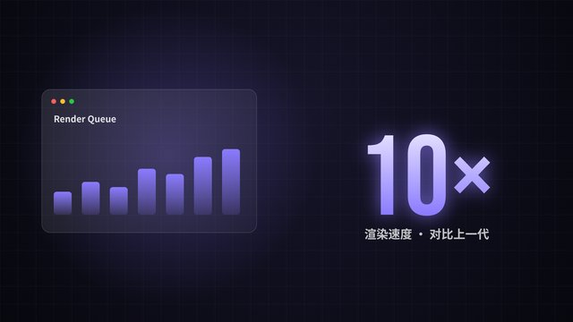
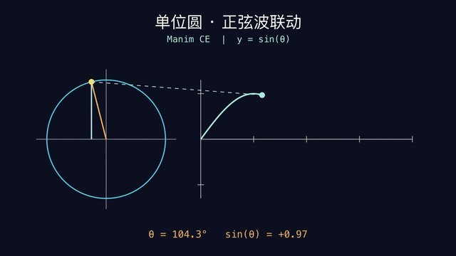

# 整套视频框架（4 种）

[← 选风格索引](../index.md) · [提示词方法](../prompting.md) · [技术标签](../tags.md)

用一整套视频框架直接出片：Manim 做数学动画，Remotion / HyperFrames 用网页组件写视频。

每个条目依次是：样片缩略图（已渲染的才有）、一句可直接复制的风格提示词、题材、适合讲什么、技术标签、参考链接。「技术（已验证）」表示仓库里有真能跑出这段样片的代码；「技术（建议）」是推荐写法，还没有样片验证。

<a id="C-041"></a>

## C-041 公式推导讲解（Manim）


```text
用 Manim 数学讲解风格：深色背景，公式用 LaTeX 渲染并逐项变形、对应项用同一颜色高亮，坐标系和曲线边讲边画出，用动点演示变化，底部字幕和旁白用同一条时间轴。
```

- 题材：信息讲解与产品发布
- 适合：数学、AI 原理
- 技术（已验证）：Canvas 2D · Playwright · ffmpeg
- 样片代码：[samples/C-041/](https://github.com/Chans-gh/AI-Coding-Video/tree/main/samples/C-041)
- 技术（建议）：Manim
- 参考：[@dotey](https://x.com/dotey/status/2103683057689522564) · [@ng169onX](https://x.com/ng169onX/status/2103183904563998809)

<a id="C-044"></a>

## C-044 暗色科技发布会



```text
用暗色科技发布会风格：近黑渐变底加发丝细网格和柔光，只有一个品牌强调色，圆角窗口和通知卡片按网格吸附、每个元素落在音符上，一道扫光揭示产品，最后用一个巨大数字说出核心价值。
```

- 题材：信息讲解与产品发布
- 适合：软件发布
- 技术（已验证）：Canvas 2D · Playwright · ffmpeg
- 样片代码：[samples/C-044/](https://github.com/Chans-gh/AI-Coding-Video/tree/main/samples/C-044)
- 风格包：[packs/dark-keynote/](https://github.com/Chans-gh/AI-Coding-Video/tree/main/packs/dark-keynote)
- 技术（建议）：Remotion · HyperFrames · GSAP
- 参考：[Lemo 说明](https://github.com/lemomo-ai/lemo-opuscar/blob/main/styles/dark-keynote/STYLE.md) · [@rexan_wong](https://x.com/rexan_wong/status/2103707054108299437)

<a id="C-198"></a>

## C-198 HyperFrames 编排发布片


```text
用「HyperFrames 编排发布片」风格：直接写声明式 HTML/CSS/SVG 合成页并用 HyperFrames CLI 渲染成 MP4，暗色渐变与细网格底上由 GSAP 时间轴编排大标题入场、斜向扫光掠过、三张关键指标卡片依次弹入，最后拉出巨型核心数字收尾，横竖屏自适应排版，配科技发布会节奏电子音。
```

- 题材：信息讲解与产品发布
- 适合：软件与 AI 产品发布、特性速览、数据亮点宣发、自动化模板视频
- 技术（已验证）：HyperFrames · HTML/CSS · SVG · GSAP · ffmpeg
- 样片代码：[samples/C-198/](https://github.com/Chans-gh/AI-Coding-Video/tree/main/samples/C-198)
- 技术（建议）：HyperFrames · HTML/CSS · SVG · GSAP · ffmpeg
- 参考：[HyperFrames](https://github.com/heygen-com/hyperframes)

<a id="C-199"></a>

## C-199 Manim 数学几何证明



```text
用「Manim 数学几何证明」风格：使用 Manim Community Edition 在深蓝黑底上精确绘制单位圆与坐标系，金色半径向量匀速旋转，青色垂线与水平虚线实时把圆周动点投影到右侧正弦曲线上同步描出完整周期，底部实时刷新角度与正弦值读数，横竖屏独立构图，配清澈电子琶音与铃声。
```

- 题材：信息讲解与产品发布
- 适合：数学与物理教学、算法原理可视化、科普动画、学术演示
- 技术（已验证）：Manim · Manim CE · ffmpeg
- 样片代码：[samples/C-199/](https://github.com/Chans-gh/AI-Coding-Video/tree/main/samples/C-199)
- 技术（建议）：Manim · Manim CE · ffmpeg
- 参考：[Manim Community](https://www.manim.community/)
