# G 类：AI 生成素材（16 种）

[← 选风格索引](../index.md) · [提示词方法](../prompting.md) · [用素材做视频](../materials.md) · [技术标签](../tags.md)

画面里用到 AI 生成的图片、视频或合成语音，再由代码排版、剪辑、加动效和字幕。生成的部分只管「画得像」，镜头顺序、文字、节奏、数字都写在代码里，所以同一批素材可以反复改剪。本仓库的样片怎么调生成服务见 [materials.md「配置生成服务」](../materials.md#配置生成服务)（模型名、参数和提示词记在每个样片的 `assets.json` 里），你自己做时换成手上的任何一家服务都行；先用便宜的模型试，满意了再换好的。按内容类型排列，每个条目标出用到了哪几种素材。

每个条目依次是：样片缩略图、一句可直接复制的风格提示词、内容类型、素材、适合讲什么、技术标签、参考链接。提示词只描述做法，生成素材的提示词见样片的 `assets.json`。

<a id="G-001"></a>

## G-001 编辑部纸拼贴讲解

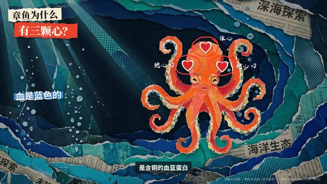

```text
用「编辑部纸拼贴讲解」：先生成两三张纸拼贴质感的插图（撕边彩纸、半调网点、旧报纸纹理），主体单独一张、背景干净，代码把它们叠成前后几层，慢慢错开移动出纵深；旁白讲到哪里，就在画面上用荧光笔划线、红笔圈出、贴上手写标签和箭头，关键数字用剪报拼字的样子砸进来，字幕跟着旁白逐句出现。
```

- 内容类型：知识科普讲解
- 素材：生图 · 语音合成
- 技术类型：生图加代码动画 · 语音合成驱动
- 适合：科普、冷知识、观点解读
- 技术（已验证）：Canvas 2D · Playwright · ffmpeg
- 样片代码：[samples/G-001/](https://github.com/Chans-gh/AI-Coding-Video/tree/main/samples/G-001)
- 技术（建议）：Canvas 2D · Playwright · ffmpeg
- 参考：[vox-director](https://github.com/Alisa0808/vox-director)

<a id="G-002"></a>

## G-002 虚拟主播口播


```text
用「虚拟主播口播」：先生成一张原创卡通主播的定妆照（不像任何真人），再用它当首帧生成一段面对镜头说话、点头、比手势的视频；代码把主播放进演播室式的版面——一侧是主播，另一侧是随旁白逐条弹出的要点卡、关键词高亮和小图标，底部一条滚动字幕，角落是节目名牌。旁白用公开音色合成，字幕时刻取自语音的逐字时间。
```

- 内容类型：口播 / 数字人
- 素材：生图 · 生视频 · 语音合成
- 技术类型：图生视频与首尾帧 · 语音合成驱动 · 数字人口播
- 适合：知识口播、账号日更、产品说明
- 技术（已验证）：Canvas 2D · Playwright · ffmpeg
- 样片代码：[samples/G-002/](https://github.com/Chans-gh/AI-Coding-Video/tree/main/samples/G-002)
- 技术（建议）：Canvas 2D · Playwright · ffmpeg
- 参考：—

<a id="G-003"></a>

## G-003 电影感产品广告

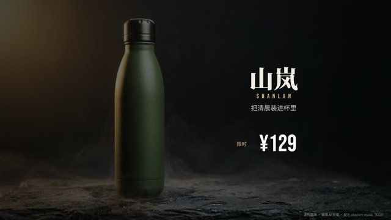

```text
用「电影感产品广告」：生成一张产品的棚拍主图（虚构品牌、暗色石台、一束侧光、薄雾），再用它当首帧生成一段镜头缓缓推近、雾气流动的视频；代码在镜头上做宽银幕黑边、慢速推拉、产品卖点的细线标注（线从产品上的点伸出，文字逐字打出），最后一屏落版：品牌名、一句口号、价格牌和购买按钮弹出。
```

- 内容类型：产品广告和带货
- 素材：生图 · 生视频
- 技术类型：图生视频与首尾帧
- 适合：新品发布、电商主图视频、广告片
- 技术（已验证）：Canvas 2D · Playwright · ffmpeg
- 样片代码：[samples/G-003/](https://github.com/Chans-gh/AI-Coding-Video/tree/main/samples/G-003)
- 技术（建议）：Canvas 2D · Playwright · ffmpeg
- 参考：[@abxxai](https://x.com/abxxai/status/2102775755646337530)

<a id="G-004"></a>

## G-004 大字品牌片

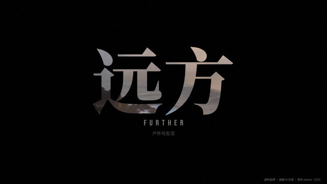

```text
用「大字品牌片」：生成两三段没有人脸的空镜（清晨的海岸、手和器物的特写、光线穿过窗），每段几秒；代码把它们按节拍剪在一起，镜头上压整屏的超大品牌字——字只显出一部分、随镜头慢慢滑动，或者把字当成遮罩让画面从字里透出来；一句一句的品牌口号用细衬线体淡入，结尾是标志和一句话的落版。
```

- 内容类型：品牌宣传片
- 素材：生视频
- 技术类型：图生视频与首尾帧
- 适合：品牌片、招募片、活动开场
- 技术（已验证）：Canvas 2D · Playwright · ffmpeg
- 样片代码：[samples/G-004/](https://github.com/Chans-gh/AI-Coding-Video/tree/main/samples/G-004)
- 技术（建议）：Canvas 2D · Playwright · ffmpeg
- 参考：—

<a id="G-005"></a>

## G-005 动漫短剧分镜

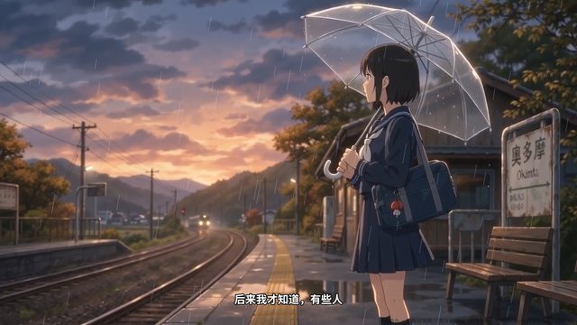

```text
用「动漫短剧分镜」：先生成主角的定妆图和一两张场景图（同一种日式动画画风），再用定妆图当首帧生成一段主角的表演镜头；代码把它们排成漫画分格——格子一格一格滑进来、镜头在格子里推拉，台词用对白气泡和竖排字，心里话用旁白合成，关键一格整屏放大、加速度线和闪白，结尾打片名和「下集」字卡。
```

- 内容类型：短剧 / 动漫剧 / 故事
- 素材：生图 · 生视频 · 语音合成
- 技术类型：角色一致性 · 图生视频与首尾帧 · 语音合成驱动
- 适合：动漫短剧、小说推文、剧情预告
- 技术（已验证）：Canvas 2D · Playwright · ffmpeg
- 样片代码：[samples/G-005/](https://github.com/Chans-gh/AI-Coding-Video/tree/main/samples/G-005)
- 技术（建议）：Canvas 2D · Playwright · ffmpeg
- 参考：[@ruinolab](https://x.com/ruinolab/status/2103120880796873091)

<a id="G-006"></a>

## G-006 无限放大拼贴

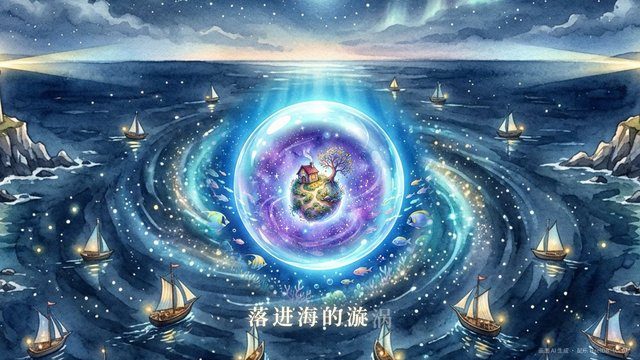

```text
用「无限放大拼贴」：生成三四张画面，每张正中都有一个圆形的「洞口」（窗、井口、镜头、月亮），下一张画就是从这个洞口里看到的世界；代码一直往画面中心推近，把下一张画缩小后用羽化的圆形遮罩嵌进上一张的洞口，推到洞口铺满画面时无缝换成下一张，如此一层层钻进去；歌词跟着节拍一个字一个字地亮起。
```

- 内容类型：音乐 MV
- 素材：生图
- 技术类型：扩图与局部重绘
- 适合：MV、歌词视频、片头
- 技术（已验证）：Canvas 2D · Playwright · ffmpeg
- 样片代码：[samples/G-006/](https://github.com/Chans-gh/AI-Coding-Video/tree/main/samples/G-006)
- 技术（建议）：Canvas 2D · Playwright · ffmpeg
- 参考：[@koldo2k](https://x.com/koldo2k/status/2103129343253778767)

<a id="G-007"></a>

## G-007 插画新闻解说

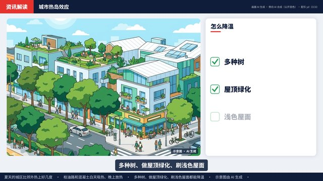

```text
用「插画新闻解说」：每个要点生成一张扁平插画式的示意图（不画真实人物、不冒充现场照片，画面角落标「示意图 · AI 生成」），代码排成新闻台的版面：顶部栏目条，中间插画慢慢推近、需要对比时左右分屏，旁边的数据卡用代码画（示意温度计、进出的箭头、旁白说到就打勾的清单），底部滚动标题和逐句字幕；换要点时用色块擦过画面。旁白用新闻播报风格的公开音色。
```

- 内容类型：新闻资讯解说
- 素材：生图 · 语音合成
- 技术类型：生图加代码动画 · 语音合成驱动
- 适合：资讯解读、政策和科学新闻、行业简报
- 技术（已验证）：Canvas 2D · Playwright · ffmpeg
- 样片代码：[samples/G-007/](https://github.com/Chans-gh/AI-Coding-Video/tree/main/samples/G-007)
- 技术（建议）：Canvas 2D · Playwright · ffmpeg
- 参考：[bang-motion](https://github.com/bangtutorial/bang-motion#style-gallery)

<a id="G-008"></a>

## G-008 伪纪录片

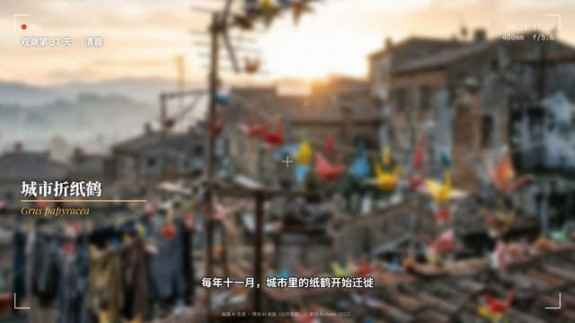

```text
用「伪纪录片」：给一个一看就是虚构的题材（会迁徙的纸鹤、住在路灯里的萤火虫）生成一张「野外笔记」式的照片和一段手持摄影感的视频，旁白用纪录片解说的口吻一本正经地讲；代码加上纪录片的包装：取景器框线、REC 和走动的时间码、手持晃动和由虚到实的拉焦，下三分之一的物种名和拉丁学名、「观察第 37 天」的场记、数量估计，轻微颗粒；结尾跟着起飞的镜头落在片名上。
```

- 内容类型：纪录片和纪实
- 素材：生图 · 生视频 · 语音合成
- 技术类型：图生视频与首尾帧 · 语音合成驱动
- 适合：伪纪录片、品牌故事、创意短片
- 技术（已验证）：Canvas 2D · Playwright · ffmpeg
- 样片代码：[samples/G-008/](https://github.com/Chans-gh/AI-Coding-Video/tree/main/samples/G-008)
- 技术（建议）：Canvas 2D · Playwright · ffmpeg
- 参考：[@gavinpurcell](https://x.com/gavinpurcell/status/2103304514329854102)

<a id="G-009"></a>

## G-009 俯拍步骤教程

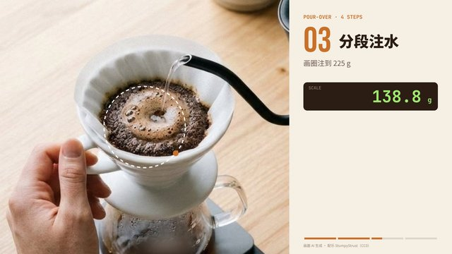

```text
用「俯拍步骤教程」：每一步生成一张同一张桌面、同一种光线的俯拍图（只露出手和工具），代码把它们按步骤切换：大号步骤编号从侧边滑入，要点用虚线圆圈和箭头指在图上，用量和时间做成会跳动的电子秤读数和倒计时圆环，底部一条步骤进度条；最后一屏用大字写出关键配比。可以不要旁白，靠大字和计数讲清楚。
```

- 内容类型：教程和录屏演示
- 素材：生图
- 技术类型：生图加代码动画
- 适合：做菜、手工、开箱和安装步骤
- 技术（已验证）：Canvas 2D · Playwright · ffmpeg
- 样片代码：[samples/G-009/](https://github.com/Chans-gh/AI-Coding-Video/tree/main/samples/G-009)
- 技术（建议）：Canvas 2D · Playwright · ffmpeg
- 参考：—

<a id="G-010"></a>

## G-010 旅行手账 vlog

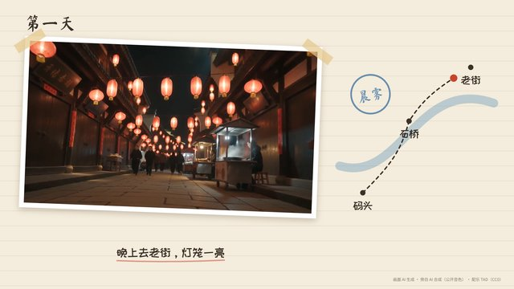

```text
用「旅行手账 vlog」：生成两三段旅行地的空镜（街巷、水边、夜市），代码把画面放进手账本：胶带贴住、微微歪着的照片框，代码画的手绘路线图上一个小点跟着旁白沿虚线走到下一站，说到的地方像盖章一样印上去，手写体的日期和字幕；换镜头时新照片落下来压住旧的，结尾盖一个「第一天」大章。旁白用轻松的口吻讲见闻，字幕跟着走。
```

- 内容类型：旅行和城市
- 素材：生视频 · 语音合成
- 技术类型：图生视频与首尾帧 · 语音合成驱动
- 适合：旅行 vlog、城市推荐、文旅宣传
- 技术（已验证）：Canvas 2D · Playwright · ffmpeg
- 样片代码：[samples/G-010/](https://github.com/Chans-gh/AI-Coding-Video/tree/main/samples/G-010)
- 技术（建议）：Canvas 2D · Playwright · ffmpeg
- 参考：—

<a id="G-011"></a>

## G-011 高光慢放集锦

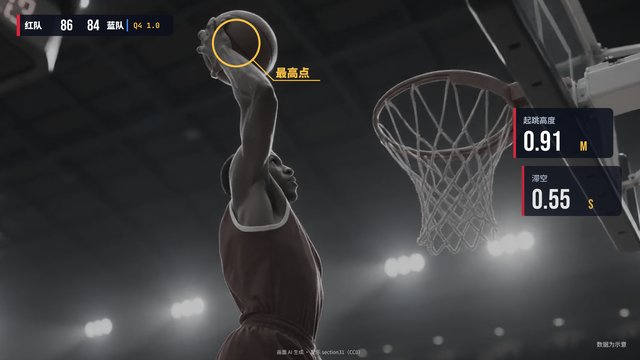

```text
用「高光慢放集锦」：生成一段没有真实球员、没有队标的运动镜头（虚构球队的扣篮、射门或冲线），代码把它做成赛事集锦：先常速，到动作最高点变成慢放再定格，定格时闪一下、画面去色变暗，圈出球、拉一条标注线，旁边弹出高度、滞空这类数据卡（标明示意），比分牌和比赛时钟一直在角落；扣进时闪白、比分翻牌，最后打出「本周最佳」。
```

- 内容类型：体育赛事
- 素材：生视频
- 技术类型：图生视频与首尾帧
- 适合：赛事集锦、运动品牌、校园比赛
- 技术（已验证）：Canvas 2D · Playwright · ffmpeg
- 样片代码：[samples/G-011/](https://github.com/Chans-gh/AI-Coding-Video/tree/main/samples/G-011)
- 技术（建议）：Canvas 2D · Playwright · ffmpeg
- 参考：—

<a id="G-012"></a>

## G-012 水彩绘本朗读

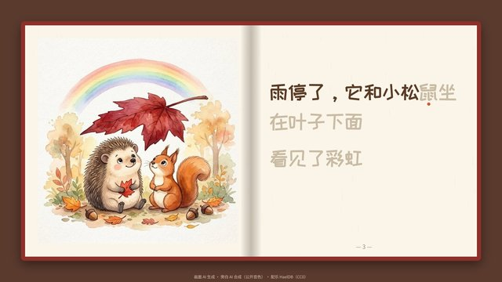

```text
用「水彩绘本朗读」：生成三四页同一个角色、同一种水彩画风的绘本插图，代码把它们排成摊开的书（竖版上图下文）：画面在页里慢慢推近，翻页时纸页绕书脊转过去、带明暗，文字跟着朗读一个字一个字变色，结尾一个手写的「完」。朗读用温和的公开音色，配乐是轻柔的摇篮曲。
```

- 内容类型：儿童绘本动画
- 素材：生图 · 语音合成
- 技术类型：角色一致性 · 生图加代码动画 · 语音合成驱动
- 适合：睡前故事、儿童教育、绘本推广
- 技术（已验证）：Canvas 2D · Playwright · ffmpeg
- 样片代码：[samples/G-012/](https://github.com/Chans-gh/AI-Coding-Video/tree/main/samples/G-012)
- 技术（建议）：Canvas 2D · Playwright · ffmpeg
- 参考：—

<a id="G-013"></a>

## G-013 食谱动效卡


```text
用「食谱动效卡」：奶油色卡片上，生成的成品菜照片和食材平铺照片做主图，四个做菜步骤的线条图标由语言模型写成 SVG，代码按笔画顺序把它们一笔一笔描出来，再弹出步骤编号和一句话；旁白用亲切的公开音色报步骤，字幕跟着旁白走，图标和照片的切换卡在旁白的句子上；结尾成品照片推近，写上菜名和用时。
```

- 内容类型：美食
- 素材：生图 · 语音合成
- 技术类型：生成矢量与动效素材 · 语音合成驱动
- 适合：菜谱短视频、餐饮门店的菜品卡、生活方式类账号
- 技术（已验证）：SVG · Canvas 2D · Playwright · ffmpeg
- 样片代码：[samples/G-013/](https://github.com/Chans-gh/AI-Coding-Video/tree/main/samples/G-013)
- 技术（建议）：SVG · Canvas 2D · Playwright · ffmpeg
- 参考：—

<a id="G-014"></a>

## G-014 虚构电竞集锦

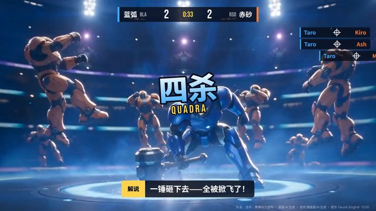

```text
用「虚构电竞集锦」：两段视频模型连声音一起生成的原创科幻竞技镜头（滑铲躲光束、护盾反打），代码做成电竞集锦的包装——开场队伍对阵牌、比分条和击杀提示、关键一秒的慢放和定格描边、解说字幕条；声音用生成镜头自带的音效和欢呼，配乐卡在镜头切换上，慢放时压低。队伍、角色、游戏全部虚构，画面里不出现真实游戏和战队的名字、标志。
```

- 内容类型：游戏和电竞
- 素材：生视频
- 技术类型：音画同生视频 · 生成音乐与音效
- 适合：电竞集锦、游戏宣传片、直播精彩回放
- 技术（已验证）：Canvas 2D · Playwright · ffmpeg
- 样片代码：[samples/G-014/](https://github.com/Chans-gh/AI-Coding-Video/tree/main/samples/G-014)
- 技术（建议）：Canvas 2D · Playwright · ffmpeg
- 参考：—

<a id="G-015"></a>

## G-015 三维产品展台

```text
用「三维产品展台」：一个开放许可（CC0）的三维产品模型放进 Three.js 转台，产品表面的花纹和摄影棚背景用生图做——生一张能平铺的纹样，按圆柱投影包到瓶身上（镜像平铺，接缝处花纹连续），再生一张空的产品摄影棚当背景，三维画面用透明底叠上去，地面只留影子。着色器里一道发光的「上釉线」从瓶底走到瓶口，白坯一路变成青花瓷；中段推近，三条细线标出高度、釉面、纹样；结尾拉回让出位置，出虚构瓷器品牌的落版。以后有三维生成服务，可以把模型也换成生成的。
```

- 内容类型：产品广告和带货
- 素材：生图 · 三维模型
- 技术类型：生成三维资产加代码渲染
- 适合：电商主图视频、新品发布、产品配色和花纹的批量展示
- 技术（建议）：Three.js · WebGL · GLSL · Canvas 2D · Playwright · ffmpeg
- 参考：[Poly Haven 模型](https://polyhaven.com/models)

<a id="G-016"></a>

## G-016 分镜表短片

```text
用「分镜表短片」：先写一张分镜表（镜号、景别、时长、画面、旁白），按表生成每个镜头的关键帧，挑两个镜头用图生视频让它动起来，再合成一段旁白；代码先把分镜表本身铺在画面上——四格草图、镜号和景别、时长条——然后一格一格放大成真正的镜头：静帧做缓慢推拉，动的镜头直接播，镜头之间按表上的时长切，旁白字幕按句对齐。四个镜头用同一句画风描述，保证看起来是同一部片子；故事和画面全部原创，不出现人物。
```

- 内容类型：短剧 / 动漫剧 / 故事
- 素材：生图 · 生视频 · 语音合成
- 技术类型：分镜到成片编排 · 图生视频与首尾帧
- 适合：短片提案、广告样片、绘本动画、故事类短视频
- 技术（建议）：Canvas 2D · Playwright · ffmpeg
- 参考：—
