# G 类：AI 生成素材（31 种）

[← 选风格索引](../index.md) · [提示词方法](../prompting.md) · [用素材做视频](../materials.md) · [技术标签](../tags.md)

画面里用到 AI 生成的图片、视频或合成语音，再由代码排版、剪辑、加动效和字幕。生成的部分只管「画得像」，镜头顺序、文字、节奏、数字都写在代码里，所以同一批素材可以反复改剪。本仓库的样片怎么调生成服务见 [materials.md「配置生成服务」](../materials.md#配置生成服务)（模型名、参数和提示词记在每个样片的 `assets.json` 里），你自己做时换成手上的任何一家服务都行；先用便宜的模型试，满意了再换好的。按内容类型排列，每个条目标出用到了哪几种素材。

每个条目依次是：样片缩略图、一句可直接复制的风格提示词、内容类型、素材、适合讲什么、技术标签、参考链接。提示词只描述做法，生成素材的提示词见样片的 `assets.json`。

<a id="G-001"></a>

## G-001 编辑部纸拼贴讲解

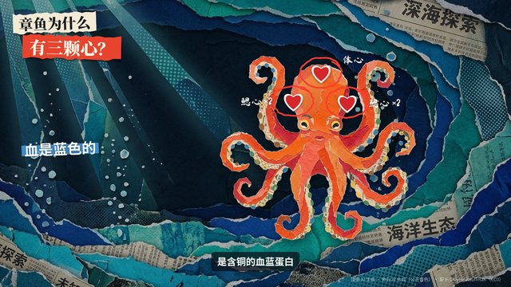

```text
用「编辑部纸拼贴讲解」：先生成两三张纸拼贴质感的插图（撕边彩纸、半调网点、旧报纸纹理），主体单独一张、背景干净，代码把它们叠成前后几层，慢慢错开移动出纵深；旁白讲到哪里，就在画面上用荧光笔划线、红笔圈出、贴上手写标签和箭头，关键数字用剪报拼字的样子砸进来，字幕跟着旁白逐句出现。
```

- 内容类型：知识科普讲解
- 素材：生图 · 语音合成
- 技术类型：生图加代码动画 · 语音合成驱动
- 适合：科普、冷知识、观点解读
- 技术（已验证）：Canvas 2D · Playwright · ffmpeg
- 样片代码：[samples/G-001/](https://github.com/Chans-gh/AI-Coding-Video/tree/main/samples/G-001)
- 技术（建议）：Canvas 2D · Playwright · ffmpeg
- 参考：[vox-director](https://github.com/Alisa0808/vox-director)

<a id="G-002"></a>

## G-002 虚拟主播口播


```text
用「虚拟主播口播」：先生成一张原创卡通主播的定妆照（不像任何真人），再用它当首帧生成一段面对镜头说话、点头、比手势的视频；代码把主播放进演播室式的版面——一侧是主播，另一侧是随旁白逐条弹出的要点卡、关键词高亮和小图标，底部一条滚动字幕，角落是节目名牌。旁白用公开音色合成，字幕时刻取自语音的逐字时间。
```

- 内容类型：口播 / 数字人
- 素材：生图 · 生视频 · 语音合成
- 技术类型：图生视频与首尾帧 · 语音合成驱动 · 数字人口播
- 适合：知识口播、账号日更、产品说明
- 技术（已验证）：Canvas 2D · Playwright · ffmpeg
- 样片代码：[samples/G-002/](https://github.com/Chans-gh/AI-Coding-Video/tree/main/samples/G-002)
- 技术（建议）：Canvas 2D · Playwright · ffmpeg
- 参考：—

<a id="G-003"></a>

## G-003 电影感产品广告

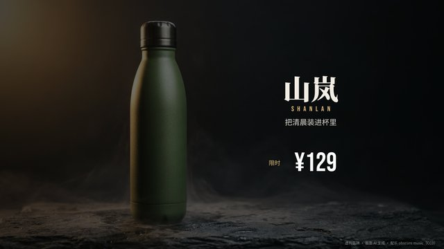

```text
用「电影感产品广告」：生成一张产品的棚拍主图（虚构品牌、暗色石台、一束侧光、薄雾），再用它当首帧生成一段镜头缓缓推近、雾气流动的视频；代码在镜头上做宽银幕黑边、慢速推拉、产品卖点的细线标注（线从产品上的点伸出，文字逐字打出），最后一屏落版：品牌名、一句口号、价格牌和购买按钮弹出。
```

- 内容类型：产品广告和带货
- 素材：生图 · 生视频
- 技术类型：图生视频与首尾帧
- 适合：新品发布、电商主图视频、广告片
- 技术（已验证）：Canvas 2D · Playwright · ffmpeg
- 样片代码：[samples/G-003/](https://github.com/Chans-gh/AI-Coding-Video/tree/main/samples/G-003)
- 技术（建议）：Canvas 2D · Playwright · ffmpeg
- 参考：[@abxxai](https://x.com/abxxai/status/2102775755646337530)

<a id="G-004"></a>

## G-004 大字品牌片

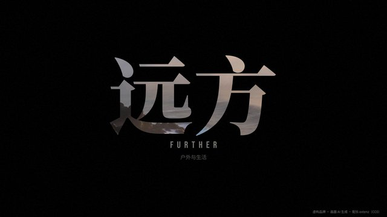

```text
用「大字品牌片」：生成两三段没有人脸的空镜（清晨的海岸、手和器物的特写、光线穿过窗），每段几秒；代码把它们按节拍剪在一起，镜头上压整屏的超大品牌字——字只显出一部分、随镜头慢慢滑动，或者把字当成遮罩让画面从字里透出来；一句一句的品牌口号用细衬线体淡入，结尾是标志和一句话的落版。
```

- 内容类型：品牌宣传片
- 素材：生视频
- 技术类型：图生视频与首尾帧
- 适合：品牌片、招募片、活动开场
- 技术（已验证）：Canvas 2D · Playwright · ffmpeg
- 样片代码：[samples/G-004/](https://github.com/Chans-gh/AI-Coding-Video/tree/main/samples/G-004)
- 技术（建议）：Canvas 2D · Playwright · ffmpeg
- 参考：—

<a id="G-005"></a>

## G-005 动漫短剧分镜

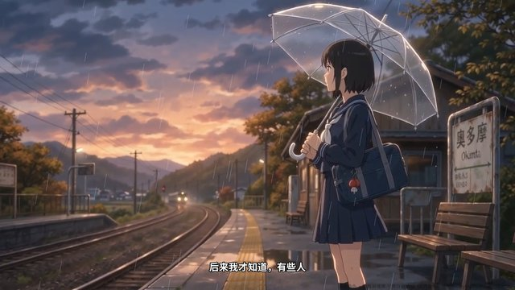

```text
用「动漫短剧分镜」：先生成主角的定妆图和一两张场景图（同一种日式动画画风），再用定妆图当首帧生成一段主角的表演镜头；代码把它们排成漫画分格——格子一格一格滑进来、镜头在格子里推拉，台词用对白气泡和竖排字，心里话用旁白合成，关键一格整屏放大、加速度线和闪白，结尾打片名和「下集」字卡。
```

- 内容类型：短剧 / 动漫剧 / 故事
- 素材：生图 · 生视频 · 语音合成
- 技术类型：角色一致性 · 图生视频与首尾帧 · 语音合成驱动
- 适合：动漫短剧、小说推文、剧情预告
- 技术（已验证）：Canvas 2D · Playwright · ffmpeg
- 样片代码：[samples/G-005/](https://github.com/Chans-gh/AI-Coding-Video/tree/main/samples/G-005)
- 技术（建议）：Canvas 2D · Playwright · ffmpeg
- 参考：[@ruinolab](https://x.com/ruinolab/status/2103120880796873091)

<a id="G-006"></a>

## G-006 无限放大拼贴

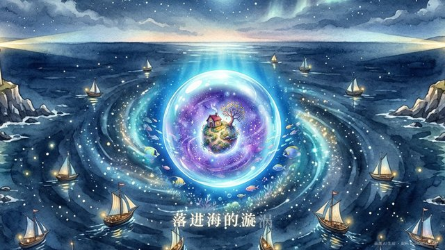

```text
用「无限放大拼贴」：生成三四张画面，每张正中都有一个圆形的「洞口」（窗、井口、镜头、月亮），下一张画就是从这个洞口里看到的世界；代码一直往画面中心推近，把下一张画缩小后用羽化的圆形遮罩嵌进上一张的洞口，推到洞口铺满画面时无缝换成下一张，如此一层层钻进去；歌词跟着节拍一个字一个字地亮起。
```

- 内容类型：音乐 MV
- 素材：生图
- 技术类型：扩图与局部重绘
- 适合：MV、歌词视频、片头
- 技术（已验证）：Canvas 2D · Playwright · ffmpeg
- 样片代码：[samples/G-006/](https://github.com/Chans-gh/AI-Coding-Video/tree/main/samples/G-006)
- 技术（建议）：Canvas 2D · Playwright · ffmpeg
- 参考：[@koldo2k](https://x.com/koldo2k/status/2103129343253778767)

<a id="G-007"></a>

## G-007 插画新闻解说

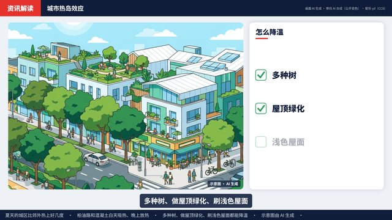

```text
用「插画新闻解说」：每个要点生成一张扁平插画式的示意图（不画真实人物、不冒充现场照片，画面角落标「示意图 · AI 生成」），代码排成新闻台的版面：顶部栏目条，中间插画慢慢推近、需要对比时左右分屏，旁边的数据卡用代码画（示意温度计、进出的箭头、旁白说到就打勾的清单），底部滚动标题和逐句字幕；换要点时用色块擦过画面。旁白用新闻播报风格的公开音色。
```

- 内容类型：新闻资讯解说
- 素材：生图 · 语音合成
- 技术类型：生图加代码动画 · 语音合成驱动
- 适合：资讯解读、政策和科学新闻、行业简报
- 技术（已验证）：Canvas 2D · Playwright · ffmpeg
- 样片代码：[samples/G-007/](https://github.com/Chans-gh/AI-Coding-Video/tree/main/samples/G-007)
- 技术（建议）：Canvas 2D · Playwright · ffmpeg
- 参考：[bang-motion](https://github.com/bangtutorial/bang-motion#style-gallery)

<a id="G-008"></a>

## G-008 伪纪录片

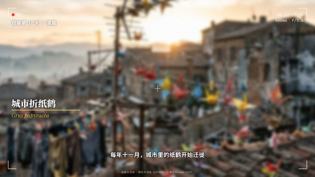

```text
用「伪纪录片」：给一个一看就是虚构的题材（会迁徙的纸鹤、住在路灯里的萤火虫）生成一张「野外笔记」式的照片和一段手持摄影感的视频，旁白用纪录片解说的口吻一本正经地讲；代码加上纪录片的包装：取景器框线、REC 和走动的时间码、手持晃动和由虚到实的拉焦，下三分之一的物种名和拉丁学名、「观察第 37 天」的场记、数量估计，轻微颗粒；结尾跟着起飞的镜头落在片名上。
```

- 内容类型：纪录片和纪实
- 素材：生图 · 生视频 · 语音合成
- 技术类型：图生视频与首尾帧 · 语音合成驱动
- 适合：伪纪录片、品牌故事、创意短片
- 技术（已验证）：Canvas 2D · Playwright · ffmpeg
- 样片代码：[samples/G-008/](https://github.com/Chans-gh/AI-Coding-Video/tree/main/samples/G-008)
- 技术（建议）：Canvas 2D · Playwright · ffmpeg
- 参考：[@gavinpurcell](https://x.com/gavinpurcell/status/2103304514329854102)

<a id="G-009"></a>

## G-009 俯拍步骤教程


```text
用「俯拍步骤教程」：每一步生成一张同一张桌面、同一种光线的俯拍图（只露出手和工具），代码把它们按步骤切换：大号步骤编号从侧边滑入，要点用虚线圆圈和箭头指在图上，用量和时间做成会跳动的电子秤读数和倒计时圆环，底部一条步骤进度条；最后一屏用大字写出关键配比。可以不要旁白，靠大字和计数讲清楚。
```

- 内容类型：教程和录屏演示
- 素材：生图
- 技术类型：生图加代码动画
- 适合：做菜、手工、开箱和安装步骤
- 技术（已验证）：Canvas 2D · Playwright · ffmpeg
- 样片代码：[samples/G-009/](https://github.com/Chans-gh/AI-Coding-Video/tree/main/samples/G-009)
- 技术（建议）：Canvas 2D · Playwright · ffmpeg
- 参考：—

<a id="G-010"></a>

## G-010 旅行手账 vlog

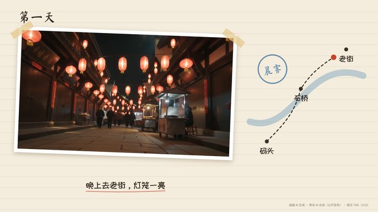

```text
用「旅行手账 vlog」：生成两三段旅行地的空镜（街巷、水边、夜市），代码把画面放进手账本：胶带贴住、微微歪着的照片框，代码画的手绘路线图上一个小点跟着旁白沿虚线走到下一站，说到的地方像盖章一样印上去，手写体的日期和字幕；换镜头时新照片落下来压住旧的，结尾盖一个「第一天」大章。旁白用轻松的口吻讲见闻，字幕跟着走。
```

- 内容类型：旅行和城市
- 素材：生视频 · 语音合成
- 技术类型：图生视频与首尾帧 · 语音合成驱动
- 适合：旅行 vlog、城市推荐、文旅宣传
- 技术（已验证）：Canvas 2D · Playwright · ffmpeg
- 样片代码：[samples/G-010/](https://github.com/Chans-gh/AI-Coding-Video/tree/main/samples/G-010)
- 技术（建议）：Canvas 2D · Playwright · ffmpeg
- 参考：—

<a id="G-011"></a>

## G-011 高光慢放集锦

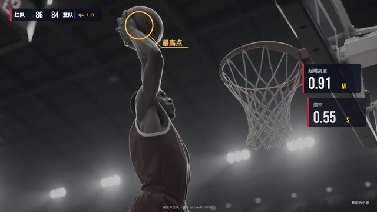

```text
用「高光慢放集锦」：生成一段没有真实球员、没有队标的运动镜头（虚构球队的扣篮、射门或冲线），代码把它做成赛事集锦：先常速，到动作最高点变成慢放再定格，定格时闪一下、画面去色变暗，圈出球、拉一条标注线，旁边弹出高度、滞空这类数据卡（标明示意），比分牌和比赛时钟一直在角落；扣进时闪白、比分翻牌，最后打出「本周最佳」。
```

- 内容类型：体育赛事
- 素材：生视频
- 技术类型：图生视频与首尾帧
- 适合：赛事集锦、运动品牌、校园比赛
- 技术（已验证）：Canvas 2D · Playwright · ffmpeg
- 样片代码：[samples/G-011/](https://github.com/Chans-gh/AI-Coding-Video/tree/main/samples/G-011)
- 技术（建议）：Canvas 2D · Playwright · ffmpeg
- 参考：—

<a id="G-012"></a>

## G-012 水彩绘本朗读

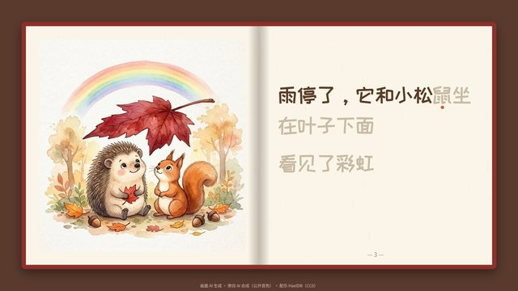

```text
用「水彩绘本朗读」：生成三四页同一个角色、同一种水彩画风的绘本插图，代码把它们排成摊开的书（竖版上图下文）：画面在页里慢慢推近，翻页时纸页绕书脊转过去、带明暗，文字跟着朗读一个字一个字变色，结尾一个手写的「完」。朗读用温和的公开音色，配乐是轻柔的摇篮曲。
```

- 内容类型：儿童绘本动画
- 素材：生图 · 语音合成
- 技术类型：角色一致性 · 生图加代码动画 · 语音合成驱动
- 适合：睡前故事、儿童教育、绘本推广
- 技术（已验证）：Canvas 2D · Playwright · ffmpeg
- 样片代码：[samples/G-012/](https://github.com/Chans-gh/AI-Coding-Video/tree/main/samples/G-012)
- 技术（建议）：Canvas 2D · Playwright · ffmpeg
- 参考：—

<a id="G-013"></a>

## G-013 食谱动效卡


```text
用「食谱动效卡」：奶油色卡片上，生成的成品菜照片和食材平铺照片做主图，四个做菜步骤的线条图标由语言模型写成 SVG，代码按笔画顺序把它们一笔一笔描出来，再弹出步骤编号和一句话；旁白用亲切的公开音色报步骤，字幕跟着旁白走，图标和照片的切换卡在旁白的句子上；结尾成品照片推近，写上菜名和用时。
```

- 内容类型：美食
- 素材：生图 · 语音合成
- 技术类型：生成矢量与动效素材 · 语音合成驱动
- 适合：菜谱短视频、餐饮门店的菜品卡、生活方式类账号
- 技术（已验证）：SVG · Canvas 2D · Playwright · ffmpeg
- 样片代码：[samples/G-013/](https://github.com/Chans-gh/AI-Coding-Video/tree/main/samples/G-013)
- 技术（建议）：SVG · Canvas 2D · Playwright · ffmpeg
- 参考：—

<a id="G-014"></a>

## G-014 虚构电竞集锦

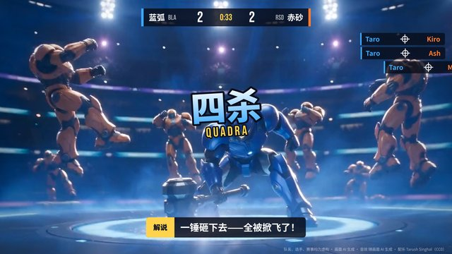

```text
用「虚构电竞集锦」：两段视频模型连声音一起生成的原创科幻竞技镜头（滑铲躲光束、护盾反打），代码做成电竞集锦的包装——开场队伍对阵牌、比分条和击杀提示、关键一秒的慢放和定格描边、解说字幕条；声音用生成镜头自带的音效和欢呼，配乐卡在镜头切换上，慢放时压低。队伍、角色、游戏全部虚构，画面里不出现真实游戏和战队的名字、标志。
```

- 内容类型：游戏和电竞
- 素材：生视频
- 技术类型：音画同生视频 · 生成音乐与音效
- 适合：电竞集锦、游戏宣传片、直播精彩回放
- 技术（已验证）：Canvas 2D · Playwright · ffmpeg
- 样片代码：[samples/G-014/](https://github.com/Chans-gh/AI-Coding-Video/tree/main/samples/G-014)
- 技术（建议）：Canvas 2D · Playwright · ffmpeg
- 参考：—

<a id="G-015"></a>

## G-015 三维产品展台

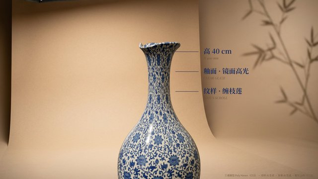

```text
用「三维产品展台」：一个开放许可（CC0）的三维产品模型放进 Three.js 转台，产品表面的花纹和摄影棚背景用生图做——生一张能平铺的纹样，按圆柱投影包到瓶身上（镜像平铺，接缝处花纹连续），再生一张空的产品摄影棚当背景，三维画面用透明底叠上去，地面只留影子。着色器里一道发光的「上釉线」从瓶底走到瓶口，白坯一路变成青花瓷；中段推近，三条细线标出高度、釉面、纹样；结尾拉回让出位置，出虚构瓷器品牌的落版。以后有三维生成服务，可以把模型也换成生成的。
```

- 内容类型：产品广告和带货
- 素材：生图 · 三维模型
- 技术类型：生成三维资产加代码渲染
- 适合：电商主图视频、新品发布、产品配色和花纹的批量展示
- 技术（已验证）：Three.js · WebGL · GLSL · Canvas 2D · Playwright · ffmpeg
- 样片代码：[samples/G-015/](https://github.com/Chans-gh/AI-Coding-Video/tree/main/samples/G-015)
- 技术（建议）：Three.js · WebGL · GLSL · Canvas 2D · Playwright · ffmpeg
- 参考：[Poly Haven 模型](https://polyhaven.com/models)

<a id="G-016"></a>

## G-016 分镜表短片


```text
用「分镜表短片」：先写一张分镜表（镜号、景别、时长、画面、旁白），按表生成每个镜头的关键帧，挑两个镜头用图生视频让它动起来，再合成一段旁白；代码先把分镜表本身铺在画面上——四格草图、镜号和景别、时长条——然后一格一格放大成真正的镜头：静帧做缓慢推拉，动的镜头直接播，镜头之间按表上的时长切，旁白字幕按句对齐。四个镜头用同一句画风描述，保证看起来是同一部片子；故事和画面全部原创，不出现人物。
```

- 内容类型：短剧 / 动漫剧 / 故事
- 素材：生图 · 生视频 · 语音合成
- 技术类型：分镜到成片编排 · 图生视频与首尾帧
- 适合：短片提案、广告样片、绘本动画、故事类短视频
- 技术（已验证）：Canvas 2D · Playwright · ffmpeg
- 样片代码：[samples/G-016/](https://github.com/Chans-gh/AI-Coding-Video/tree/main/samples/G-016)
- 风格包：[packs/style-swap/](https://github.com/Chans-gh/AI-Coding-Video/tree/main/packs/style-swap)
- 技术（建议）：Canvas 2D · Playwright · ffmpeg
- 参考：—

<a id="G-017"></a>

## G-017 情景安全演练

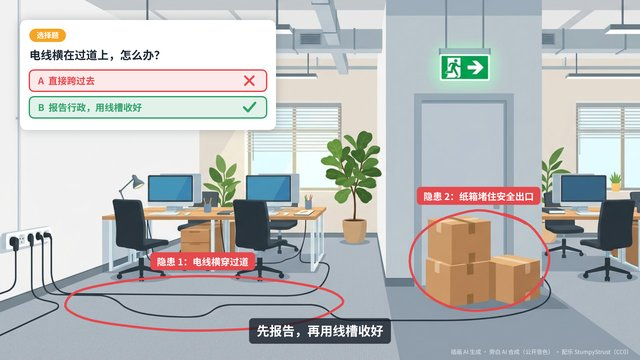

```text
用「情景安全演练」：生成一张有安全隐患的办公室场景图（电线横穿过道、纸箱堵住消防通道），代码在图上逐个圈出隐患、拉出编号标签；接着弹出一道选择题，先选错的那个——选项变红、轻轻一抖，再亮出正确答案打勾；最后切到同一间办公室整改后的图（以第一张为参考图生成），画面左右滑动对比，写上「整改完成」。旁白用沉稳的公开音色讲解，圈出隐患、出题、揭晓答案的时刻都卡在旁白的句子上。
```

- 内容类型：企业培训和课件
- 素材：生图 · 语音合成
- 技术类型：生图加代码动画 · 语音合成驱动
- 适合：安全培训、新员工入职课件、合规考试的情景题
- 技术（已验证）：Canvas 2D · Playwright · ffmpeg
- 样片代码：[samples/G-017/](https://github.com/Chans-gh/AI-Coding-Video/tree/main/samples/G-017)
- 技术（建议）：Canvas 2D · Playwright · ffmpeg
- 参考：—

<a id="G-018"></a>

## G-018 双人播客声波


```text
用「双人播客声波」：两位虚构主持人的插画头像（生图）一左一右，两段公开音色的语音合成一问一答；代码在浏览器里解码音频算出音量包络，谁在说话谁的头像外圈跟着声波起伏、亮起，另一位变暗；下面是逐字点亮的字幕，答到金句时弹出一张金句卡，结尾落节目名和期数。
```

- 内容类型：播客和访谈可视化
- 素材：生图 · 语音合成
- 技术类型：语音合成驱动 · 生图加代码动画
- 适合：播客切片、音频节目的视频版、访谈金句卡
- 技术（已验证）：Canvas 2D · Web Audio · Playwright · ffmpeg
- 样片代码：[samples/G-018/](https://github.com/Chans-gh/AI-Coding-Video/tree/main/samples/G-018)
- 技术（建议）：Canvas 2D · Web Audio · Playwright · ffmpeg
- 参考：—

<a id="G-019"></a>

## G-019 十二月插画回顾


```text
用「十二月插画回顾」：生成一张 4 列 3 行的拼图插画，每格是一家虚构咖啡馆一个月的样子（雪天、樱花、梅雨、盛夏、落叶……），代码按格子切开，一月一张快速翻页；每页套同一个数字卡模板，写这个月卖了多少杯、最受欢迎的饮品，数字滚动到位；最后十二张缩回原位拼成总览墙，最忙的那个月描边，写出全年总数。旁白用轻快的公开音色报全年数字。
```

- 内容类型：年度回顾和数据总结
- 素材：生图 · 语音合成
- 技术类型：生图加代码动画 · 模板化批量生成
- 适合：年终总结、门店和账号的年度回顾、月报合集
- 技术（已验证）：Canvas 2D · Playwright · ffmpeg
- 样片代码：[samples/G-019/](https://github.com/Chans-gh/AI-Coding-Video/tree/main/samples/G-019)
- 技术（建议）：Canvas 2D · Playwright · ffmpeg
- 参考：—

<a id="G-020"></a>

## G-020 拉伸跟练


```text
用「拉伸跟练」：生成一位虚构教练的定妆图当首帧，图生视频让教练做一个侧腰拉伸，来回放慢衔接成跟练镜头；代码在旁边叠动作名、要点清单（逐条随旁白点亮）、保持阶段的倒计时圆环和组数；旁白用温和的公开音色带练，数到「三、二、一」时圆环走完、亮起「完成」。
```

- 内容类型：健康和运动指导
- 素材：生图 · 生视频 · 语音合成
- 技术类型：图生视频与首尾帧 · 语音合成驱动
- 适合：健身跟练、康复动作指导、办公室微运动
- 技术（已验证）：Canvas 2D · Playwright · ffmpeg
- 样片代码：[samples/G-020/](https://github.com/Chans-gh/AI-Coding-Video/tree/main/samples/G-020)
- 技术（建议）：Canvas 2D · Playwright · ffmpeg
- 参考：—

<a id="G-021"></a>

## G-021 伪监控录像

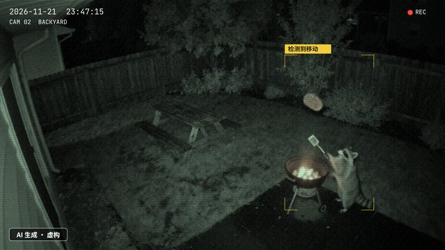

```text
用「伪监控录像」：生成一张后院监控探头视角的夜景图（高机位俯拍、广角、低清、没有人），再以它为首帧图生视频，让动物做一件一看就不可能的事（浣熊站在烧烤架前用锅铲给肉饼翻面）；代码把它包装成家用监控的样子：红外夜视的黑白偏绿、鱼眼桶形畸变、暗角、跳动的噪点和横向扫描线，左上角走动的时间戳和摄像头编号，偶尔卡住几帧、跳一下画面，动作发生时右上角弹出「检测到移动」的框；画面角落一直挂着「AI 生成 · 虚构」的标识。题材要荒诞到一眼看出是编的，不写真实地址、人名，不做成新闻的样子。
```

- 内容类型：短剧 / 动漫剧 / 故事
- 素材：生图 · 生视频
- 技术类型：图生视频与首尾帧 · 生图加代码动画
- 适合：搞笑短片、虚构的「监控拍到」系列、品牌创意彩蛋
- 技术（已验证）：Canvas 2D · WebGL · GLSL · Playwright · ffmpeg
- 样片代码：[samples/G-021/](https://github.com/Chans-gh/AI-Coding-Video/tree/main/samples/G-021)
- 技术（建议）：Canvas 2D · WebGL · GLSL · Playwright · ffmpeg
- 参考：—

<a id="G-022"></a>

## G-022 玻璃水果 ASMR 切割

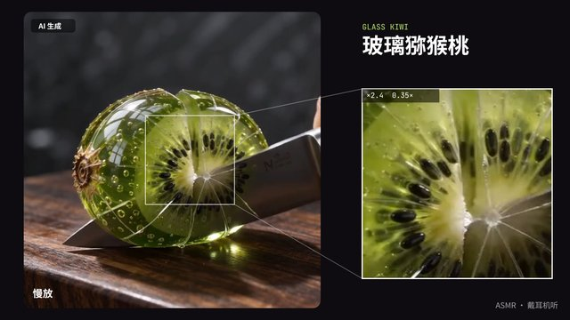

```text
用「玻璃水果 ASMR 切割」：先生成几张微距特写图，案板上放着现实里不存在的材质——玻璃做的猕猴桃、晶体做的苹果，透光、带折射；再以它们为首帧图生视频，一刀慢慢切下去、切面裂开，让视频模型连声音一起生成（刀刃划过玻璃的细响、切开时清脆的碎裂声）；代码负责慢放切开的那一下、在切口上开一个放大的特写框，每段首尾做淡入淡出接成可以循环的一组，角落写「AI 生成」。声音就用生成的原声，不另配乐。
```

- 内容类型：美食
- 素材：生图 · 生视频
- 技术类型：音画同生视频 · 图生视频与首尾帧
- 适合：ASMR 切割短视频、解压类循环片、美食账号的创意片
- 技术（已验证）：Canvas 2D · Playwright · ffmpeg
- 样片代码：[samples/G-022/](https://github.com/Chans-gh/AI-Coding-Video/tree/main/samples/G-022)
- 技术（建议）：Canvas 2D · Playwright · ffmpeg
- 参考：—

<a id="G-023"></a>

## G-023 水果拟人小剧场

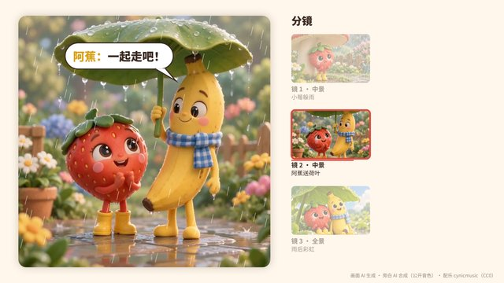

```text
用「水果拟人小剧场」：先生成一张两三个拟人水果角色的定妆图（大眼睛、小手小脚、各自一个鲜明的特征），之后每个镜头都拿它当参考图生成，保证角色长得一样；按一张三四个镜头的分镜表排一段温和的小剧情（比如雨天里一个角色把叶子借给另一个挡雨），挑一两个镜头图生视频让它动起来，其余静帧做推拉；台词不对口型，用字幕条加角色名，旁白用一个公开音色讲故事，镜头的切点和字幕都按旁白的逐字时间排。不要暴力、狗血和低俗的情节。
```

- 内容类型：短剧 / 动漫剧 / 故事
- 素材：生图 · 生视频 · 语音合成
- 技术类型：角色一致性 · 语音合成驱动 · 分镜到成片编排
- 适合：拟人短剧、儿童故事、品牌吉祥物小剧场
- 技术（已验证）：Canvas 2D · Playwright · ffmpeg
- 样片代码：[samples/G-023/](https://github.com/Chans-gh/AI-Coding-Video/tree/main/samples/G-023)
- 技术（建议）：Canvas 2D · Playwright · ffmpeg
- 参考：—

<a id="G-024"></a>

## G-024 首尾帧变装卡点


```text
用「首尾帧变装卡点」：生成一个虚构的卡通角色（不是真人，也不像任何真人）穿日常衣服的全身图当「变装前」，再以它为参考图生成同一个角色、同一个姿势和背景、换上一套新衣服的「变装后」；两张图分别当首帧和尾帧，用首尾帧生视频生成中间转一圈换装的过程；代码按配乐的节拍剪：前几拍是变装前的定格和小幅推拉，抬手的一拍接上变装视频、转身的瞬间闪白，落拍定格在变装后，弹出这套衣服的单品标签和价格牌。
```

- 内容类型：产品广告和带货
- 素材：生图 · 生视频
- 技术类型：图生视频与首尾帧 · 节拍对齐剪辑 · 角色一致性
- 适合：服装带货、换装挑战、穿搭推荐
- 技术（已验证）：Canvas 2D · Playwright · ffmpeg
- 样片代码：[samples/G-024/](https://github.com/Chans-gh/AI-Coding-Video/tree/main/samples/G-024)
- 技术（建议）：Canvas 2D · Playwright · ffmpeg
- 参考：—

<a id="G-025"></a>

## G-025 实拍产品 AI 换景重打光

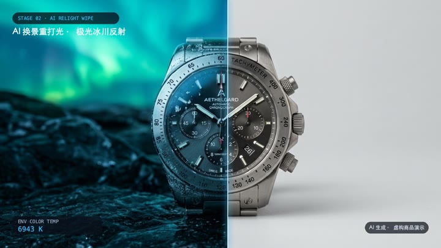

```text
用「实拍产品 AI 换景重打光」：保留棚拍产品原图的本体结构与细节不变，以它为参考图通过 AI 换景重打光生成极光冰川与赛博雨夜两套环境版本，使金属机身真实反射新环境的冷暖光影；再用首尾帧生视频衔接两套场景的动态流光迁移；代码先展示棚拍原图，随后一道青色发光扫光线横向擦除切换进重打光画面，并叠加实时环境色温 HUD 与「AI 生成 · 虚构」标注。
```

- 内容类型：产品广告和带货
- 素材：生图 · 生视频
- 技术类型：图生视频与首尾帧 · 扩图与局部重绘
- 适合：高溢价电商广告、3C 与腕表新品宣发、零外景成本商业换景大片
- 技术（已验证）：NumPy · Skia · ffmpeg
- 样片代码：[samples/G-025/](https://github.com/Chans-gh/AI-Coding-Video/tree/main/samples/G-025)
- 技术（建议）：NumPy · Skia · ffmpeg
- 参考：—

<a id="G-026"></a>

## G-026 历史人物第一视角自拍 Vlog

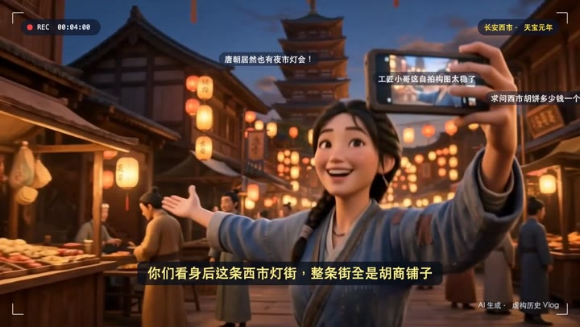

```text
用「历史人物第一视角自拍 Vlog」：先生成一位原创虚构历史人物（非真人）举手机自拍的定妆照，再以参考图模式生成第一视角手持自拍边走边展示古代夜市灯火的动态视频；代码在画面上叠加拟真手机前置 REC 闪烁红点与计时器、古代地标定位角标、横向飘过的观众互动弹幕以及底部大号口播字幕，营造高网感跨时空沉浸体验。
```

- 内容类型：旅行和城市
- 素材：生图 · 生视频
- 技术类型：角色一致性 · 图生视频与首尾帧
- 适合：文旅创意宣传、历史趣味科普、品牌玩梗与原生 AI IP 连载
- 技术（已验证）：NumPy · Skia · ffmpeg
- 样片代码：[samples/G-026/](https://github.com/Chans-gh/AI-Coding-Video/tree/main/samples/G-026)
- 技术（建议）：NumPy · Skia · ffmpeg
- 参考：—

<a id="G-027"></a>

## G-027 穿物一镜到底微距穿越

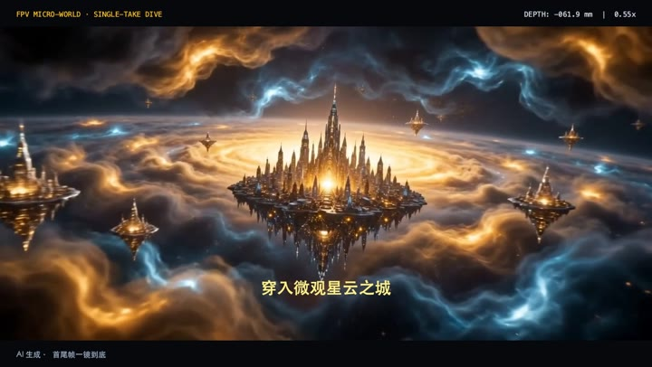

```text
用「穿物一镜到底微距穿越」：分别生成微距拿铁咖啡液面首帧与液面之下的奇幻微观星云城市尾帧，由首尾帧视频模型生成无剪辑感的 FPV 俯冲穿入一镜到底画面；代码按钟形曲线对穿入液面瞬间施加 3.0x 俯冲变速、多帧快门运动模糊与微缩放冲击，上下加电影宽银幕黑边与实时微距深度读数。
```

- 内容类型：品牌宣传片
- 素材：生图 · 生视频
- 技术类型：图生视频与首尾帧 · 节拍对齐剪辑
- 适合：品牌高概念创意大片、饮品与科技新品视觉钩子、文旅奇幻转场
- 技术（已验证）：NumPy · Skia · ffmpeg
- 样片代码：[samples/G-027/](https://github.com/Chans-gh/AI-Coding-Video/tree/main/samples/G-027)
- 技术（建议）：NumPy · Skia · ffmpeg
- 参考：—

<a id="G-028"></a>

## G-028 实景转粘土定格微缩重绘

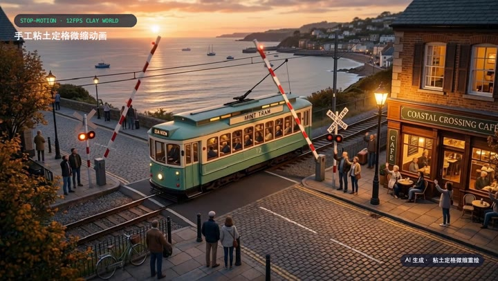

```text
用「实景转粘土定格微缩重绘」：先准备海滨铁道街角写实画面，再以它为参考图保持构图与主体位置不变、整幅重绘为手工粘土微缩模型风格，随后驱动粘土场景生成小电车与行人活动的动态画面；代码先做写实到粘土的琥珀扫光擦除对比，再对粘土动态段施加 12fps 抽帧定格质感（Posterize Time），还原手工逐帧定格动画的触感。
```

- 内容类型：短剧 / 动漫剧 / 故事
- 素材：生图 · 生视频
- 技术类型：视频转视频与风格重绘 · 图生视频与首尾帧
- 适合：风格化短片、城市微缩宣传、治愈系社交媒体短视频与前后对比玩法
- 技术（已验证）：NumPy · Skia · ffmpeg
- 样片代码：[samples/G-028/](https://github.com/Chans-gh/AI-Coding-Video/tree/main/samples/G-028)
- 技术（建议）：NumPy · Skia · ffmpeg
- 参考：—

<a id="G-029"></a>

## G-029 文字闪切

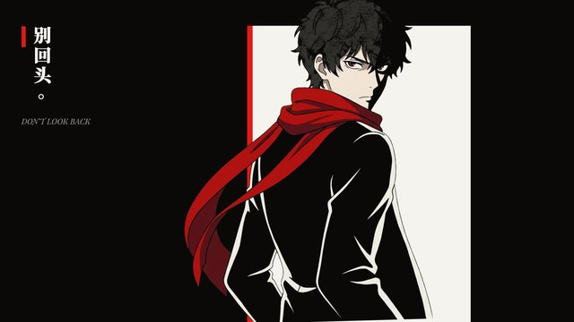

```text
用「文字闪切」：以红（#E01A14）、黑（#0A0908）、纸白（#F5F3EE）严格三色构图，绿幕生成平涂硬阴影角色背影、回头半身与眼部大特写并收敛三色；代码把建筑压成单点透视走廊与无限楼梯，踩着 150 BPM 节拍交替插切 2–6 帧带砸入震动的大字闪卡、左右定色竖排发言边栏、按拍跳步剪影、剪影甩头残影切平涂加 2 帧红黑对调反相（绝非 RGB 反色），最终以红色光隙与非对称标题卡收束。
```

- 内容类型：短剧 / 动漫剧 / 故事
- 素材：生图
- 技术类型：生图加代码动画 · 节拍对齐剪辑
- 适合：悬疑动漫预告、倒计时宣言片、强冲突对话短剧与概念片头
- 技术（已验证）：Canvas 2D · Playwright · ffmpeg
- 样片代码：[samples/G-029/](https://github.com/Chans-gh/AI-Coding-Video/tree/main/samples/G-029)
- 技术（建议）：Canvas 2D · Playwright · ffmpeg
- 参考：[Lemo 说明](https://github.com/lemomo-ai/lemo-opuscar/blob/main/styles/text-flash-cuts/STYLE.md)

<a id="G-030"></a>

## G-030 黑白漫画分格

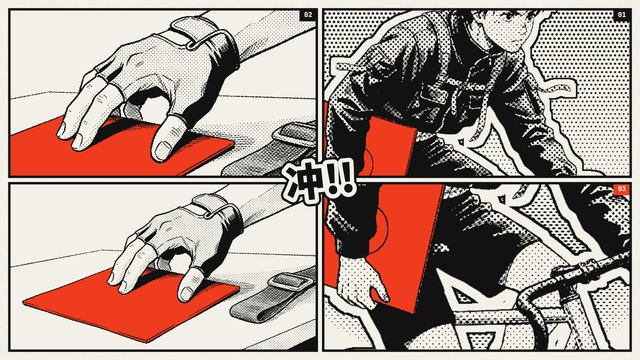

```text
用「黑白漫画分格」：准备手绘 G 笔墨线与平灰阶原画并保留唯一一件道具为朱红色（#F03C1E），由 Python 把中间灰阶转印成 45° 圆形 AM 网点并给破格角色加暖纸「白フチ」外框；代码按漫画阅读顺序（右→左、上→下）让斜切黑框分格踩拍擦开，叠 10fps 抖动拟声字、集中线与角色跨沟出格飞跃，在 1→2→4→8→16 爆裂分格与反白冲击帧后骤然切入静默留白的「間」落针格，以奥付版权格收尾。
```

- 内容类型：短剧 / 动漫剧 / 故事
- 素材：生图
- 技术类型：生图加代码动画 · 节拍对齐剪辑
- 适合：漫画化动漫预告、产品拟漫画发布、潮牌与街拍音乐 MV
- 技术（已验证）：Canvas 2D · Playwright · ffmpeg
- 样片代码：[samples/G-030/](https://github.com/Chans-gh/AI-Coding-Video/tree/main/samples/G-030)
- 技术（建议）：Canvas 2D · Playwright · ffmpeg
- 参考：[Lemo 说明](https://github.com/lemomo-ai/lemo-opuscar/blob/main/styles/manga-panels/STYLE.md)

<a id="G-031"></a>

## G-031 搞笑历史卡通

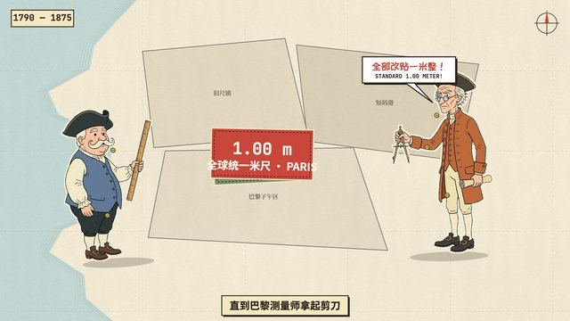

```text
用「搞笑历史卡通」：在程序生成的暖米色雕版印刷地图底上，导入绿幕抠像并带撕纸白边的原创剪纸人偶，以 12fps 一拍二弹簧过冲与黄铜「割ピン」关节铆钉驱动动作；通过红柄剪刀沿虚线剪图、高空带大投射阴影飞落并在落地拍平的纸贴、掀角卷边与 2.5D 纸层堆叠倾斜演绎变迁，配诙谐语音合成旁白与淡黄墨框字幕条，片尾拉远露出木桌上的四格完整漫画页。
```

- 内容类型：知识科普讲解
- 素材：生图 · 语音合成
- 技术类型：生图加代码动画 · 角色一致性 · 语音合成驱动
- 适合：历史与地理趣闻科普、度量衡与制度演变、企业发展轻喜剧与品牌玩梗
- 技术（已验证）：Canvas 2D · Playwright · ffmpeg
- 样片代码：[samples/G-031/](https://github.com/Chans-gh/AI-Coding-Video/tree/main/samples/G-031)
- 技术（建议）：Canvas 2D · Playwright · ffmpeg
- 参考：[Lemo 说明](https://github.com/lemomo-ai/lemo-opuscar/blob/main/styles/comic-history/STYLE.md)
