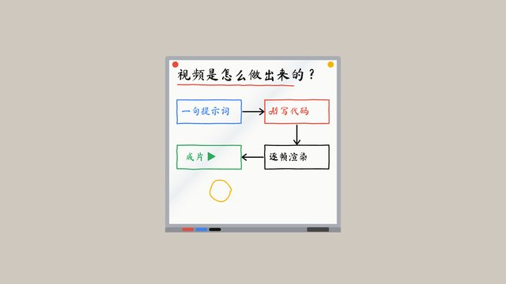
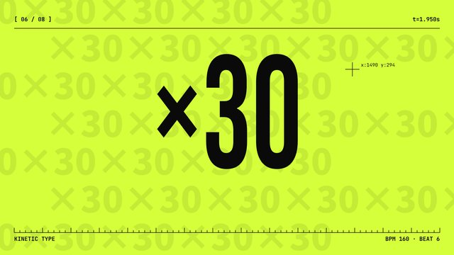
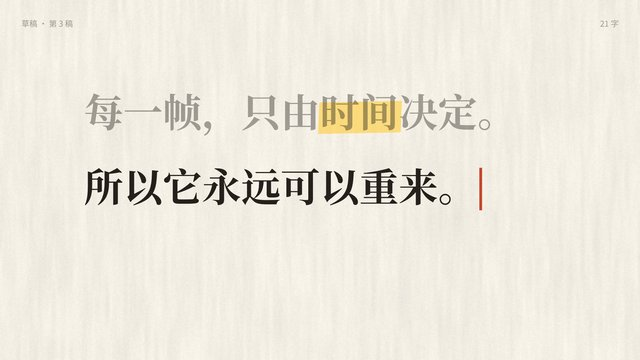
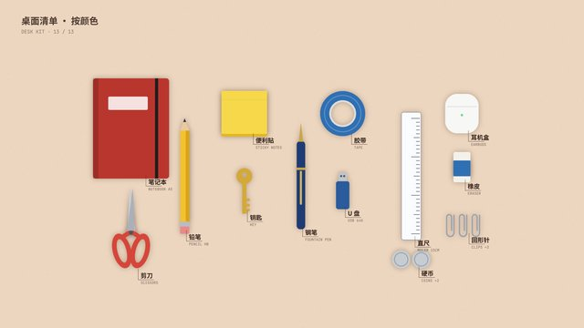
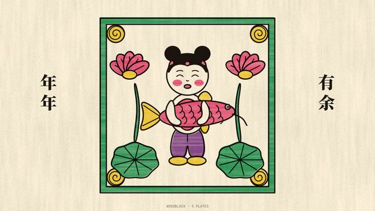
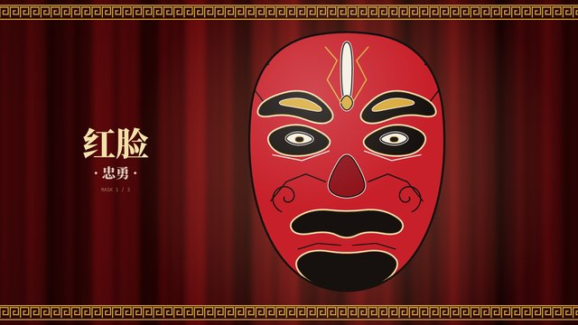
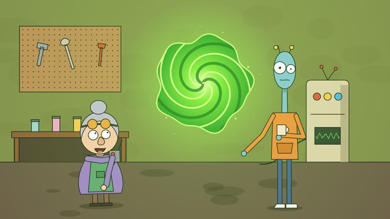

# SVG 与 HTML/CSS（54 种）

[← 选风格索引](../index.md) · [提示词方法](../prompting.md) · [技术标签](../tags.md)

画面是矢量图形或网页元素：SVG 路径动画、HTML/CSS 排版，常配 GSAP 做时间轴。排版、图解、界面类风格在这里。

每个条目依次是：样片缩略图（已渲染的才有）、一句可直接复制的风格提示词、题材、适合讲什么、技术标签、参考链接。「技术（已验证）」表示仓库里有真能跑出这段样片的代码；「技术（建议）」是推荐写法，还没有样片验证。

<a id="C-008"></a>

## C-008 一笔画

```text
用一笔画风格：一根不离纸的黑色墨线在暖白纸上连续画出所有人物和场景，笔尖始终可见地向前移动，转场就是这根线变形成下一个画面，结尾镜头拉远，所有画过的东西原来是一整幅画。
```

- 题材：手绘与绘画
- 适合：开场、收尾、人生故事
- 技术（建议）：SVG · GSAP
- 参考：[Lemo 说明](https://github.com/lemomo-ai/lemo-opuscar/blob/main/styles/one-line/STYLE.md) · [源码](https://github.com/yasinozmeen/animasyon-stil-katalogu/tree/main/stiller/tek-cizgi)

<a id="C-009"></a>

## C-009 白板讲解



```text
用白板讲解风格：一整块略反光的白板，手写字和简笔图是一笔一笔真正写出来的，悬浮的马克笔没有手，可以用磁铁移动元素、用板擦“倒带”，镜头全程不离开白板，最后拉远看到整块写满的板。
```

- 题材：手绘与绘画
- 适合：科普、“怎么运作”
- 技术（已验证）：Canvas 2D · Playwright · ffmpeg
- 样片代码：[samples/C-009/](https://github.com/Chans-gh/AI-Coding-Video/tree/main/samples/C-009)
- 技术（建议）：SVG · Rough.js · GSAP
- 参考：[Lemo 说明](https://github.com/lemomo-ai/lemo-opuscar/blob/main/styles/whiteboard/STYLE.md) · [源码](https://github.com/yasinozmeen/animasyon-stil-katalogu/tree/main/stiller/beyaz-tahta)

<a id="C-015"></a>

## C-015 红色窗花剪纸


```text
用中国红色窗花剪纸风格：所有形象都是一张红纸镂空剪出来的，“剪即是画”，镂空处透出底色的光，背景是宣纸或靛蓝夜色纸，角色是关节式剪纸人，全片只用红、纸白、靛蓝三色。
```

- 题材：东方传统
- 适合：春节、民俗
- 技术（已验证）：Canvas 2D · Playwright · ffmpeg
- 样片代码：[samples/C-015/](https://github.com/Chans-gh/AI-Coding-Video/tree/main/samples/C-015)
- 技术（建议）：SVG · Canvas 2D
- 参考：[Lemo 说明](https://github.com/lemomo-ai/lemo-opuscar/blob/main/styles/papercut-red/STYLE.md)

<a id="C-020"></a>

## C-020 复古半调案卷

```text
用复古半调案卷风格：米色档案纸，四种平涂油墨叠印出半调网点，超大粗体标题带错位阴影，橡皮图章重重砸下，一个粗描边的胖吉祥物当“嫌疑人”，内容像调查报告一样按“证物”逐条出示。
```

- 题材：印刷、版画与装饰
- 适合：调查式讲解、趣味科普
- 技术（建议）：SVG · HTML/CSS
- 参考：[Lemo 说明](https://github.com/lemomo-ai/lemo-opuscar/blob/main/styles/halftone-dossier/STYLE.md)

<a id="C-021"></a>

## C-021 蓝图 / 工程制图

```text
用蓝图工程制图风格：普鲁士蓝晒图纸带折痕和水渍，白色技术线分 4 种粗细，按真实制图顺序画出（中心线→轮廓→虚线→尺寸线），手写标注和尺寸会动，右下角有图框标题栏和一个红色印章。
```

- 题材：印刷、版画与装饰
- 适合：产品原理、结构拆解
- 技术（建议）：SVG
- 参考：[Lemo 说明](https://github.com/lemomo-ai/lemo-opuscar/blob/main/styles/blueprint/STYLE.md) · [源码](https://github.com/yasinozmeen/animasyon-stil-katalogu/tree/main/stiller/blueprint)

<a id="C-024"></a>

## C-024 装饰艺术（Art Deco）

```text
用 1930 年代装饰艺术（Art Deco）风格：黑漆底、金色雕刻线、喷枪渐变的几何形，每个构图都有一条中轴、左右对称，转场沿中轴开合，灯泡一个一个亮起，像一张会动的豪华酒店海报，爵士乐配乐。
```

- 题材：印刷、版画与装饰
- 适合：高端品牌、酒店、爵士题材
- 技术（建议）：SVG · GSAP
- 参考：[Lemo 说明](https://github.com/lemomo-ai/lemo-opuscar/blob/main/styles/art-deco/STYLE.md)

<a id="C-031"></a>

## C-031 包豪斯

```text
用包豪斯风格：米白底加浅网格，只用圆、方、三角三种基本形和红、黄、蓝、黑四色，超大无衬线粗体字压在网格上，形状滑入、旋转、切割组成海报式构图，转场用一个大色块擦过整屏。
```

- 题材：平面设计与动态排版
- 适合：原则、步骤、强信息
- 技术（建议）：SVG · GSAP
- 参考：[源码](https://github.com/yasinozmeen/animasyon-stil-katalogu/tree/main/stiller/bauhaus)

<a id="C-032"></a>

## C-032 孟菲斯

```text
用 80 年代孟菲斯风格：粉色、薄荷绿、明黄等糖果色撞色，满屏漂浮波浪线、锯齿、圆点阵、小三角，粗黑描边加错位硬阴影，所有元素弹跳入场带过冲，节奏活泼。
```

- 题材：平面设计与动态排版
- 适合：轻松公告、短视频
- 技术（建议）：SVG · GSAP
- 参考：[源码](https://github.com/yasinozmeen/animasyon-stil-katalogu/tree/main/stiller/memphis)

<a id="C-033"></a>

## C-033 瑞士国际主义排版

```text
用瑞士国际主义动态排版风格：白底模块化网格，只用一种无衬线字体、黑白加一个信号红，文字和色块严格沿网格对齐、也可竖排，运动像印刷机一样精准卡拍，没有任何装饰和渐变。
```

- 题材：平面设计与动态排版
- 适合：设计、规则类内容
- 技术（建议）：HTML/CSS · GSAP
- 参考：[Lemo 说明](https://github.com/lemomo-ai/lemo-opuscar/blob/main/styles/swiss-motion/STYLE.md)

<a id="C-034"></a>

## C-034 60 年代间谍片头

```text
用 60 年代间谍片片头风格：剪纸剪影人物在由演职员字幕搭成的布景里追逐，只用四种平涂油墨（黑、暖白、橙红、芒黄之类），每一声铜管重音就是一个剪切，最后才拼出片名，爵士大乐队配乐。
```

- 题材：平面设计与动态排版
- 适合：片头、预告
- 技术（建议）：SVG · GSAP
- 参考：[Lemo 说明](https://github.com/lemomo-ai/lemo-opuscar/blob/main/styles/spy-titles/STYLE.md)

<a id="C-036"></a>

## C-036 动态文字排版



```text
用动态文字排版风格：画面里只有字，纯色暖灰底，一种粗体无衬线加一种衣线斜体做对比，字词跟旁白或节拍逐个出现，靠字号大小、粗细、位移和挤压制造节奏，句末用一个彩色圆点收尾。
```

- 题材：平面设计与动态排版
- 适合：金句、短视频钩子、作品集
- 技术（已验证）：Canvas 2D · Playwright · ffmpeg
- 样片代码：[samples/C-036/](https://github.com/Chans-gh/AI-Coding-Video/tree/main/samples/C-036)
- 技术（建议）：HTML/CSS · GSAP
- 参考：[源码](https://github.com/yasinozmeen/animasyon-stil-katalogu/tree/main/stiller/kinetik-tipografi) · [kinetic-reel](https://github.com/tuzhechen2005/opus-video-skills) · [@stephanlivera](https://x.com/stephanlivera/status/2103315922098470926)

<a id="C-037"></a>

## C-037 象形图运动图形

```text
用象形图运动图形风格：纯色平涂底加方格“核心图形”（圆、半圆、小花纹格，各行互相滑动），圆头杆状几何小人做动作，双语粗体字从下往上滑出，每张闪卡卡在节拍上切换，没有描边和纹理。
```

- 题材：平面设计与动态排版
- 适合：赛事、分类介绍
- 技术（建议）：SVG
- 参考：[Lemo 说明](https://github.com/lemomo-ai/lemo-opuscar/blob/main/styles/pictogram-motion/STYLE.md)

<a id="C-038"></a>

## C-038 科普扁平（Kurzgesagt 式）


```text
用科普扁平插画风格：深蓝紫太空背景配高饱和渐变，圆润几何造型、无描边、边缘带一道柔光，前中后景分层造出深度，数字和概念用大量小圆点粒子可视化，镜头平滑推进并带轻微弹性。
```

- 题材：信息讲解与产品发布
- 适合：科学概念
- 技术（已验证）：Canvas 2D · Playwright · ffmpeg
- 样片代码：[samples/C-038/](https://github.com/Chans-gh/AI-Coding-Video/tree/main/samples/C-038)
- 技术（建议）：SVG · Canvas 2D
- 参考：[源码](https://github.com/yasinozmeen/animasyon-stil-katalogu/tree/main/stiller/kurzgesagt)

<a id="C-039"></a>

## C-039 等距信息图

```text
用等距信息图风格：整个系统是一座 30° 等距微缩沙盘，每个方块只用亮、中、暗三个色阶平涂，细墨线标注和 Isotype 式数字图标，镜头一镜到底穿过整条流程、剖开物体看内部，最后拉远成一张可打印的信息图。
```

- 题材：信息讲解与产品发布
- 适合：流程、系统拆解
- 技术（建议）：SVG
- 参考：[Lemo 说明](https://github.com/lemomo-ai/lemo-opuscar/blob/main/styles/iso-infographic/STYLE.md) · [源码](https://github.com/yasinozmeen/animasyon-stil-katalogu/tree/main/stiller/izometrik)

<a id="C-040"></a>

## C-040 数据叙事

```text
用数据叙事风格：米色纸上用红蓝铅笔把真实数据一个点一个点画出来，每个数据点出现时响一个音，手写批注钉在关键数字旁，图表本身就是镜头和情节，数字只能来自我提供的数据文件。
```

- 题材：信息讲解与产品发布
- 适合：用数字说话、前后对比
- 技术（建议）：SVG · D3.js
- 参考：[Lemo 说明](https://github.com/lemomo-ai/lemo-opuscar/blob/main/styles/dataviz/STYLE.md) · [源码](https://github.com/yasinozmeen/animasyon-stil-katalogu/tree/main/stiller/veri)

<a id="C-042"></a>

## C-042 极简图解 / 时间轴

```text
用极简图解时间轴风格：米白底、细黑线方框和箭头组成关系图，只用一个红色强调当前节点，底部是带年份刻度的时间轴并随讲解推进，左上角大号年份标题，边讲边画线连接。
```

- 题材：信息讲解与产品发布
- 适合：历史、行业史、技术科普
- 技术（建议）：SVG
- 参考：[@akokoi1](https://x.com/akokoi1/status/2102583898865873225) · [@Tz_2022](https://x.com/Tz_2022/status/2102838830285898214)

<a id="C-043"></a>

## C-043 说明书 / 步骤图

```text
用家具说明书风格：白底、细线条线稿和简单立体板件，每步左上角标“Step N / 总步数”，零件带编号标签和数量，箭头指示安装方向，易错处用黄色警告框，每步结束停顿一下再进入下一步。
```

- 题材：信息讲解与产品发布
- 适合：教程、菜谱、组装
- 技术（建议）：SVG
- 参考：[@Ror_Fly](https://x.com/Ror_Fly/status/2102853258582880547)

<a id="C-046"></a>

## C-046 UI 形变循环

```text
用 UI 形变循环风格：暖灰底、一种几何无衬线字体、单色加一个强调色，一个界面元素连续形变成下一个（按钮→加载→对勾→卡片…），每次点击和拖动都由可见光标触发，用克制的弹簧动画卡拍，最后一帧与第一帧完全相同可无缝循环；禁用弹跳缓动、粒子和发光。
```

- 题材：信息讲解与产品发布
- 适合：产品动效、作品集
- 技术（建议）：HTML/CSS · Motion
- 参考：[实现清单](https://github.com/opusvideo/awesome-claude-video/blob/main/IMPLEMENTATION_GUIDES.md)

<a id="C-050"></a>

## C-050 科幻情景喜剧卡通

```text
用成人向科幻情景喜剧卡通风格：粗黑描边每帧轻微抖动、平涂无渐变，实验室里堆满稀奇古怪的装置，一个发光的绿色传送门，每个平行宇宙换一套完全不同的配色，对白驱动的冷幽默。
```

- 题材：卡通与动漫
- 适合：成人向搞笑
- 技术（建议）：SVG
- 参考：[Lemo 说明](https://github.com/lemomo-ai/lemo-opuscar/blob/main/styles/scifi-toon/STYLE.md)

<a id="C-051"></a>

## C-051 扁平矢量角色短片

```text
用扁平矢量角色短片风格：白底或浅色单色背景，细黑线勾出简化场景，主角是一个造型简单、轮廓清晰的小角色并全片不变，色块平涂无阴影，动作有预备和过冲，一个镜头讲一个小笑点。
```

- 题材：卡通与动漫
- 适合：日常小故事、App 广告；可附上你自己的角色图
- 技术（建议）：SVG · GSAP
- 参考：[@YoshiKura535130](https://x.com/YoshiKura535130/status/2102910805721362875)

<a id="C-057"></a>

## C-057 综艺节奏扁平

```text
用综艺节奏游戏扁平风格：豆子形吉祥物带 8px 墨色描边和硬投影，糖果色条纹和放射光背景，无渐变无纹理，每个动作卡在 150 BPM 的节拍上，一问一答式表演，每关结尾弹出“Perfect!”。
```

- 题材：游戏
- 适合：节奏综艺、年度回顾
- 技术（建议）：SVG · GSAP
- 参考：[Lemo 说明](https://github.com/lemomo-ai/lemo-opuscar/blob/main/styles/game-show/STYLE.md)

<a id="C-065"></a>

## C-065 科幻 HUD 界面

```text
用科幻 HUD 界面风格：深蓝黑底、冷青白色发丝细线，四角有取景框和小字号等宽字读数，雷达圆环、波形和进度数字实时跳动，锁定框吸附到目标上，元素出现时带扫描和轻微故障闪烁。
```

- 题材：电影年代与屏幕科技
- 适合：分析、评分
- 技术（建议）：SVG · Canvas 2D
- 参考：[源码](https://github.com/yasinozmeen/animasyon-stil-katalogu/tree/main/stiller/hud)

<a id="C-066"></a>

## C-066 代码编辑器叙事

```text
用代码编辑器叙事风格：深色编辑器界面就是舞台，代码行用彩色圆角色块抽象表示，一个发光的小 bug 是主角，巨大的鼠标光标是对手，追逐在行与行之间发生，结尾整屏暗下。
```

- 题材：电影年代与屏幕科技
- 适合：开发者故事
- 技术（建议）：HTML/CSS
- 参考：[@shneural](https://x.com/shneural/status/2103472385563459833)

<a id="C-083"></a>

## C-083 玻璃拟态极光

```text
用玻璃拟态极光风格：深午夜蓝背景（#070b1f）上三条缓慢漂移的青、紫、玫红极光带和微弱星点，前景是毛玻璃面板（背景模糊、1px 内高光描边、细颗粒），大号细体无衬线标题，核心元素（如呼吸球）柔和地缩放发光，整体安静高级。
```

- 题材：信息讲解与产品发布
- 适合：消费类 App、冥想健康、氛围感首屏
- 技术（建议）：HTML/CSS · WebGL

<a id="C-085"></a>

## C-085 地图路线动画

```text
用地图路线动画风格：米白色简洁底图、淡蓝水域和浅灰行政边界，路线用一条橙红色大圆弧线从起点实时画到终点，镜头跟着线头移动并逐渐缩放，角落有里程计数器和经纬度小卡片，城市名用小号无衬线字标注。
```

- 题材：信息讲解与产品发布
- 适合：物流、出行、旅行、路演里的地理叙事
- 技术（建议）：SVG · D3.js

<a id="C-086"></a>

## C-086 无缝循环科普插画

```text
用扁平分层插画的无缝循环风格：柔和低饱和配色的风景（海、雪山、森林、河流），云和雨是分层平涂而非写实体积，过程按阶段出现中英小标签，所有运动都是周期函数，最后一帧与第一帧完全一致可无限循环。
```

- 题材：信息讲解与产品发布
- 适合：科普素材、网站背景、展厅屏幕
- 技术（建议）：SVG

<a id="C-095"></a>

## C-095 国风纸片拼贴

```text
用国风纸片拼贴动画风格：画面主体（人、动物、器物、山、云）拆成一张张白描纸片，叠在墨线山水底图上，纸片边缘撕出毛边并带硬纸投影，每张纸片从侧下方带回弹滑入、之后缓慢呼吸浮动，主角动得多、远景几乎不动，全片只有一个高饱和色：朱红印章；中文由代码渲染，不让模型把字画进图里。
```

- 题材：东方传统
- 适合：成语、古诗、国学与传统文化科普
- 技术（建议）：SVG
- 参考：[国风视觉 DNA](https://github.com/AllenAI2014/remotion-guofeng-starter/blob/main/style/design.md) · [remotion-guofeng-starter](https://github.com/AllenAI2014/remotion-guofeng-starter)

<a id="C-098"></a>

## C-098 丝网印刷旅行海报

```text
用丝网印刷旅行海报风格：4–6 种不透明的平涂油墨一色一色印出来，用分层色带代替渐变，各层套印错位 1–3 px、留下一丝纸白缝，米色纸张带纤维和针孔，底部一条深色信息带放地名和数字，信息像印刷一样一层一拍地出现；参考上世纪国家公园丝网海报的做法，不照搬任何真实海报。
```

- 题材：印刷、版画与装饰
- 适合：旅行指南、活动海报、景点与路线系列
- 技术（建议）：SVG · Canvas 2D
- 参考：[Lemo 说明](https://github.com/lemomo-ai/lemo-opuscar/blob/main/styles/silkscreen-poster/STYLE.md)

<a id="C-100"></a>

## C-100 旧档案剪贴簿

```text
用旧档案剪贴簿风格：泛黄、带锈斑的老相册页，撕边卡片用发黄的胶带粘住或用木夹子夹在麻绳上，卡片上是手工上过淡彩的铜版插画，配打字机字、勒索信式剪字和红笔批注，最后盖一个橡皮章。
```

- 题材：纸艺、材质与定格
- 适合：调查与历史故事、田野笔记、悬疑纪录片
- 技术（建议）：HTML/CSS
- 参考：[anidoodle 配方](https://github.com/alexgreensh/anidoodle/blob/main/skills/anidoodle/references/styles/scrapbook.md)

<a id="C-101"></a>

## C-101 海报色块动态字

```text
用海报色块动态字风格：巨大的、被裁掉一半的单词，大面积纯色块跟着拍子砸进画面，字体超粗、颜色高饱和，文字从画面边缘撞入，每次卡点换一块色场。
```

- 题材：平面设计与动态排版
- 适合：音乐节与活动预告、品牌宣言、消费类应用
- 技术（建议）：HTML/CSS · GSAP
- 参考：[bang-motion 风格画廊](https://github.com/bangtutorial/bang-motion#style-gallery)

<a id="C-103"></a>

## C-103 白色目录册

```text
用白色目录册风格：白底浅格线，产品抠图居中，手写体和粗黑无衬线混排，一个大号浅灰数字当背景，虚线圈和手写批注指向产品细节，黄色荧光笔划出关键词。
```

- 题材：信息讲解与产品发布
- 适合：产品介绍、品牌故事、电商与新品发布
- 技术（建议）：HTML/CSS
- 参考：[bang-motion 风格画廊](https://github.com/bangtutorial/bang-motion#style-gallery)

<a id="C-104"></a>

## C-104 1950 年代中世纪卡通

```text
用 1950 年代中世纪（Mid-century）卡通风格：颜色印得和断开的墨线错开几个像素、按两帧一拍抖动，人物是蛋形头和豆形头的几何造型，讲解人的身体不动、只有手臂、手、眼睛和嘴在动，房间只有一块色面加一条地板线，用温暖的原子时代互补色，配冷爵士小乐队。
```

- 题材：卡通与动漫
- 适合：操作指南、产品使用步骤、食谱卡、安全提示
- 技术（建议）：SVG
- 参考：[Lemo 说明](https://github.com/lemomo-ai/lemo-opuscar/blob/main/styles/midcentury-toon/STYLE.md) · [同风格静帧：anidoodle](https://github.com/alexgreensh/anidoodle/blob/main/skills/anidoodle/references/styles/INDEX.md)

<a id="C-112"></a>

## C-112 电视新闻包装

```text
用电视新闻包装风格：深墨色底，片头标识缩成角标，今日要闻目录开场又在结尾逐条打勾，平行四边形台标和纸色字条始终压在画面下方、换标题时上下翻转，每屏只放一个事实（翻牌价格板、破线折线、说明地图、盖章），干净无滚动字幕，配新闻鼓点。
```

- 题材：平面设计与动态排版
- 适合：每日简报、行业快讯、周报回顾
- 技术（建议）：HTML/CSS · SVG · GSAP
- 参考：[Lemo STYLE.md](https://github.com/lemomo-ai/lemo-opuscar/blob/main/styles/news-package/STYLE.md)

<a id="C-113"></a>

## C-113 翻牌显示板

```text
用翻牌显示板风格：车站出发信息牌，深色底板上一格格带铰链缝的翻片，文字逐列哗啦翻过字母表后停在新消息上，表格列出时间、目的地、站台和状态，琥珀、绿、红三色状态灯其中一盏在闪，顶部有站名和走动的钟，每次翻片都配密集的咔哒声。
```

- 题材：平面设计与动态排版
- 适合：发布公告、行程安排、版本更新
- 技术（建议）：HTML/CSS · GSAP · Web Audio
- 参考：[code-video splitflap.md](https://github.com/Changroro/code-video/blob/main/references/styles/splitflap.md)

<a id="C-115"></a>

## C-115 热敏小票

```text
用热敏小票风格：青绿色桌面底部摆着一台深色小票打印机，每一场打出一张米白热敏纸，从机口一行行往上长出来，等宽字、虚线分隔、底部条形码、锯齿撕边，步骤是逐个打勾的清单，数字印在“合计”一行，结尾盖红章再撕下，配打印机走纸声。
```

- 题材：平面设计与动态排版
- 适合：清单总结、价格说明、年度账单
- 技术（建议）：HTML/CSS · SVG · GSAP
- 参考：[code-video thermal.md](https://github.com/Changroro/code-video/blob/main/references/styles/thermal.md)

<a id="C-117"></a>

## C-117 侦探线索板

```text
用侦探线索板风格：台灯照亮的软木板，四周暗角压黑，中央是一张写着问号的嫌疑人剪影卡，带编号的米色索引卡和黄、粉便签一张张钉上，红图钉之间拉紧红线织成网，镜头只做横移和缓推，一次相机闪光白场揭晓答案并盖上“结案”红章。
```

- 题材：信息讲解与产品发布
- 适合：问题排查、悬疑揭秘、案例复盘
- 技术（建议）：HTML/CSS · SVG · GSAP
- 参考：[code-video detective.md](https://github.com/Changroro/code-video/blob/main/references/styles/detective.md)

<a id="C-118"></a>

## C-118 电视天气预报

```text
用电视天气预报风格：上浅下深的藏青渐变底，开场是一团由发光圆点组成的旋转风暴云，随后切到一张张圆角预报卡：温度图、温度计、风速表盘、多日预报条，图标是带软阴影的扁平天气图标，角上有台标和日期徽标，底部滚动快讯条，场景间斜向快速擦除。
```

- 题材：信息讲解与产品发布
- 适合：状态报告、季度预测、趣味数据播报
- 技术（建议）：SVG · HTML/CSS · GSAP
- 参考：[code-video weather.md](https://github.com/Changroro/code-video/blob/main/references/styles/weather.md)

<a id="C-119"></a>

## C-119 电视购物

```text
用电视购物风格：每一句卖点独占一屏，满屏单色放射光芒背景、颜色随段落从灰黑换到金黄、警报红、电光蓝，粗描边漫画大字砸进画面，底部滚动卖点条一直在跑，圆滚滚的吉祥物从垂头丧气变得神采飞扬，镜头不动、硬切前闪一帧白，配热闹的叫卖音效。
```

- 题材：卡通与动漫
- 适合：促销活动、产品对比、搞笑广告
- 技术（建议）：SVG · HTML/CSS · GSAP
- 参考：[code-video infomercial.md](https://github.com/Changroro/code-video/blob/main/references/styles/infomercial.md)

<a id="C-120"></a>

## C-120 体育直播包装

```text
用体育直播包装风格：开场是夜场体育馆，交叉的探照光束、点阵灯组成的看台和一角绿茵，之后是带球衣斜纹的深藏青数据卡，左上比分角标、右上红色“直播”徽章、底部来源滚动条始终不动，双方用橙和灰蓝区分，数字滚动、对比条填满，高潮撒彩纸。
```

- 题材：平面设计与动态排版
- 适合：两款产品对比、排行榜、年度成绩
- 技术（建议）：HTML/CSS · SVG · GSAP
- 参考：[code-video sports.md](https://github.com/Changroro/code-video/blob/main/references/styles/sports.md)

<a id="C-123"></a>

## C-123 手账剪贴本

```text
用手账剪贴本风格：牛皮纸桌面上斜放着横线笔记本页，拍立得照片用米色和薄荷色和纸胶带贴住、下面写手写说明，撕边纸条标关键词，模切贴纸和橡皮章标记里程碑，红蓝马克笔画箭头、星星和圈，元素都歪 2–8°，换场时一页新纸滑过桌面。
```

- 题材：纸艺、材质与定格
- 适合：项目幕后、成长记录、旅行日志
- 技术（建议）：HTML/CSS · SVG · GSAP
- 参考：[code-video scrapbook.md](https://github.com/Changroro/code-video/blob/main/references/styles/scrapbook.md)

<a id="C-124"></a>

## C-124 平板黑板马克笔

```text
用平板黑板马克笔风格：纯黑数位画板，3–6 px 圆头单线笔画带轻微手抖，按说话的速度一笔笔画出来，一支数位笔尖始终跟着笔头，白、蓝、绿、黄、红五色各有固定含义，手写标签，红色实心箭头像图章一样盖下，每块板只长一张图，只配人声。
```

- 题材：手绘与绘画
- 适合：技术原理、安全漏洞讲解、计算机科普
- 技术（建议）：SVG · Remotion
- 参考：[animation-skills board-explainer](https://github.com/madhavsomani/animation-skills/blob/main/skills/board-explainer/SKILL.md)

<a id="C-125"></a>

## C-125 机密档案袋

```text
用机密档案袋风格：台灯光圈下的深色木桌，牛皮纸档案夹和米色备忘纸，打字机字随旁白逐词敲出，旧橡皮章在关键词上重重砸下，红铅笔箭头和勾、荧光笔划痕、黑色涂抹条、回形针和地图图钉，配打字机、纸张和盖章音效。
```

- 题材：信息讲解与产品发布
- 适合：政策解读、安全事件、历史揭秘
- 技术（建议）：SVG · Remotion
- 参考：[animation-skills declassified-dossier](https://github.com/madhavsomani/animation-skills/blob/main/skills/declassified-dossier/SKILL.md)

<a id="C-137"></a>

## C-137 新艺术运动

```text
用新艺术运动风格：画面被一圈鞭子般弯曲的有机线框住，线条外粗内细，主角身后衬一个圆形光环，长发和衣褶卷成 S 形波浪，配色是橄榄绿、芥末黄、蜜桃粉和金，边框上的花藤从四角长出来，转场是金边曲线生长并包住整个新画面。
```

- 题材：印刷、版画与装饰
- 适合：海报式开场、美妆与香氛、文学与诗歌
- 技术（建议）：SVG · GSAP
- 参考：[huashu 风格卡 10_nouveau](https://github.com/alchaincyf/huashu-art-motion/blob/main/references/%E9%A3%8E%E6%A0%BC%E9%85%8D%E6%96%B9/10_nouveau.md) · [huashu 风格卡 18_klimt](https://github.com/alchaincyf/huashu-art-motion/blob/main/references/%E9%A3%8E%E6%A0%BC%E9%85%8D%E6%96%B9/18_klimt.md)

<a id="C-143"></a>

## C-143 俄国构成主义

```text
用俄国构成主义风格：灰卡纸底上只有黑和红两色大平面与斜放的粗体方块字，代码画出的灰度“照片”经网点化后剪下、带白边贴上去，红色楔形直刺黑色圆形，构图沿对角线冲出画框，标语逐字像盖章一样砸下，镜头在拼贴板上快速推拉。
```

- 题材：平面设计与动态排版
- 适合：宣言与观点片、工业与工程史、论证型讲解
- 技术（建议）：SVG · Canvas 2D · GSAP
- 参考：[huashu 风格卡 22_constructivism](https://github.com/alchaincyf/huashu-art-motion/blob/main/references/%E9%A3%8E%E6%A0%BC%E9%85%8D%E6%96%B9/22_constructivism.md) · [opus-5.5-mv photomontage](https://github.com/cyborggirl963/opus-5.5-music-video-art-styles/tree/main/styles/photomontage)

<a id="C-146"></a>

## C-146 野兽派彩纸剪贴

```text
用野兽派彩纸剪贴风格：先刷满浓烈水粉的彩纸再直接用剪刀剪出形状，海藻、叶片、星形和舞动人形的边缘带不规则剪口，钴蓝、柠檬黄、品红和翠绿平涂并排，纸片用图钉钉在白墙上留下细小投影，纸角随风轻轻翘动，转场是一大张蓝纸从侧边扫过换场。
```

- 题材：纸艺、材质与定格
- 适合：音乐与舞蹈、儿童艺术启蒙、轻快的品牌片
- 技术（建议）：SVG · GSAP
- 参考：[huashu 风格卡 30_matisse](https://github.com/alchaincyf/huashu-art-motion/blob/main/references/%E9%A3%8E%E6%A0%BC%E9%85%8D%E6%96%B9/30_matisse.md)

<a id="C-148"></a>

## C-148 街头波普涂鸦

```text
用街头波普涂鸦风格：纯色背景上只有等宽粗黑线画的小人、狗、心形和电视，没有五官细节，身体周围有短短的放射动作线，所有形象每 8 帧硬切一个姿势地跳舞并跟着节拍整体弹跳，配色是荧光红、黄、绿，转场是一个小人放大、身体里装着下一幅画。
```

- 题材：手绘与绘画
- 适合：音乐 MV、公益宣传、派对与节日
- 技术（建议）：SVG · GSAP
- 参考：[huashu 风格卡 31_haring](https://github.com/alchaincyf/huashu-art-motion/blob/main/references/%E9%A3%8E%E6%A0%BC%E9%85%8D%E6%96%B9/31_haring.md)

<a id="C-156"></a>

## C-156 图形形变叙事

```text
用图形形变叙事风格：浅色纯底上的扁平图形一个接一个连续变形来讲故事，咖啡杯变成落日、手机变成地图钉，复杂形状先收拢成圆或胶囊再展开成下一个，变形时带一点挤压拉伸和旋转，速度中段最快、首尾各留几帧缓冲，颜色随形状一起过渡，配柔和的嗖声。
```

- 题材：信息讲解与产品发布
- 适合：产品功能串讲、品牌故事、图形化讲解
- 技术（建议）：SVG · GSAP
- 参考：[mg-styles-15 08-morph](https://github.com/Vincentwei1021/mg-styles-15/blob/main/prompts/08-morph.md)

<a id="C-157"></a>

## C-157 粗描边贴纸科普

```text
用粗描边贴纸科普风格：米白或蓝灰底的超大画布上铺满带粗白边和小投影的“贴纸”，物件全部用代码画成扁平插画再加白边，旁边是精确的柱状图、滚动数字和细线标注，镜头用长缓动在画布上平移缩放、串起一个个信息点，每句解说都有新元素弹出，只用两三种克制的配色。
```

- 题材：信息讲解与产品发布
- 适合：硬核科普、财经知识、企业介绍
- 技术（建议）：HTML/CSS · D3.js · GSAP
- 参考：[mg-styles-15 19-paperclip](https://github.com/Vincentwei1021/mg-styles-15/blob/main/prompts/19-paperclip.md)

<a id="C-169"></a>

## C-169 光标打字



```text
用光标打字风格：大片留白的纸色页面上只有一行等宽或衬线文字，一个闪烁的竖线光标逐字打出句子，偶尔停顿、删掉几个字再改写，节奏像真人在犹豫，关键词打完后被高亮或加粗，整页上滚换到下一句，声音只有清脆的键盘声和换行时的一声叮。
```

- 题材：平面设计与动态排版
- 适合：独白与书信、产品文案演示、悬念开场
- 技术（已验证）：Canvas 2D · Playwright · ffmpeg
- 样片代码：[samples/C-169/](https://github.com/Chans-gh/AI-Coding-Video/tree/main/samples/C-169)
- 技术（建议）：HTML/CSS · GSAP

<a id="C-179"></a>

## C-179 平铺整理（Knolling）



```text
用平铺整理风格：正上方俯拍一块干净的纯色台面，所有物品按 90 度对齐、等间距排成整齐的网格，同类同色归在一起，物品一件件从画外滑入就位，有时整组重新排序或拆成零件再摆开，每件只有正下方一圈柔和阴影，旁边用细线标出名称，配干脆的落位声。
```

- 题材：信息讲解与产品发布
- 适合：产品拆解与清单、装备介绍、收纳与旅行准备
- 技术（已验证）：Canvas 2D · Playwright · ffmpeg
- 样片代码：[samples/C-179/](https://github.com/Chans-gh/AI-Coding-Video/tree/main/samples/C-179)
- 技术（建议）：SVG · GSAP

<a id="C-181"></a>

## C-181 年画



```text
用年画风格：木版套色印出的喜庆画面，粗黑墨线框出胖娃娃、鲤鱼、门神和莲花，桃红、翠绿、柠檬黄、品紫大块平涂，套版略有错位露出白纸，构图饱满对称、四角有吉祥纹样，开场像刷墨压纸一样一色一色印出来，配锣鼓。
```

- 题材：东方传统
- 适合：春节与节庆、民俗科普、新年品牌片
- 技术（已验证）：Canvas 2D · Playwright · ffmpeg
- 样片代码：[samples/C-181/](https://github.com/Chans-gh/AI-Coding-Video/tree/main/samples/C-181)
- 技术（建议）：SVG · GSAP

<a id="C-183"></a>

## C-183 京剧脸谱



```text
用京剧脸谱风格：一张左右对称的大脸谱占满画面，额头、眉眼和鼻窝用红、黑、白、金、蓝大块勾画，颜色代表人物性格，线条从中轴向两边同时一笔笔描出，背景是深红幕布和金色回纹，每一声锣响就像变脸一样翻换成下一张，配京胡和锣鼓点。
```

- 题材：东方传统
- 适合：戏曲科普、国潮品牌、人物性格讲解
- 技术（已验证）：Canvas 2D · Playwright · ffmpeg
- 样片代码：[samples/C-183/](https://github.com/Chans-gh/AI-Coding-Video/tree/main/samples/C-183)
- 技术（建议）：SVG · GSAP

<a id="C-192"></a>

## C-192 瑞克和莫蒂式扁平卡通



```text
用瑞克和莫蒂式扁平卡通风格：均匀的细黑描边，几乎没有明暗，只在少数地方加一阶硬阴影，角色眼睛是带不规则小瞳孔的白圆、嘴形松散、身材比例略微怪异，背景是饱和而有点脏的平涂色，科幻道具画得像旧家电，传送门之类的特效是一团发光的绿色螺旋，表演靠姿势切换、停顿和眼神。角色全部原创，不使用剧中人物。
```

- 题材：卡通与动漫
- 适合：荒诞科幻喜剧、技术梗讲解、成人向短剧
- 技术（已验证）：Canvas 2D · Playwright · ffmpeg
- 样片代码：[samples/C-192/](https://github.com/Chans-gh/AI-Coding-Video/tree/main/samples/C-192)
- 技术（建议）：SVG · GSAP
- 参考：[huashu 风格卡 37_rick_morty](https://github.com/alchaincyf/huashu-art-motion/blob/main/references/%E9%A3%8E%E6%A0%BC%E9%85%8D%E6%96%B9/37_rick_morty.md)

<a id="C-193"></a>

## C-193 南方公园式数字剪纸


```text
用南方公园式数字剪纸风格：所有角色和场景都像用彩色卡纸剪出来的平面纸片，造型是几何化的大剪影、五官极少，人物几乎只做平移、整片转动和嘴形切换，走路是上下小幅颠动，纸片之间靠前后层级遮挡，背景是简单的平涂小镇或室内，纹理很克制；笑点靠停顿、反应镜头和突然的切换。角色全部原创，不复制剧中人物和地点。
```

- 题材：卡通与动漫
- 适合：讽刺短剧、快速成本低的连载、职场与社会话题
- 技术（已验证）：Canvas 2D · Playwright · ffmpeg
- 样片代码：[samples/C-193/](https://github.com/Chans-gh/AI-Coding-Video/tree/main/samples/C-193)
- 技术（建议）：SVG · HTML/CSS
- 参考：[huashu 风格卡 52_south_park](https://github.com/alchaincyf/huashu-art-motion/blob/main/references/%E9%A3%8E%E6%A0%BC%E9%85%8D%E6%96%B9/52_south_park.md)
