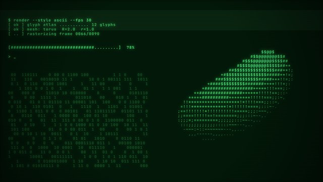

# 终端字符（1 种）

[← 选风格索引](../index.md) · [提示词方法](../prompting.md) · [技术标签](../tags.md)

画面上的一切都是等宽字符，用 Canvas 2D 或真实终端渲染。

每个条目依次是：样片缩略图（已渲染的才有）、一句可直接复制的风格提示词、题材、适合讲什么、技术标签、参考链接。「技术（已验证）」表示仓库里有真能跑出这段样片的代码；「技术（建议）」是推荐写法，还没有样片验证。

<a id="C-064"></a>

## C-064 终端 / ASCII CRT



```text
用 ASCII 终端风格：屏幕上每一个形象都是等宽字符网格里的真实字符，单色荧光（绿或琥珀色）带光晕和余辉拖影，黑色弯曲显像管屏幕有扫描线，文字像命令行一样逐字打出、光标闪烁，配键盘声。
```

- 题材：电影年代与屏幕科技
- 适合：AI/技术过程
- 技术（已验证）：终端字符 · Canvas 2D · Playwright · ffmpeg
- 样片代码：[samples/C-064/](https://github.com/Chans-gh/AI-Coding-Video/tree/main/samples/C-064)
- 技术（建议）：终端字符 · Canvas 2D
- 参考：[Lemo 说明](https://github.com/lemomo-ai/lemo-opuscar/blob/main/styles/ascii-crt/STYLE.md) · [源码](https://github.com/yasinozmeen/animasyon-stil-katalogu/tree/main/stiller/terminal)
