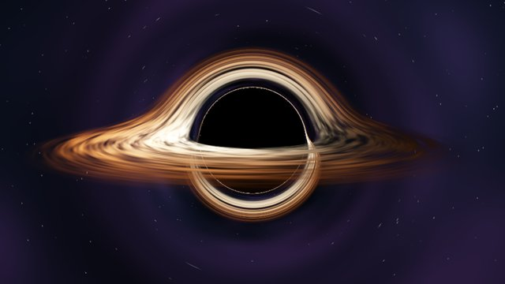

# WebGL / 着色器 / Three.js（49 种）

[← 选风格索引](../index.md) · [提示词方法](../prompting.md) · [技术标签](../tags.md)

画面由 GPU 算出：自己写 GLSL 着色器，或用 Three.js 搭 3D 场景。光影、粒子、3D 世界在这里。

每个条目依次是：样片缩略图（已渲染的才有）、一句可直接复制的风格提示词、题材、适合讲什么、技术标签、参考链接。「技术（已验证）」表示仓库里有真能跑出这段样片的代码；「技术（建议）」是推荐写法，还没有样片验证。

<a id="C-022"></a>

## C-022 彩色玻璃窗

```text
用中世纪彩色玻璃窗风格：黑色铅条把画面分成手工切割的玻璃块，宝石蓝、宝石红、琥珀黄玻璃带气泡和手绘纹饰，阳光照到哪块玻璃哪块才亮起来并“活”过来，彩色光斑投在石墙上。
```

- 题材：印刷、版画与装饰
- 适合：传说、史诗感故事
- 技术（建议）：WebGL · GLSL · Canvas 2D
- 参考：[Lemo 说明](https://github.com/lemomo-ai/lemo-opuscar/blob/main/styles/stained-glass/STYLE.md)

<a id="C-023"></a>

## C-023 金色马赛克

```text
用金色马赛克风格：画面由上万块带缝隙的小瓷砖拼成，金箔瓷砖反光闪烁，瓷砖像鸟群鱼群一样聚散流动，拼成新形象后再散开，边框是古典马赛克花纹。
```

- 题材：印刷、版画与装饰
- 适合：艺术短片、循环视频
- 技术（建议）：WebGL · Three.js
- 参考：[@dfeinition](https://x.com/dfeinition/status/2102436001473786054)

<a id="C-026"></a>

## C-026 纸片立体书

```text
用纸片立体书风格：一本书在真实木桌上打开变成舞台，布景随翻页从书页弹起，角色是带白边的扁平剪纸片、转身时像纸片一样翻面，微距浅景深，结尾主角从书里跳到真实桌面上。
```

- 题材：纸艺、材质与定格
- 适合：儿童、品牌故事
- 技术（建议）：WebGL · Three.js
- 参考：[Lemo 说明](https://github.com/lemomo-ai/lemo-opuscar/blob/main/styles/paper-popup/STYLE.md)

<a id="C-028"></a>

## C-028 黏土定格

```text
用黏土定格动画风格：所有物体是圆润的橡皮泥，表面有指纹和按压痕迹，暖色柔光带软阴影，按 12fps 定格节奏运动、每帧轮廓轻微变化，形状之间像被捏过一样变形过渡。
```

- 题材：纸艺、材质与定格
- 适合：可爱、亲切内容
- 技术（建议）：WebGL · Three.js
- 参考：[源码](https://github.com/yasinozmeen/animasyon-stil-katalogu/tree/main/stiller/kil) · [@alexalbert__](https://x.com/alexalbert__/status/2102458348511879448)

<a id="C-029"></a>

## C-029 积木玩具

```text
用积木玩具定格风格：所有东西由带凸点的塑料积木拼成，放在真实桌面上用微距镜头拍摄，浅景深、柔光箱光线和塑料高光，按定格动画节奏一块块搭起来，每次卡入有“哒”的声音。
```

- 题材：纸艺、材质与定格
- 适合：搭建、工程、儿童
- 技术（建议）：WebGL · Three.js · cannon-es
- 参考：[Lemo 说明](https://github.com/lemomo-ai/lemo-opuscar/blob/main/styles/brick-toy/STYLE.md)

<a id="C-045"></a>

## C-045 玻璃质感产品

```text
用玻璃质感产品渲染风格：一个透明和磨砂玻璃加金属的产品悬浮在无限黑色影棚里，长条灯光慢慢扫过表面，边缘有色散彩边、地面有焦散光纹，慢速爆炸视图在音乐重音处“咔”地合拢。
```

- 题材：信息讲解与产品发布
- 适合：硬件发布
- 技术（建议）：WebGL · Three.js
- 参考：[Lemo 说明](https://github.com/lemomo-ai/lemo-opuscar/blob/main/styles/glass-product/STYLE.md)

<a id="C-047"></a>

## C-047 发布片式粒子隧道

```text
用模型发布片式粒子风格：黑色空间里金色粒子和光线构成隧道与网格，镜头高速穿行，超大数值标题卡在节拍上切换，整片只用黑、金、白，以品牌字标定格收尾。
```

- 题材：信息讲解与产品发布
- 适合：模型/产品发布
- 技术（建议）：WebGL · Three.js · GLSL
- 参考：[claude-horizon-animation](https://github.com/misbahsy/claude-horizon-animation)

<a id="C-055"></a>

## C-055 HD-2D

```text
用 HD-2D 风格：手工像素精灵像剪纸一样立在完整的 3D 微缩场景里，夜晚、有雾，每盏灯投下真实阴影，从高处三分之四视角拍摄并加移轴景深模糊，整个世界像一个发光的玩具模型。
```

- 题材：游戏
- 适合：夜景、奇幻
- 技术（建议）：WebGL · Three.js
- 参考：[Lemo 说明](https://github.com/lemomo-ai/lemo-opuscar/blob/main/styles/hd-2d/STYLE.md)

<a id="C-059"></a>

## C-059 分屏“跑酷 + 讲解”

```text
用左右分屏格式：左半屏是一个原创的 3D 街道跑酷游戏一直在跑、带分数和金币，右半屏是深色背景上的公式和图表跟着旁白逐项讲解，两边同时进行。
```

- 题材：游戏
- 适合：短视频留存
- 技术（建议）：WebGL · Three.js · SVG

<a id="C-062"></a>

## C-062 后室 / 找到的录像带

```text
用后室录像带风格：像 90 年代家用摄像机拍的录像带（横向干扰、色带偏移、右下角日期时间戳），发黄的壁纸、潮湿地毯、嵌入式荧光灯构成无尽空房间，手持镜头慢慢前行，恐惧来自“规则”和环境音而不是怪物。
```

- 题材：电影年代与屏幕科技
- 适合：悬疑、新怪谈
- 技术（建议）：WebGL · Three.js · GLSL
- 参考：[Lemo 说明](https://github.com/lemomo-ai/lemo-opuscar/blob/main/styles/backrooms/STYLE.md)

<a id="C-063"></a>

## C-063 移轴微缩

```text
用移轴微缩风格：用 Three.js 程序生成一座小镇，从高处俯拍，只有中间一条水平带清晰、上下强烈虚化（景深后处理），饱和度和对比度调高，车辆行人以延时节奏快速移动，云影扫过街道，整座城像桌面模型。
```

- 题材：电影年代与屏幕科技
- 适合：城市、交通
- 技术（建议）：WebGL · Three.js
- 参考：[Lemo 说明](https://github.com/lemomo-ai/lemo-opuscar/blob/main/styles/tilt-shift/STYLE.md)

<a id="C-067"></a>

## C-067 Demoscene

```text
用 C64 式 demoscene 风格：低分辨率像素和 16 色复古调色板，水平彩虹光栅条、正弦波滚动字幕、程序化隧道和粒子，所有画面和芯片音乐都由同一个程序实时生成，段落之间硬切换。
```

- 题材：电影年代与屏幕科技
- 适合：炫技、音乐片
- 技术（建议）：WebGL · GLSL · Hydra
- 参考：[@gandamu_ml](https://x.com/gandamu_ml/status/2102919394775220530) · [@JustinPerea](https://x.com/JustinPerea/status/2102893186330841502)

<a id="C-068"></a>

## C-068 低多边形等距岛

```text
用低多边形等距小岛风格：正交等距镜头俯看一座漂在海上的小岛，所有物体都是平面着色的几何块、没有贴图，地块颜色有轻微明暗随机，每个新出现的东西带弹性落地并响一个音符，岛屿随时间长大。
```

- 题材：3D 与实时图形
- 适合：成长、建造
- 技术（建议）：WebGL · Three.js
- 参考：[Lemo 说明](https://github.com/lemomo-ai/lemo-opuscar/blob/main/styles/lowpoly-island/STYLE.md)

<a id="C-069"></a>

## C-069 写实光线步进

```text
用写实光线步进渲染风格：自写 GPU 光线步进渲染器，没有外部 3D 模型和贴图，夕阳低角度逆光、海面反射和大气雾气，每帧多次采样降噪，电影感调色和浅景深，镜头缓慢移动。
```

- 题材：3D 与实时图形
- 适合：炫技短片
- 技术（建议）：WebGL2 · GLSL

<a id="C-070"></a>

## C-070 实时 WebGL 自然

```text
用实时 WebGL 自然场景风格：单个 HTML 里用着色器模拟浅水波浪、涟漪和水底焦散光纹，水下是程序生成的鹅卵石，镜头缓慢漂移并会被点击激起水波，写实光照。
```

- 题材：3D 与实时图形
- 适合：环境、壁纸
- 技术（建议）：WebGL · GLSL
- 参考：[@hayashimon1](https://x.com/hayashimon1/status/2102576886182453454)

<a id="C-072"></a>

## C-072 爆炸图 / 剖面

```text
用 3D 爆炸图风格：白底干净工作室光，物体先完整展示，再沿垂直方向一层一层爆开、每层旁边出现材料标注引线，镜头慢慢环绕，最后按原路合拢；需要看内部时改成剖面切开并叠加气流或热力颜色。
```

- 题材：3D 与实时图形
- 适合：建筑、硬件、数据中心
- 技术（建议）：WebGL · Three.js
- 参考：[@RyanSael](https://x.com/RyanSael/status/2102740041621762166)

<a id="C-073"></a>

## C-073 3D 战役 / 地图俯瞰

```text
用电视特别节目式 3D 战役复盘风格：俯视真实地形和海湾，双方舰队用红白两色区分并按阵形移动，箭雨、潮流反转和雾气可视化，角落有兵力和潮汐仪表盘，多个机位切换并配字幕解说。
```

- 题材：3D 与实时图形
- 适合：历史战役
- 技术（建议）：WebGL · Three.js

<a id="C-074"></a>

## C-074 风格化 3D 打斗

```text
用风格化 3D 动作片风格：低细节模型加平滑明暗的卡通渲染，绿色和红色火柴人角色在沙漠、神殿等不同场景追逐对打，暖色氛围光、击中时亮色粒子过闪和短暂定格，镜头跟随动作快切。
```

- 题材：3D 与实时图形
- 适合：动作、对战
- 技术（建议）：WebGL · Three.js
- 参考：[@akokoi1](https://x.com/akokoi1/status/2103149275945517546)

<a id="C-075"></a>

## C-075 抽象品牌片

```text
用抽象品牌形象片风格：整片只用品牌的红、蓝、白三色，深色背景上抽象光环扩散，超大字标以像素化和故障效果撞入画面，快节奏卡点切换，以 Logo 定格收尾。
```

- 题材：3D 与实时图形
- 适合：品牌形象片
- 技术（建议）：WebGL · GLSL

<a id="C-076"></a>

## C-076 科学可视化



```text
用科学可视化风格：深黑太空背景，黑洞周围的引力透镜把星系和光线弯成光环，吸积盘发出金色光，边上有可调参数的细线控制面板，镜头随参数变化靠近，物理关系要按真实公式计算。
```

- 题材：3D 与实时图形
- 适合：科普
- 技术（已验证）：WebGL2 · GLSL · Playwright · ffmpeg
- 样片代码：samples/C-076/
- 技术（建议）：WebGL · GLSL
- 参考：[@superalesha](https://x.com/superalesha/status/2102779758408774104)

<a id="C-078"></a>

## C-078 体素世界

```text
用体素（Voxel）风格：地形、建筑、树木全部由统一尺寸的小立方体搭成，方块表面平涂、带轻微环境光遮蔽和柔和阴影，花和树叶是彩色方块簇，水面半透明并反射天空，镜头在多个机位间缓慢切换，可切换清晨、蓝调时刻、雨天等时段氛围。
```

- 题材：3D 与实时图形
- 适合：文旅、游戏官网、儿童科普
- 技术（建议）：WebGL · Three.js

<a id="C-079"></a>

## C-079 赛博朋克霓虹都市

```text
用赛博朋克霓虹都市风格：夜雨中的超高层巨型城市，湿滑地面反射粉紫和青色霓虹招牌（招牌文字全部原创、不用真实品牌），高架轨道和列车穿过楼宇，雾气和体积光，冷暗基调里只有霓虹是亮的，镜头慢速推进或跟车。
```

- 题材：3D 与实时图形
- 适合：科幻、游戏、电子音乐
- 技术（建议）：WebGL · Three.js
- 参考：[@Gorden_Sun](https://x.com/Gorden_Sun/status/2103079013615034692) · [@trymirage](https://x.com/trymirage/status/2103542300844474452)

<a id="C-080"></a>

## C-080 3D 动画电影式卡通

```text
用 3D 动画电影式卡通风格（Three.js 实时渲染）：圆润夸张的角色造型、大而有高光的眼睛、柔软的材质，三点布光加暖色轮廓光，浅景深，角色动作有挤压拉伸、预备和跟随，表情靠眼睛和眉毛表演，场景是温暖的小世界。
```

- 题材：3D 与实时图形
- 适合：品牌吉祥物、儿童内容、产品拟人化
- 技术（建议）：WebGL · Three.js
- 参考：[@scheemunai](https://x.com/scheemunai/status/2102788223835463902)

<a id="C-081"></a>

## C-081 三渲二 3D 动漫

```text
用三渲二（卡通着色 3D）动漫风格：3D 场景和角色用 toon shading，明暗只有两三个色阶加黑色描边，天空通透、云朵有体积感，街道有樱花、电线杆、小店等生活细节，画面叠加日文标题和游戏 UI 式信息，镜头可自由漫游。
```

- 题材：3D 与实时图形
- 适合：二次元、游戏宣发、文旅
- 技术（建议）：WebGL · Three.js
- 参考：[@every](https://x.com/every/status/2103144530157687114)

<a id="C-082"></a>

## C-082 霓虹流体

```text
用霓虹流体模拟风格：纯黑背景上 GPU 实时模拟的流体，染料是高饱和的橙、红、品红、青，边缘发光并卷成涡旋，随鼠标轨迹或音乐节拍被搅动，画面只有流体和一个极简半透明参数面板。
```

- 题材：3D 与实时图形
- 适合：科技品牌背景、音乐可视化、互动装置
- 技术（建议）：WebGL · GLSL

<a id="C-102"></a>

## C-102 颗粒渐变开场

```text
用颗粒渐变开场风格：深色底上一层层发光的饱和色形状（同心拱门、光环），带细小颗粒，镜头一路穿过这些层，一个小光球在前面带路，字体小而干净，一句话收尾。
```

- 题材：平面设计与动态排版
- 适合：科技与 AI、音乐、创意产品发布的开场
- 技术（建议）：WebGL · GLSL
- 参考：[bang-motion 风格画廊](https://github.com/bangtutorial/bang-motion#style-gallery)

<a id="C-105"></a>

## C-105 科幻全息线框

```text
用科幻全息线框风格：物体被扫描成发光的线框，悬在圆形投影台上，瞄准框一个个锁定部件并局部爆炸展开，引线拉出，数字从乱码滚动成真实数值，数值锁定的那一帧变成唯一的暖色强调，整体只用一种冷色加一种暖色。
```

- 题材：电影年代与屏幕科技
- 适合：产品参数讲解、硬件拆解、循环展示屏
- 技术（建议）：WebGL · Three.js
- 参考：[Lemo 说明](https://github.com/lemomo-ai/lemo-opuscar/blob/main/styles/hologram-hud/STYLE.md)

<a id="C-106"></a>

## C-106 孟菲斯微缩景

```text
用孟菲斯微缩景风格：暖白纸面上一个带颗粒边缘的圆角画框从中心张开，框里是一座俯视的桌面模型小镇，糖果原色加粉彩平涂、深靛蓝描边，硬边紫色投影里铺满半调圆点，水波、鸟群、灯火这些小动静处处在动，镜头缓慢环绕一镜到底，配钢琴与马林巴。
```

- 题材：3D 与实时图形
- 适合：城市介绍、季节变化、地方风物
- 技术（建议）：WebGL · Three.js · GLSL
- 参考：[Lemo STYLE.md](https://github.com/lemomo-ai/lemo-opuscar/blob/main/styles/memphis-diorama/STYLE.md)

<a id="C-107"></a>

## C-107 地铁线路图生长

```text
用地铁线路图生长风格：线路只走横竖和 45° 八个方向、转角统一圆角，白色站点和黑框换乘胶囊，水面是一条平涂蓝带，发光的笔尖沿线路把网络一段段画出来，镜头是真实透视，贴着纸面掠过、浅景深，站点点亮配钢片琴拨音，换乘处落一记低音。
```

- 题材：信息讲解与产品发布
- 适合：交通规划、网络扩张、流程分支
- 技术（建议）：WebGL · Three.js · Web Audio
- 参考：[Lemo STYLE.md](https://github.com/lemomo-ai/lemo-opuscar/blob/main/styles/transit-map/STYLE.md)

<a id="C-109"></a>

## C-109 刻线印刷长镜头

```text
用刻线印刷长镜头风格：一个 3D 山水世界全部画成黑墨与纸白，灰度只靠刀刻平行线的粗细和疏密，只留一点红给一个小主角，山、林、水、前景枝条至少分三层彼此滑过，镜头一镜到底穿行其中，转场时响起刻刀划纸和压印的声音。
```

- 题材：印刷、版画与装饰
- 适合：自然纪录、旅途、季节变换
- 技术（建议）：WebGL · Three.js · GLSL
- 参考：[Lemo STYLE.md](https://github.com/lemomo-ai/lemo-opuscar/blob/main/styles/printed-long-take/STYLE.md)

<a id="C-111"></a>

## C-111 桌面穿梭

```text
用桌面穿梭风格：阳光斜照的木桌上铺着点阵纸垫，各个应用界面是印在厚纸卡上的小场地，像素小人被挤成一格一格的体素玩具，在卡片间跳跃搬运，笔、便签、杯子投下长长软影，镜头不剪一刀地追随、甩镜，最后拉远看全桌，每个动作都踩在马林巴节拍上。
```

- 题材：3D 与实时图形
- 适合：软件功能导览、工作流演示、产品发布
- 技术（建议）：WebGL · Three.js · Web Audio
- 参考：[Lemo STYLE.md](https://github.com/lemomo-ai/lemo-opuscar/blob/main/styles/desktop-flythrough/STYLE.md)

<a id="C-116"></a>

## C-116 夜间博物馆特展

```text
用夜间博物馆特展风格：近乎全黑的暖炭色展厅，每个镜头只有一束从顶上垂下的琥珀色聚光，光柱里浮着细尘，照亮基座上缓缓自转的低多边形宝石，旁边是米色展签和底部逐字打出的讲解字条，数字做成吊牌和高低不一的展柱，光束暗下再“寻找”下一件展品。
```

- 题材：3D 与实时图形
- 适合：产品回顾、历史沿革、成果展示
- 技术（建议）：WebGL · Three.js · GSAP
- 参考：[code-video museum.md](https://github.com/Changroro/code-video/blob/main/references/styles/museum.md)

<a id="C-126"></a>

## C-126 虹彩玻璃泡

```text
用虹彩玻璃泡风格：深藏青影棚里悬着一个肥皂泡般的玻璃球，薄膜干涉让表面流动着青、品红、金三色虹彩，边缘有菲涅尔亮边和窗形高光，球里是一座发光的小城，金币倾泻进来，一道细裂纹出现后被金线封合，镜头缓慢环绕。
```

- 题材：3D 与实时图形
- 适合：AI 经济、市场泡沫、行业趋势
- 技术（建议）：WebGL · Three.js · GLSL
- 参考：[animation-skills glass-bubble-3d](https://github.com/madhavsomani/animation-skills/blob/main/skills/glass-bubble-3d/SKILL.md)

<a id="C-127"></a>

## C-127 发光宇宙

```text
用发光宇宙风格：深靛紫的太空雾里，无数叠加发光的点和光晕组成星系与网络，青色代表数据、紫色代表结构、琥珀色只给最关键的结论，半透明玻璃卡片悬在空中写字，一个反复出现的主角物体贯穿全片，镜头按关键帧在几处布景间飞越。
```

- 题材：3D 与实时图形
- 适合：AI 原理、复杂系统、抽象概念讲解
- 技术（建议）：WebGL · Three.js · Remotion
- 参考：[animation-skills luminous-cosmos-3d](https://github.com/madhavsomani/animation-skills/blob/main/skills/luminous-cosmos-3d/SKILL.md)

<a id="C-149"></a>

## C-149 早期光线追踪 CGI

```text
用早期光线追踪 CGI风格：90 年代初电脑图形的样子，所有物体都是同一种光滑塑料，带一颗硬边白色高光，地面是无限延伸的红白棋盘格并映出倒影，铬球反射出扭曲的环境，背景是紫到青的渐变天空，开场先显示绿色线框再逐行扫描渲染出来，镜头沿轨道慢慢绕转。
```

- 题材：3D 与实时图形
- 适合：计算机图形学史、复古科技片、怀旧片头
- 技术（建议）：WebGL · GLSL
- 参考：[huashu 风格卡 15_raytrace](https://github.com/alchaincyf/huashu-art-motion/blob/main/references/%E9%A3%8E%E6%A0%BC%E9%85%8D%E6%96%B9/15_raytrace.md)

<a id="C-153"></a>

## C-153 合成波（Synthwave）

```text
用合成波风格：深紫夜空下一轮切成横条的橙粉渐变落日，品红霓虹透视网格向地平线无限滚动，远处是线框山脉，镀铬金属大字带一道高光扫过，所有亮线都有一紧一散两层辉光，最后叠上 VHS 扫描线、红蓝通道错位和偶尔的磁带卡顿，配模拟合成器琶音。
```

- 题材：电影年代与屏幕科技
- 适合：复古音乐 MV、游戏与潮牌宣传、80 年代怀旧片头
- 技术（建议）：WebGL · GLSL · Web Audio
- 参考：[mg-styles-15 10-synthwave](https://github.com/Vincentwei1021/mg-styles-15/blob/main/prompts/10-synthwave.md) · [huashu 风格卡 26_vaporwave](https://github.com/alchaincyf/huashu-art-motion/blob/main/references/%E9%A3%8E%E6%A0%BC%E9%85%8D%E6%96%B9/26_vaporwave.md)

<a id="C-155"></a>

## C-155 液态融合

```text
用液态融合风格：纯色背景上的高光泽液体图形，两团靠近就自动粘连融合，分开时拉出细颈再断裂回弹，小液滴晚两三帧跟着主体被甩出去，转场是一道带几个凸起的波浪前沿泼过整屏，结尾一滴液体聚合成标志，表面用场的梯度假装出立体高光，配水滴和吸管声。
```

- 题材：平面设计与动态排版
- 适合：饮料与食品广告、标志演绎、音乐转场包装
- 技术（建议）：WebGL2 · GLSL
- 参考：[mg-styles-15 07-liquid](https://github.com/Vincentwei1021/mg-styles-15/blob/main/prompts/07-liquid.md)

<a id="C-161"></a>

## C-161 蜡染

```text
用蜡染风格：棉布上只有靛蓝、姜黄和米白蜡三种颜色，场景先在 3D 里被一盏金灯和一盏蓝灯照亮，再换算成染色区：只照到金灯处染黄、只照到蓝灯处染蓝、两盏都照到处留蜡白，蜡面布满细冰裂纹，换色时一道染液前沿扫过布面，四周是几何花边。
```

- 题材：纸艺、材质与定格
- 适合：民族与手工艺题材、双人对唱、旅途与田野
- 技术（建议）：WebGL · Three.js · GLSL
- 参考：[opus-5.5-mv batik](https://github.com/cyborggirl963/opus-5.5-music-video-art-styles/tree/main/styles/batik)

<a id="C-162"></a>

## C-162 木雕彩绘微缩景

```text
用木雕彩绘微缩景风格：一张地形浮雕桌上摆着手刻、上过彩漆的小木人、房子和树，表面留着刻刀痕和木纹，只有一盏台灯从上方照亮，浅景深让远处和近处都微微虚化，木偶按一拍二的节奏顿挫移动，镜头像无人机一样低空掠过整片小世界。
```

- 题材：纸艺、材质与定格
- 适合：俯瞰一个完整小世界、童话与寓言、旅行路线
- 技术（建议）：WebGL · Three.js
- 参考：[opus-5.5-mv diorama](https://github.com/cyborggirl963/opus-5.5-music-video-art-styles/tree/main/styles/diorama)

<a id="C-166"></a>

## C-166 60 年代液体灯光秀

```text
用60 年代液体灯光秀风格：投影仪下一只玻璃皿里油、水和染料不停旋转交融，品红、橙、绿、紫被挤成气泡和漩涡，上面叠着手绘透明片，黑墨处真的挡住灯光，每个重拍都在液面荡开一圈，灯偶尔熄灭又亮起，配迷幻摇滚。
```

- 题材：电影年代与屏幕科技
- 适合：迷幻音乐 MV、间奏与转场、梦境段落
- 技术（建议）：WebGL · GLSL
- 参考：[opus-5.5-mv liquid-light](https://github.com/cyborggirl963/opus-5.5-music-video-art-styles/tree/main/styles/liquid-light)

<a id="C-167"></a>

## C-167 热成像

```text
用热成像风格：画面是热像仪看到的寒夜，人和动物的身体、呼出的气、刚踩过的脚印先发亮再慢慢冷却消失，烟囱的烟被风压平，伪彩调色板从黑紫到橙黄再到白，起风时整片调色板跟着扫换，所有轮廓上叠一条细白边线，角落有温度读数。
```

- 题材：电影年代与屏幕科技
- 适合：夜晚与寒冷、监视与追踪、身体与触碰
- 技术（建议）：WebGL · Three.js · GLSL
- 参考：[opus-5.5-mv thermal](https://github.com/cyborggirl963/opus-5.5-music-video-art-styles/tree/main/styles/thermal)

<a id="C-170"></a>

## C-170 字的隧道

```text
用字的隧道风格：镜头沿一条无尽的圆形隧道向前飞，隧道内壁由一圈圈环形排列的文字组成，近处的字大而清晰、远处缩成发光的细线，文字随旁白逐句更换，经过镜头时正好读出，隧道偶尔拐弯或整体旋转，黑底单色字加一个强调色，配逐渐加速的风声。
```

- 题材：平面设计与动态排版
- 适合：宣言与口号、歌词 MV、数据与信息洪流
- 技术（建议）：WebGL · Three.js

<a id="C-174"></a>

## C-174 雨窗

```text
用雨窗风格：镜头隔着一扇夜晚的玻璃窗，窗外城市灯光全部失焦成暖橙和冷青的大光斑，玻璃上水珠大小不一，小的停着不动、大的忽然沿曲折路线滑下并吞掉沿途的小水珠，每颗水珠里折射出倒置的清晰灯影，窗角偶尔起雾，配持续的雨声和远处车声。
```

- 题材：3D 与实时图形
- 适合：失恋与思念、深夜电台、学习陪伴背景
- 技术（建议）：WebGL · GLSL

<a id="C-175"></a>

## C-175 窗光与尘

```text
用窗光与尘风格：昏暗安静的室内，一束午后斜阳从百叶窗或格子窗射进来，在空气中形成清晰的体积光柱，光柱里无数细小尘埃缓慢翻滚闪亮，地板和墙上的窗格暖黄光块随时间缓缓移动，阴影是冷灰蓝，镜头静止或极慢推移，只有钟表的滴答声。
```

- 题材：3D 与实时图形
- 适合：怀旧与回忆、阅读与书房、慢节奏开场
- 技术（建议）：WebGL · Three.js

<a id="C-177"></a>

## C-177 信号故障（Glitch）

```text
用信号故障风格：画面在正常和损坏之间跳动，整条像素被横向错位撕开，红绿蓝通道各自偏移，压缩方块像马赛克一样拖着残影，像素按亮度被拉成竖向条纹，偶尔整屏冻结一帧再跳回，故障严格卡在节拍重音上，配数据噪音和断续的电流声。
```

- 题材：电影年代与屏幕科技
- 适合：电子音乐 MV、网络安全题材、科技发布转场
- 技术（建议）：WebGL · GLSL

<a id="C-178"></a>

## C-178 折纸

```text
用折纸风格：一张方形彩纸在纯色桌面上沿折痕自己一步步折起来，山折谷折时纸面明暗随角度变化，折痕处留下浅浅的压线，最后变成鹤、青蛙或小船，成品轻轻弹跳后展开再折成下一个，纸面带细微纤维纹，侧光投出柔和阴影，配纸张摩擦声。
```

- 题材：纸艺、材质与定格
- 适合：手工教程、变化与成长寓意、日式品牌片
- 技术（建议）：WebGL · Three.js

<a id="C-186"></a>

## C-186 东方赛博

```text
用东方赛博风格：夜雨中的立体城市叠着飞檐斗拱、牌楼和霓虹招牌，红灯笼和全息汉字广告并排悬浮，主色是朱红、青绿和电光紫，楼宇之间有水墨般的雾层缓缓流动，招牌文字全部原创，镜头沿窄巷慢慢升上屋顶，配古筝加电子低音。
```

- 题材：3D 与实时图形
- 适合：国风科幻、游戏宣传、未来城市设想
- 技术（建议）：WebGL · Three.js

<a id="C-189"></a>

## C-189 皮克斯式 3D 动画

```text
用皮克斯式 3D 动画风格：先设计一眼能认出的剪影和大小对比，再做表面；布、木头、金属、皮肤各有清楚不同的材质，材质本身说明角色性格；光是讲故事的工具，主光把视线引向剧情焦点，可以为情绪偏离物理；角色表演有预备、跟随和重心转移，情绪来自动作因果而不是频繁换表情，无脸的物件（台灯、玩具、机器）也能靠姿态演戏，浅景深加柔和的全局光。只学这套方法，不复刻任何现有角色。
```

- 题材：卡通与动漫
- 适合：品牌吉祥物短片、拟人化产品故事、儿童动画
- 技术（建议）：WebGL · Three.js
- 参考：[huashu 风格卡 53_pixar](https://github.com/alchaincyf/huashu-art-motion/blob/main/references/%E9%A3%8E%E6%A0%BC%E9%85%8D%E6%96%B9/53_pixar.md)

<a id="C-195"></a>

## C-195 末日工业暗黑科幻

```text
用末日工业暗黑科幻风格：巨大的锈蚀钢铁结构、管道和冷却塔在灰黄色的烟尘中层层叠叠，远处只有零星的警示红灯和焊接火花，体积雾把光切成一道道光柱，地面积着带油膜的黑水，镜头沿着高耸的结构缓慢仰拍上移或低空穿行，画面整体去饱和、偏铁锈和冷钢灰，低频轰鸣和金属回响作声音。
```

- 题材：3D 与实时图形
- 适合：科幻世界观、游戏宣传、环境与能源议题、悬念开场
- 技术（建议）：WebGL · GLSL
